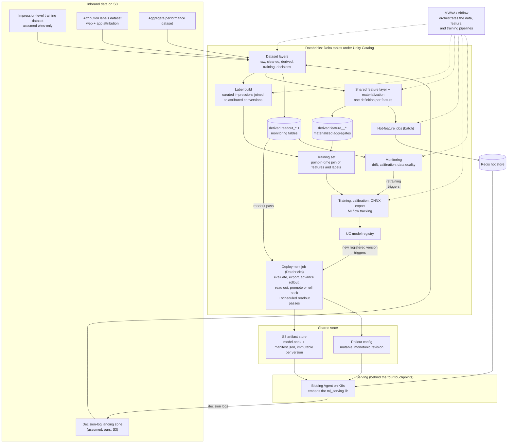

# 00 — Overview

The end-to-end map of the offline ML platform. Every other doc in this
set details one box of the diagram below; this doc fixes the boxes, the
arrows, and the boundary with serving.

## Purpose and scope

The offline platform produces everything the
[`ml_serving`](https://github.com/cunha-sigma/ml_serving) Go library
consumes and consumes everything it emits. The boundary is the four
touchpoint contracts in this doc: the published artifact, the rollout
config, the hot-feature store, and the decision logs. Offline owns
everything up to the first three and everything after the fourth. The
Bidding Agent and the lib own the space in between; we never reach into
it, and it never reaches into Databricks or MLflow.

One team owns both sides. Responsibilities split per person (Go, ML, data
engineering, QA), not per organization, so no contract here crosses a
team boundary; they cross repo and lane boundaries only — the Data
Engineering lane that owns data provenance (`01_data_access.md`) is such
a per-person lane inside the team, not another organization.

Platform: Databricks runs the ML workloads (client-confirmed). Within
it, Delta tables, Unity Catalog, and MLflow with the UC model registry
for storage, tracking, and registry are our directed picks
(`PLAN.md`), not client-mandated; our own MWAA (Airflow) instance for
orchestration is likewise directed. Input data is reachable from our
account; who curates it — the client directly, or our Data Engineer
curating from the client's internal tables — is the Data Engineering
lane's scope, unresolved (`adr/0005`), and immaterial to this
platform's design. The transfer mechanism is open (`01_data_access.md`).

## System map

Solid arrows are data flow; dotted arrows are orchestration. Two loops
close through the diagram. The training loop: the client's impression-level
dataset (assumed wins-only, so every row is a served impression — a
working assumption to confirm, `03_labels.md`) joins to the attribution
labels dataset to produce the label and, with the features, the next
training set. The decision-log loop: the lib logs
every scored candidate, the rows land in our landing zone, and they
feed offline replay, the per-arm readout, and monitoring; they are
never the label universe, because a scored candidate may have lost the
auction. The same rule covers the client's auction and bid data: the label
universe is served impressions, because `P(Action | Impression)`
conditions on one; auction and bid data enter only as feature and
analysis sources. Guardrail breaches on serving health route directly
from the observability stack's own alert rules to the deployment job's
abort path through the jobs API — never through the monitoring job
above (`09_monitoring.md`). One Databricks deployment job, triggered
when training registers a new version, owns the whole rollout: each
rollout state (fleet load, shadow, canary, A/B, rollout canary) is
just a content of the rollout config, and the job advances by writing successive
revisions, reading out the per-arm tables between advances. It is the
only writer of shared state.

## Goals and models

The ad set's `optimization_goal` decides whether a model is consulted
and which one. The goal values are the client's proposed enum — both
`optimization_goal` and `bidding_strategy` are proposed fields that do
not yet exist in the ad set data model. Slot names are ours
(lowercase); goal values are the client's spelling:

| `optimization_goal` | Bidder behavior | ML model (slot) | Labels from | Status |
|---|---|---|---|---|
| `impressions` | Deterministic: `P = 1`; `EV = max_bid / 1000` (the max_cpm strategy's formula). ML never called. | none | — | Effectively live today (all ad sets behave as this; the field itself is proposed) |
| `PIXEL_PAGE_VIEW` | Calls ML for `P(page view)` | `pixel_page_view` | Web pixel via the web-attribution provider (`event_name` mapping pending the client) | Initial |
| `PIXEL_PURCHASE` | Calls ML for `P(purchase)` | `pixel_purchase` | Web pixel via the web-attribution provider (`event_name` mapping pending the client) | Initial |
| `app_installs` | Calls ML for `P(install)` | future slot | App events via MMP | Future, out of MVP |

`bidding_strategy` never changes the model: `goal_cpa` and
`lowest_cost` use the same goal's slot, only the value multiplied
downstream differs, and `max_cpm` behaves as `impressions`. Routing is
by goal alone. If the client ships advertiser-selectable windows, each offered
(goal, window) becomes its own slot (window placement and the modeling
approach per window are still open); the client also names further
pixel goals (lead generation) as future — each is a new slot, no
architecture change.

## Components

Each component is owned by one detail doc.

- Dataset layers (`02_datasets.md`) — four stages: raw (Unity Catalog
  external tables reading the curated datasets in place, no copy),
  cleaned (the first materialized Delta tables: typed, deduplicated,
  identity resolved — reshaped the client content, nothing computed), derived
  (tables whose content we compute: labels, feature tables, readout
  and monitoring tables),
  training (immutable point-in-time snapshots, one per run); plus a
  decisions schema for ingested serving events. Read path in
  `01_data_access.md`. Also owns the identity-space naming convention
  and the privacy drop/hash/retain rules.
- Label build (`03_labels.md`) — joins the client's impression-level training
  dataset (assumed wins-only) to the attribution labels dataset,
  bridged by the impression key (assumed `impression_id`; confirming
  both assumptions is `03_labels.md`'s open question 3). The client exposes
  7/14/30-day attribution outputs (the web-attribution provider for web, MMP for app; app
  goals are out of MVP scope; the client's ML report states a 1-day
  variant is also available, to confirm), and the window may become
  advertiser-facing configuration. Both initial goals (Page View,
  Purchase) get label configs, each on a single window for now; the
  expected end state is one label config and one model per
  (goal, window), with the shipped windows pending label-volume data
  and the client's offered-window set. Labels mature
  late; recent data is only partially labeled, and the build tracks
  maturity explicitly. The web-attribution provider's `ad_id` is
  nullable on the conversion row; it never affects the label join, it
  only shrinks rollups joining conversions directly to ads or
  campaigns, tracked as a data-quality metric.
- Shared feature layer (`04_features.md`) — one definition per feature,
  called by the feature-materialization pipeline (which maintains the
  historical aggregates incrementally in `derived.feature_<model>_*` tables the
  training-set build joins point-in-time) and by the hot-feature jobs.
  This is the no-skew contract: the value a model trained with and the
  value the serving-time join finds in Redis come from the same code. Proven at
  dev scale in [ml_serving](https://github.com/cunha-sigma/ml_serving) (one shared feature function feeds
  both the training join and the store seeder; the export gates on an
  ONNX-versus-Python parity check at 1e-4).
- Hot-feature jobs (`04_features.md`) — batch Databricks jobs on an MWAA
  schedule that compute rolling-window aggregates and write them to
  Redis under the key templates declared in the feature definitions
  (the manifest's `hot_features` section is generated from those same
  definitions). No streaming component.
- Training (`05_training.md`) — the training-set build (the diagram's
  "Training set" node: point-in-time join of labels and features, with
  the maturity cutoff applied) plus training, calibration, and ONNX
  export as Databricks workloads with MLflow tracking. The export bakes
  preprocessing, model, and calibration into one graph and gates on an
  ONNX-versus-Python parity check.
- Deployment job (`06_validation_promotion.md`,
  `07_deployment_job.md`) — one Databricks job attached to the
  registered model, triggered when a new version registers, one task per
  step: evaluate (offline replay against logged decisions; sets the
  challenger alias), export (the artifact pair to an immutable S3
  path), advance the rollout (write the next config revision), read out
  (per-arm tables from decision rows and matured labels), promote or
  roll back (move the champion and previous aliases; rollback is a
  config write pointing at a previous version). The advance and readout
  tasks loop through the rollout states as scheduled passes of the same
  job, with an alert trigger for immediate aborts; the rollout config's
  content is the state (`07_deployment_job.md`, Execution model). Two docs, one component: `06`
  owns the decision logic
  (gates, metrics, readout, approval placement), `07` owns the job
  itself (task structure, export and config-write mechanics). Not an
  MWAA DAG.
- Orchestration (`08_orchestration_repos.md`) — MWAA DAGs submit the
  data, feature, and training runs to Databricks at trigger time, each
  pinned to its pipeline's `package_version` (the deployment job is the
  exception: a standing job triggered by model registration). Two
  dedicated repos split definitions from machinery: the DAG repo holds
  the framework and every per-model definition; the workload repo is
  the pipeline-agnostic versioned package. A manual backfill DAG
  re-runs the same workloads over explicit ranges.
- Monitoring (`09_monitoring.md`) — the decision-ingest pipeline and
  readout-table build (`decisions.scored_candidates`,
  `derived.readout_<model>`); one monitoring DAG, parametrized per
  model, computing `derived.model_metrics` and `derived.data_quality`
  daily and firing the mapped actions (recalibrate-only run, full train
  run, alerts); the retraining triggers the training pipeline executes;
  pipeline alerting; and the bidder response dataset the client wants back.

## Touchpoint contracts

What serving expects is defined in the
[`ml_serving`](https://github.com/cunha-sigma/ml_serving) repo (its
`docs/SCHEMAS.md` and `testdata/`; the schema drafts are pending team
review, and the shapes below are the working contract). This section
states the offline-side obligations.

### 1. Published artifact

Per version, an immutable S3 path `<model_name>/v<version>/` holding
`model.onnx` and `manifest.json`. The ONNX graph contains preprocessing,
model, and calibration; one input tensor per raw field, named identically
to the field; raw strings pass through untouched. The manifest carries
`input_schema` (`name`, `source`: request/candidate/hot, `dtype`:
numeric/string) and `hot_features` (`name`, `join_keys`, `key_template`,
`default`), plus `onnx.file` and `onnx.output_name` (artifact filename
and calibrated-probability output are manifest-declared, not hardcoded).
Offline obligations: the export parity check (ONNX versus Python on
held-out rows) is a hard gate we own; `mlflow_run_id` in the manifest is
our lineage pointer, ignored by the lib; published paths are never
rewritten.

### 2. Rollout config

Path: `<model_name>/rollout_config.json`, sibling to that model's
`v<version>/` artifact folders. One mutable JSON per model slot: `model_name`, monotonic `revision`,
`updated_at` and `updated_by` for audit, `champion` (`version`, `uri`,
`checksums` for both files), later `challenger` and `routing`. Slots
are named per goal, later per goal and window; the bidding agent groups
each request's candidates by goal and calls the lib per slot, so a new
goal is a new slot and config file, not an interface change. The lib
reacts only to revision changes and fails static. Offline obligations:
the deployment job is the only
writer; it validates before writing (schema, artifact exists, checksums
match); every revision strictly increases; checksums live in the config
so the mutable pointer is tied to immutable content.

### 3. Hot-feature store

A flat Redis keyspace of float scalars, one key per rendered
`key_template`. The lib mirrors the whole keyspace every 5–10 minutes
and knows nothing about windows or aggregation. Offline obligations: the
hot-feature jobs own all windowing logic; each model owns its
key-template namespace prefix (the anti-collision contract); values must
parse as float64. The freshness a hot feature can promise is floored by
three delays in series: how fresh the inbound curated data is when it
crosses the account boundary, plus our job cadence, plus the lib's
mirror interval; `04_features.md` sizes this.

Everything runs in one installation: the Bidding Agent on Kubernetes,
Redis expected to be a managed AWS service reachable by both our jobs
and the agent. The exact service choice is deferred.

### 4. Decision logs

One row per scored candidate: model name, version, arm, config
revision, request id, candidate id, probability, timestamp, the model
inputs, the routing salt, the routing-unit value, and a per-candidate
scored-versus-default flag. Rows join impressions and labels by
`(request_id, candidate_id)`. Offline obligations: ingest
the rows into the dataset layers and build the per-arm readout tables
the deployment job's readout pass judges. Decision logs also feed
offline replay and monitoring, and are the raw material for the bidder
response dataset the client wants back (`09_monitoring.md`); they are never the
label universe. The serving side has not settled where the rows land:
the lib exposes an async logger interface and its docs name an ingest
only as a placeholder. We assume the rows become available on S3 (the
landing zone in the diagram); the design holds for any location we can
read.

## Cross-cutting concerns

- Identity mapping — three ID spaces exist: client UUIDs, DSP IDs, and
  raw-log integer IDs. The client bridges the first two with `external_id` (a
  string on the client side; documented as comma-separated for one entity,
  placements) and `alt_id` (the client UUID stored on the DSP side);
  raw logs carry integer ids that must be mapped, never read as UUIDs.
  the client's dataset guidance says curated datasets should expose all three
  as separate named fields; the client controls the identity mapping (stated),
  but who fills the triplets in the curated feed is unconfirmed
  (`02_datasets.md` holds the operative check).
  Our obligation: every join key in a feature definition declares which
  of the three spaces it is in, in the definition metadata
  (`04_features.md`); our table columns carry explicit space suffixes.
  `02_datasets.md` fixes the naming convention once.
- Label maturity — attributed conversions are expected on a daily
  cadence (the client's proposed expectation for the curated feed, not
  a live cadence yet) and windows stay open up to 30 days, so recent
  impressions are only partially labeled. Training-set construction and promotion gates must
  account for it; early rollout readouts run on proxy metrics while true
  labels trail.
- Privacy — input data carries privacy-sensitive fields (`ifa`,
  IP-type fields, device ids, `hhid`, `user_id`, `user_email`,
  `ga_client_id`, tracking URLs) and consent signals (`is_gdpr`,
  `is_gdpr_consented`, `gdpr_consent_string`, `us_privacy`, `dnt`,
  `lmt`). `user_id` arrives non-null on the web attribution tables
  backing the labels dataset, so it reaches us whether or not we use
  it. The dataset layers (`02_datasets.md`) define which fields are
  dropped, hashed, or retained, and under what retention.

## Environments

Settled: two environments, dev and prod; separate S3 prefixes for
artifacts and rollout configs per environment; no staging environment.
Working assumptions, open until the account and MWAA questions land:
both environments in the same AWS account, one Databricks workspace to
start (separated by Unity Catalog catalog, `ml_dev`/`ml_prod`, with
permissions per catalog), and possibly one MWAA instance per
environment. `08_orchestration_repos.md` encodes the mechanics and
tracks both questions.

## Open questions

1. Which attribution windows the client will offer per goal (possibly
   advertiser-selectable), and label volumes per (goal, window). Both
   initial goals (Page View, Purchase) ship, so the volumes decide each
   goal's windows, not which goal goes first. The attribution method
   (click- versus view-through) is a separate question: the client's tables do
   not record it, so the question to the client is whether that information can
   be exposed at all (`03_labels.md`).
2. The concrete decision-log sink, a serving-side decision not yet made
   (see touchpoint 4). We assume the rows land on S3.
