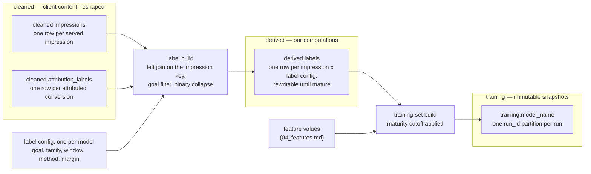

# 03 — Labels

How the training label is built: which impressions count, which
conversions count, how the two join, and when a label is final.
Attribution itself is the client's pipeline's work; we consume its outputs and
never recompute them.

## The label

Per goal: an impression gets label 1 if the attribution data links at
least one conversion of that goal to it within the attribution window,
label 0 otherwise. The two MVP goals are Page View and Purchase, both
initial priorities per the client; each gets its own label
configurations. The universe is `cleaned.impressions`, under our
working assumption, to confirm with the client, that this dataset contains wins
only — every row a served impression, a scored-but-lost candidate never
in it. The client describes the dataset as "joined delivery, campaign, ad set,
ad, creative, supply, bid, win, spend, and event-outcome data" without
stating it is wins-only (open question 3).

The universe is served impressions by definition: `P(Action |
Impression)` conditions on an impression being shown. Auction and bid
data (which the client lists among training sources) can never be the label
universe — a lost auction has no impression to condition on — and
neither can our decision logs; both enter only as feature and analysis
sources.

## Dataflow

The label build runs on a schedule, keeps `derived.labels` current as
conversions mature, and is independent of training; the training-set
build reads whatever is mature when a run starts.

## Inputs

- `cleaned.impressions` — one row per served impression. Which key it
  carries is unconfirmed: the client's attribution tables reference an
  `impression_id`, but the client's delivery-log inventory documents
  `auction_id` and `request_id` instead, and names `auction_id` as the
  bridge from conversions to delivery "where available". We assume the
  curated dataset carries a key the attribution rows reference; which
  key is open question 3.
- `cleaned.attribution_labels` — one row per attributed conversion,
  from two source families: web (the web-attribution provider, conversions measured through
  an enhanced pixel: Pixel Purchase, Page View) and app (MMP trackers:
  App Install, out of MVP scope). Both families carry a required
  `impression_id` (the web table documents it as the DSP impression
  identifier; the app table does not name its space). Field names here
  come from the client's internal models; they are confirmed only when the
  curated feed's schema arrives.

## Label parameters

One label configuration per model, registered with the model version in
the registry (mechanics in `05_training.md`):

- goal event — which conversions count. Goals arrive as the ad set's
  `optimization_goal` values (`PIXEL_PURCHASE`, `PIXEL_PAGE_VIEW`; app
  events later); the filter column is `event_name`, and the mapping
  from goal value to `event_name` values needs the client confirmation (open
  question 1).
- window — 7, 14, or 30 days per the client's data models, and the client's
  ML report states a 1-day variant is also available (to confirm,
  open question 1). The client ships one source table per window;
  `cleaned.attribution_labels` unions them with a `window` column
  (`02_datasets.md`), so picking the window means filtering on it. The
  window may become advertiser-facing configuration (a goal-suffixed
  value like `PIXEL_PURCHASE_7_day`, or an ad set column), making it a
  product dimension: each goal uses a single window for now, and the
  expected end state is one label configuration and one model per
  (goal, window), each model trained on its own window's labels.
  Training on a shorter window and calibrating up to a longer one is a
  conditional alternative owned by `05_training.md`; the label build
  supports both unchanged.
- source family — web or app.
- method — click- versus view-through. The window tables carry no
  method field (a nullable `attribution_method` exists only on a legacy
  raw table), so today the parameter has one value: "as attributed by
  the client".
- maturity margin — extra days added to the window before a label is
  considered final, covering the proposed daily cadence of the
  attributed-conversions feed (the client's cadence expectation, not a
  live feed yet). Proposal: 2 days. Attribution reprocessing is handled separately (see Maturity),
  not by this margin.

Both goals ship in the MVP; what stays open is each goal's windows.
Which windows the client will offer per goal is a product question (open
question 1), and label volumes per (goal, window) decide what is
trainable. Lean, not decided: per goal, the shortest offered window
that yields enough positives.

## Join mechanics

- Left join: every impression row survives; conversions attach by
  `impression_id`, filtered to the configured goal event.
- Conversions are scoped by their measurement source as well as the
  goal event: `enhanced_pixel_id` on the web side, `app_tracker_id` on
  the app side. The same `event_name` can arrive from different
  pixels; the source key keeps goals from colliding.
- The label is binary. An impression with three matching conversions
  gets the same label 1 as one with a single conversion. Conversion
  count and value (`price` on web, `revenue` on app) are kept as
  metadata columns for future value models; the MVP label ignores them.
- Conversion timestamps use the UTC fields (`event_timestamp_utc`; the
  web table marks it preferred for cross-system joins, the app table
  carries only the UTC form).
- A conversion whose `impression_id` matches no impression row is an
  orphan. Orphans are counted and reported per day, never silently
  dropped: a rising orphan rate means the impressions feed and the
  attribution feed disagree about what was served.
- The conversion rows' `ad_id` is nullable on the web side. This never
  affects the label (identity comes from the impression row); it only
  shrinks rollups that join conversions directly to ads or campaigns.
  The share of null-`ad_id` conversions is reported alongside the
  orphan rate.

## Maturity

A label is final only once the window has closed and the data has
arrived: impression time + window + maturity margin. Before that, the
impression is immature — its label can still flip from 0 to 1.

Training uses matured impressions only. The training-set build drops
every impression younger than (window + margin) at build time. This is
the simplest rule that is correct, and it is the MVP rule: no
weighting, no provisional labels. Training on younger impressions with
early labels is a possible later iteration; the client's own docs anticipate it
(early feedback datasets next to finalized attribution snapshots).

The cutoff guarantees the config's label is final for every row read:
the window has passed, so normal late arrivals cannot flip it.
Rebuilding a training set over the same date range therefore reproduces
the same labels, with one exception: the client's attribution reprocessing (a
weekly/backfill-tier event in their cadence plan) may correct
conversions after the fact, including in otherwise-final partitions.
Exact reproduction of a specific past run never depends on this; that
is the training snapshot's job (`02_datasets.md`).

## Output

`derived.labels` — one row per impression and label configuration (the
config id subsumes goal, window, and family): the binary label,
first-conversion timestamp, conversion count, conversion value,
maturity status, and the label-configuration id.
Partitioned by impression date like its inputs, and rewritable on the
same horizon (a late conversion flips a row from 0 to 1 until the
partition is final).

The training-set build (`05_training.md`, with features from
`04_features.md`) reads `derived.labels`. If it downsamples negatives,
the keep fraction is recorded with the run; the base-rate correction
that number feeds belongs to training and calibration
(`05_training.md`), not here.

## Open questions

1. Which windows the client will offer per goal (the client suggests
   advertiser-selectable windows), label volumes per (goal, window),
   whether the 1-day attribution variant named in the client's ML
   report exists as a table, and the mapping from `optimization_goal`
   values to `event_name` values. Blocks the window choice per goal;
   everything else here is parametrized and does not wait for it.
2. Whether the client's attribution exposes click- versus view-through on the
   window tables at all (only a legacy raw table carries a nullable
   `attribution_method` today).
3. The join, end to end: whether the curated impressions dataset is
   wins-only; which key it carries (`impression_id` versus `auction_id`
   / `request_id`); and which layer the attribution feed derives from
   (attribution tables where `impression_id` is required, or the gold
   query layer where it is nullable — and where `event_name`, the goal
   filter, is also nullable and ids arrive string-typed). The label
   universe and label coverage both depend on it.
4. The maturity margin value (proposal: 2 days), and how attribution
   reprocessing events are detected so downstream rebuilds trigger.