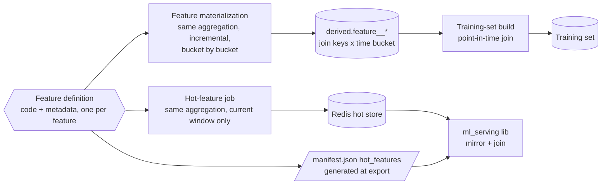

# 04 — Feature layer and hot-feature jobs

The shared feature layer: one definition per feature, consumed by both
the training-set build and the batch hot-feature jobs. Owns everything
about hot features that the serving lib deliberately does not: windows,
aggregation, key rendering, freshness, and lifecycle.

## The no-skew contract

Every feature has exactly one definition: one aggregation (for example,
clicks counted and grouped by publisher, over a 30-minute window),
computed by one piece of code. That code runs in two places:

- the feature-materialization pipeline runs it incrementally across
  history, bucket by bucket, into the derived feature tables
  (Feature materialization, below); the training-set build joins those
  tables point-in-time, so each training row gets the value as it was
  at its own moment. Running the definition inline over a run's range
  is the fallback when a definition version is not materialized yet.
- the hot-feature job runs it once, over the current window, to
  populate Redis.

The grouping, the metric, and the window length are identical in both
places; only how many times the code runs, and over what span, differs.
The value a model trained with and the value the serving-time join
finds must come from that one definition; divergence between the two
is train/serve skew, the failure mode this whole layer exists to
prevent. The contract is proven at dev scale in the
[`ml_serving`](https://github.com/cunha-sigma/ml_serving) repo: one
Python function feeds both the training join and the Redis seeder, and
the exported artifact gates on an ONNX-versus-Python parity check at
1e-4, re-verified end to end by the repo's smoke test at the same
tolerance.

## What a definition declares

A feature definition is Python code plus declarative metadata, both in
the shared layer:

- name — also the ONNX input name and the manifest `hot_features.name`.
- input events — which Delta tables feed the aggregation.
- aggregation and window — the computation and its lookback (for
  example, impressions per line item over the last 30 minutes).
- join keys — field names, composite allowed. The definition metadata
  declares each key's ID space (client UUID, DSP ID, or raw-log ID,
  per the identity-mapping rule in `00_overview.md`); a join-key
  declaration without an ID space is invalid. The key string itself
  (and the `key_template`) stays plain.
- key_template — the Redis key name for one dimension-combination's
  value, with `{field}` placeholders filled in per combination (a
  feature grouped by publisher needs one key per publisher, not one key
  for the whole feature). Starts with a namespace prefix owned by the
  model whose feature set declares the definition (the anti-collision
  contract), for example `pixel_purchase:li_clicks_30m:{line_item_id}`.
- default — a float used when the key is absent. The default means cold
  start (a line item with no history yet), not error masking; it must
  be a value the model can meaningfully consume.
- privacy class — whether the feature reads any privacy-sensitive field
  (`02_datasets.md`'s treatment rules). Required declaration; it is the
  enforcement point for the rule that no sensitive field enters a
  training table undeclared.

The manifest's `hot_features` section is generated from these
definitions at export time, never written by hand. One source of truth:
if training, Redis, and the manifest disagree, the bug is in exactly
one place.

## The two consumers

Example: `clicks_per_publisher_past_30min`, clicks counted and grouped
by publisher, over a 30-minute window.

For training, each training row needs the feature's value as it was at
its own moment, not today's value. The materialization pipeline buckets
history into successive 30-minute windows and runs the aggregation once
per bucket, per publisher, maintaining a time series of values in the
feature's derived table; each training row joins to the bucket covering
its own timestamp. The time series is extended incrementally as new
cleaned data lands, never recomputed per training run.

For the hot-feature job, only one number per publisher is needed,
right now.
It runs the same aggregation, clicks grouped by publisher, over a
single window: the past 30 minutes, ending now. No buckets, no
history, one value per publisher, written to Redis under that
publisher's rendered key_template.

Same metric, same grouping key, same window length. The only
difference is that training evaluates it repeatedly across a
historical range (one value per bucket) and the hot-feature job
evaluates it once, for the current moment. A bucket or key with no
history gets the declared default, the same value in both places, so
the model learns what the default means.

Key rendering must match the Go assembler's rules: strings pass
through as-is; numeric key values format as the shortest
round-tripping decimal in fixed-point form, never exponent notation
(an id of 4521.0 renders "4521"; Go's
`strconv.FormatFloat(v, 'f', -1, 64)` semantics). The fixed-point
constraint is the trap: Python's default float formatting switches to
exponent form at large and small magnitudes and would silently render
a different key. The shared layer provides the one rendering function
both jobs and any validation use.

## Feature materialization

The offline half of the feature store: a batch pipeline, ours, that
executes the definitions over the cleaned tables and maintains the
historical aggregates as Delta tables, so training runs join instead of
recompute.

- Tables — `derived.feature_<model>_*`, one table per model and grain
  (one set of join keys, one bucket length). A model's features sharing
  both ride in the same table as columns; a feature with the same keys
  but a different window stepping gets its own table. Example: model A
  with `metricA` and `metricB` on keys (X, Y) and `metricC` on key Z
  produces two tables — `derived.feature_modelA_x_y` with rows keyed
  (X, Y, bucket) and columns `metricA`/`metricB`, and
  `derived.feature_modelA_z` with rows keyed (Z, bucket) and column
  `metricC`. The same three metrics appear in Redis as flat per-key
  floats (Keyspace management, below); the table grouping exists only
  offline. Ownership is per model by design: a formula two models both
  declare is computed per model, under each model's tables and
  prefixes — ownership over deduplication. One point-in-time join per
  grain at training-set-build time, however many features ride on it.
- Grain — join keys × time bucket; the bucket length is the
  definition's window stepping (a 30-minute-window feature produces
  30-minute buckets).
- Incremental rule — buckets are computed as cleaned partitions land
  and partitioned by bucket date; a late or corrected cleaned partition
  recomputes the buckets it feeds. A bucket stays rewritable for as
  long as its cleaned inputs are, then it is final with them
  (`02_datasets.md`). Each day costs one day of computation, not a
  full-lookback recompute per training run.
- Versioning — materialized values carry the definition version that
  computed them. The version identity is per definition — a content
  hash of that definition's code and metadata (or an explicit version
  field), so it changes exactly when the definition changes; the repo
  commit that produced the rows is recorded alongside as lineage, but
  never used as the version key, since unrelated commits would mark
  every value stale. A changed definition is a new version and needs
  its backfill before training runs can join it; until the backfill
  lands,
  a run whose feature set names the new version computes that feature
  inline over its own range (the fallback). The training-set build
  checks the model configuration's feature-set versions against the tables
  and chooses join or fallback per feature.
- Scheduling and ownership — scheduled alongside the hot-feature jobs,
  same definitions, same shared layer; the DAG repo schedules, the
  workload repo computes.
- Hot-feature job — unchanged by materialization: it computes the
  current trailing window straight to Redis. The materialized tables
  serve history; Redis serves now.

Implementation lean, not decided: Unity Catalog feature tables with
point-in-time lookup are the Databricks-native fit for exactly this
shape.

## Repo home

The shared layer is part of the workload package. Both consumers are
Databricks workloads, so both import it inside their runs; the package
ships as versioned wheels, pinned per pipeline
(`08_orchestration_repos.md`). The DAG repo defines and schedules
pipelines but never contains feature logic; the only workload code it
imports is the config-schema subpackage, in CI.

## Freshness and cadence

Three delays stack in series: how fresh the inbound curated data is
when it reaches us, our job cadence, and the lib's whole-keyspace
mirror interval (5–10 minutes; serving reads a snapshot, not Redis).
Worst-case staleness at scoring time is the sum.

The first delay is the binding one and is not ours to set: the client's
stated cadence tier for delivery metrics, impressions, and clicks (the
events hot features aggregate) is hourly, so unless a fresher boundary
feed is negotiated, hot features carry an hourly freshness floor
regardless of how often our jobs run (`01_data_access.md`).

Our sizing proposal for the part we do control: one hot-feature
pipeline, parametrized over the models' feature sets
(`08_orchestration_repos.md`), runs every 10 minutes as an
MWAA-triggered Databricks run, adding at most 20 minutes (10 of job
cadence plus 10 of mirror interval) on top of the inbound delay.
Cadence is a per-feature-set parameter, not a platform constant; a
feature whose window is hours can run hourly.

## Keyspace management

- Shape — one key per metric per key-combination, value a single float
  for the current window; tables and buckets exist only offline. A
  model with `metricA` and `metricB` on keys (X, Y) and `metricC` on
  key Z produces keys like `modelA:metricA:x1:y1`,
  `modelA:metricB:x1:y1`, `modelA:metricC:z1` — the join-key values are
  in the key name, metrics never share a key.
- Namespace — every key starts with the owning model's prefix. Nothing
  writes outside its model's prefixes; collisions are a review-time
  check on key_templates.
- TTL — every key gets a TTL of 3x its job cadence (proposal). Keys for
  retired line items expire instead of living in the lib's in-memory
  mirror forever; a healthy job refreshes its keys long before they
  expire.
- Size budget — the lib mirrors the whole keyspace into every Bidding
  Agent process, so total key count is a real budget, not a Redis
  concern. Each definition estimates its key cardinality (bounded by
  its join-key space, for example active line items, not users);
  anything user-keyed would blow the mirror and is out of scope for
  this store.
- Write mechanics — idempotent pipelined SET with TTL, full overwrite
  per run. No deletes needed: TTL handles retirement. If a run fails,
  existing values go stale, then expire, and the lib falls back to
  declared defaults per key. This degrades prediction quality without
  failing requests. One dependency to flag: serving the default on a
  missing key is the lib's current v0 behavior, and whether defaulting
  should ever gate a request instead is an open question on the serving
  side; this TTL design assumes the current behavior stands. Job
  failures must still alert (see `09_monitoring.md`).

## Feature lifecycle

Ordering rules, both directions:

- Adding: add the definition, backfill its training values, deploy and
  verify its hot-feature job, and only then train and ship a model
  declaring it. A manifest must never declare a feature whose job is
  not live; the deployment job's validation step checks that the
  feature's keys exist in Redis before writing a config.
- Removing: ship a model that no longer declares the feature, wait out
  rollback horizons (the previous version may still be re-promoted),
  then stop the job and delete the definition. TTL clears the keys.

## Planned feature families

Beyond request-derived fields (free at bid time, not this doc's
concern), two aggregate families are planned; both flow through the
same definition layer as any other feature:

- Advertiser-level rolling aggregates — conversion and delivery rates
  at advertiser, campaign, and ad set grain. These are the
  sparse-signal mechanism: one global model per goal personalizes
  through these features as an advertiser's history accumulates, so no
  per-advertiser model is ever needed. The client requires that the
  approach not depend on per-advertiser history; personalizing through
  features is our chosen mechanism. A new advertiser has no keys yet
  and gets the defaults — cold start is the declared-default case, not
  a special mode.
- Auction and bid-landscape aggregates — win rates, price
  distributions, auction volume by segment, sourced from the client's auction
  and bid data via the curated feeds (`01_data_access.md`). Candidate
  features only; they never define the label universe
  (`03_labels.md`).

## Open questions

1. The freshness budget per feature: the inbound-data floor (hourly as
   currently stated, unless a fresher boundary feed is negotiated —
   the client's internal inventory includes a streamed win-log table, so
   fresher is physically possible; see `01_data_access.md`) plus what
   staleness each feature can tolerate. Needs real features and
   product input. Until then, 10-minute cadence and 3x TTL stand as
   proposals for our share of the delay.
2. Whether key-presence validation at deploy time checks existence
   only or also value distributions (a job writing zeros passes an
   existence check).
3. Real keyspace sizing. The flat key-per-dimension-combination shape
   (above) matches how online feature stores work everywhere (offline
   = table, scanned in bulk for training; online = key-value, point
   lookup per request); that split is not in question. What is not yet
   sized: total key count once real metrics and their join-key
   cardinality exist, since the lib mirrors the whole keyspace into
   every Bidding Agent process's memory rather than doing a live lookup
   per request. Moderate cardinality (hundreds to low thousands per
   metric) is cheap to mirror; a metric with high-cardinality join keys
   (user-level, for example) would not be. Revisit once real metrics
   are known; options if any metric runs too large: a live per-request
   lookup for just that feature instead of mirroring it, or grouping
   several metrics sharing a join key into one Redis hash per
   combination instead of one flat key per metric (the latter needs a
   serving-lib read-path change, a cross-repo decision).
