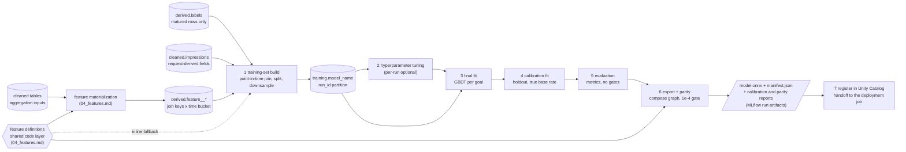

# 05 — Training

The training pipeline: from matured labels and feature definitions to a
registered model version carrying a parity-checked serving artifact.
Upstream, `09_monitoring.md` owns when runs happen and MWAA triggers
them; downstream, registration in Unity Catalog starts the deployment
job (`07_deployment_job.md`), which publishes what this pipeline
already produced. This doc is the full design; which capabilities the
first implementation activates is an operational decision, not part of
it.

## Model configuration

One configuration per model slot, versioned, and the single
parametrization point of the pipeline:

- model name — the slot name, by goal (`pixel_purchase`,
  `pixel_page_view`); extends to goal and window (`pixel_purchase_7d`)
  when windows multiply.
- label configuration id — goal event, source family, window, method,
  maturity margin (`03_labels.md`).
- feature set — the feature definitions used, with their versions
  (`04_features.md`), plus the request-derived fields the model
  consumes, each declared with its source and dtype (what the export
  writes into the manifest's input schema).
- hyperparameters — either fixed values or a tuning spec (search space,
  budget, objective); see Hyperparameter tuning.
- calibration configuration — method (Platt or isotonic), advertiser
  layer settings (on/off, eligibility threshold, shrinkage strength),
  window variants to export.
- data ranges — training lookback, calibration and evaluation holdout
  lengths.
- downsampling policy — negative keep fraction and stratification, or
  none.
- rollout policy — a sibling definition in the pipeline folder
  (`08_orchestration_repos.md`), contents owned by
  `06_validation_promotion.md`; the training run does not consume it,
  it passes it through for registration.

The configuration and the rollout policy are registered with the model
version the run produced, closing the lineage `03_labels.md` defers
here: a version always knows which label configuration, feature
versions, calibration settings, and rollout policy belong to it, and
the deployment job reads the policy from the registry.

## Pipeline structure

One pipeline definition, instantiated per model configuration,
submitted as a Databricks job run on an MWAA trigger
(`08_orchestration_repos.md`). The pipeline does not know why it
was triggered; schedules and degradation triggers are
`09_monitoring.md`'s.

Cylinders are tables, the hexagon is code (the shared feature-definition
layer), rectangles are pipeline stages, the parallelogram is the run's
output bundle. The feature materialization pipeline is `04_features.md`'s
component, drawn here because it produces the build's feature input. The
dotted edge is the fallback: when a feature's configured version has no
materialized values yet (new feature, or a changed definition whose
backfill hasn't run), the build executes that feature's code itself,
over its own range only, instead of reading the table. The definitions feed the export stage
too: the manifest is generated from them.

### Run modes

Over the same stages:

- full train — all stages, fixed hyperparameters (stage 2 skipped).
- tune and train — stage 2 enabled by the tuning spec.
- recalibrate-only — skip stages 2–3: rebuild a fresh calibration slice,
  refit the calibrator over the existing trees, re-run evaluation,
  export, and registration. Cheaper than a retrain when the model ranks
  well but drifts in calibration. The result is a new version like any
  other: the calibrator never changes independently of a registered
  version, so model and calibrator stay a matched pair.
- window-variant export — stages 4–7 once per configured window: the
  same trees with a calibrator fit on that window's matured labels, one
  artifact and one registered version per window. This is the
  train-short-and-calibrate-up alternative to training each window's
  model separately; its validity gate is the ranking-invariance
  measurement in evaluation.

## Training-set build

- Universe — the matured rows of `derived.labels` for the model's label
  configuration, over the configured lookback. Maturity is
  `03_labels.md`'s cutoff (window plus margin at build time), so every
  label read is final under normal operation.
- Features — request-derived fields come from the impression row
  itself (`cleaned.impressions`); aggregates come from the materialized
  feature tables (`derived.feature_<model>_*`, `04_features.md`) by
  point-in-time join, each row picking the bucket covering its own
  timestamp. A feature whose definition version is not materialized yet
  is computed inline over the run's range with the same shared code —
  the fallback, never the normal path.
- Split — temporal, three ways: train, calibration holdout, evaluation
  holdout, in time order. The calibration and evaluation holdouts keep
  the true label distribution; only the train split may downsample.
- Downsampling — negatives only, parametrized by the policy, keep
  fraction recorded with the run. Sampling is stratified by advertiser
  so the global model keeps seeing small advertisers instead of a
  uniform sample dominated by the largest ones; stratification keys and
  rates are part of the policy.
- Snapshot — written to `training.<model_name>` under the new run id
  (`02_datasets.md`), with a split column, so the snapshot holds the
  exact rows and the exact split of the run. Immutable once written.

## Hyperparameter tuning

A pipeline stage, present in the design and enabled per run by the
tuning spec in the model configuration:

- search space and budget (trials or wall time) come from the spec; the
  objective is a ranking metric on an internal temporal validation
  slice carved from the train split. The calibration and evaluation
  holdouts are never visible to tuning.
- trials run as nested MLflow runs under the pipeline's run, so the
  search is inspectable and the winner reproducible.
- the winning parameters become the final fit's parameters and are
  recorded in the configuration lineage as the resolved values.

A run without a tuning spec uses the configuration's fixed
hyperparameters unchanged. Tuning cadence is an operational choice:
nothing in the pipeline assumes it runs every time.

## Model fit

One global gradient-boosted tree model per goal (LightGBM), trained on
CPU, over all advertisers. Advertiser, campaign, and ad set identity
plus their history aggregates enter as features; this is what serves
new and low-signal advertisers without per-advertiser models — a new
advertiser scores through the request and setup features until its
aggregates accumulate.

Class imbalance is handled in the data, by the build's downsampling,
not by loss weighting. Decision, not accident: a recorded keep fraction
has a closed-form probability correction, while loss weights distort
scores in a way no closed form undoes, and the output of this pipeline
must end as a true probability.

Categorical fields are encoded inside the exported graph, so the
training-time encoding is chosen for exportability: the encoder fit at
training is the one baked at export, never a separate serving
implementation.

## Calibration fit

Two steps, in order, fit on the calibration holdout (true base rate):

1. Base-rate correction — closed-form, from the recorded keep fraction;
   skipped when the run did not downsample.
2. Calibrator — Platt or isotonic per the configuration. Lean: isotonic
   when the holdout has enough positives to support a stepwise fit,
   Platt when sparse; the threshold is set at EDA with real volumes.

The advertiser layer, when enabled in the configuration, fits on the
same holdout as a grouped calibration: one global calibrator plus
per-advertiser parameters for every advertiser above the eligibility
threshold (minimum matured conversions in the holdout), each shrunk
toward the global fit in proportion to its volume. Below the threshold
an advertiser simply has no row and gets the global behavior. The
result exports as a lookup inside the graph — advertiser id to
parameters, with the global fit as the default row — so serving stays a
single self-contained artifact and a batch can mix advertisers freely.

Window variants reuse the fitted trees and fit one calibrator per
configured window on that window's matured labels, producing one
artifact per window (see Run modes).

## Evaluation

Metrics, not gates: this stage measures and logs; thresholds, offline
replay against logged decisions, and promotion verdicts belong to the
deployment job's decision logic (`06_validation_promotion.md`).

On the evaluation holdout:

- ranking — AUC and PR-AUC (PR-AUC is the informative one at these
  base rates).
- calibration — reliability curve and expected calibration error,
  computed on the corrected, calibrated output.
- standard cuts — the same metrics by advertiser (per-advertiser
  calibration error is the signal that tells us when the advertiser
  layer earns activation), by campaign, and by time slice within the
  holdout.
- ranking invariance — when window variants are configured: whether the
  long-window conversion rate is a stable monotone function of the
  short-window score across segments. Stable supports calibrating up;
  unstable means that window needs its own trained model.

All metrics land in the MLflow run.

## Export, parity, registration

- Export composes the self-contained ONNX graph: in-graph preprocessing
  (the encoders fit at training), the trees, and the calibration —
  including the advertiser lookup when that layer is active. One input
  tensor per raw field, named identically to the field; raw strings
  pass through; single output `p_cal`; the file named per the manifest's
  `onnx.file` (convention `model.onnx`).
- The manifest is assembled at export, never written by hand: the
  hot-feature join spec (join keys, `key_template`, default per
  feature) from the feature definitions; the input schema (name,
  source, dtype per field) from the model configuration's feature set,
  request-derived fields included; plus `onnx.file`, `output_name`, and
  `mlflow_run_id` as the lineage pointer, `model_name`, and `version`.
- Parity is a hard gate: the Python pipeline and the exported graph are
  scored on held-out rows and the run fails if max |diff| exceeds 1e-4.
  The serving repo applies the same tolerance in its dev-scale smoke
  test ([ml_serving](https://github.com/cunha-sigma/ml_serving)).
- `model.onnx`, `manifest.json`, the calibration report, the parity
  report, and the monitoring references — the holdout score
  distribution and per-feature input distributions with null shares
  (`09_monitoring.md` reads them as drift baselines) — are logged as
  run artifacts; registering the version in Unity
  Catalog is the pipeline's last act and the deployment job's trigger.
  Registration triggers the deployment job through a link set on the
  registered model in Unity Catalog ("on a new version, run this job");
  for a brand-new slot that link does not exist yet, so the pipeline
  sets it when it registers the slot's first version — once per model,
  a no-op afterwards. Automating it here means a new slot can never
  silently register versions that no rollout picks up.
  The job's export task publishes these files unchanged
  (`07_deployment_job.md`); nothing downstream rebuilds or re-checks
  them.

## Lineage and reproducibility

The MLflow run records the resolved model configuration (label
configuration id, feature versions, final hyperparameters, calibration
settings), the rollout policy, the data ranges and split boundaries,
the keep fraction, all evaluation metrics, and the parity result. The run id is also the
snapshot partition in `training.<model_name>`, so the chain is one
lookup deep in each direction: registered version → run → snapshot →
configurations.

Exact reproduction of a past run reads its snapshot (`02_datasets.md`).
Rebuilding over the same date range reproduces the same labels for the
same configuration, with the client's attribution reprocessing as the one
documented exception (`03_labels.md`).

## Open questions

1. Label volumes per goal and window gate three knobs at once: the
   downsampling policy, the Platt-versus-isotonic threshold, and a
   sensible tuning budget. All set at EDA.
2. The advertiser layer's eligibility threshold and shrinkage strength,
   set against calibration-fit variance on real per-advertiser volumes.
3. Lookback and holdout lengths per goal, against volume and seasonality
   (a purchase model likely needs a longer lookback than a page-view
   model).
4. Categorical encoding for high-cardinality id fields (vocabulary with
   an out-of-vocabulary bucket versus hashing), decided with the first
   real feature set, since it must round-trip through the in-graph
   encoder.
