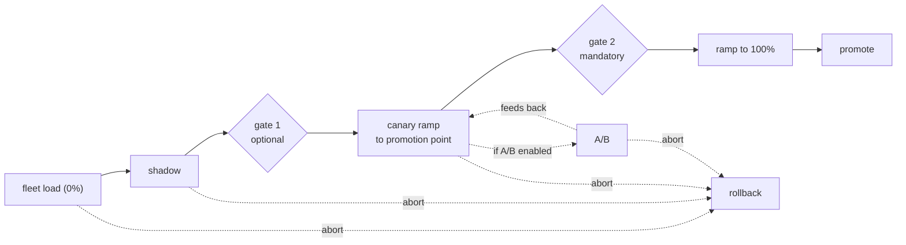

# 06 — Validation and promotion

The decision logic of the deployment job. One job, two docs:
`07_deployment_job.md` owns the mechanics (tasks, triggers, writes);
this doc owns what the tasks decide on — the rollout policy, the
per-state readout verdicts, the guardrails, and where humans approve.

## Decision inputs

Everything a verdict reads comes from three places:

- the training run's own gate (`05_training.md`): ranking and
  calibration checked against absolute thresholds before the version
  ever registers. A version that fails never registers, so the job can
  assume quality is already settled.
- the per-arm readout tables (`09_monitoring.md` builds them): decision
  rows joined with matured labels, aggregated per model, version, arm,
  and revision. This is also where an enabled A/B's champion-versus-
  challenger comparison is read from.
- guardrail signals: spend, win rate, delivery, and the serving-side
  health metrics (latency, errors, defaulted-feature rates). Latency,
  errors, and defaulted-feature rate are agent-internal, continuous.
  Spend, win rate, and delivery depend on auction-outcome data the
  agent does not observe directly (open question 5) — the only
  confirmed path for win rate and delivery is the client's curated
  feed, hourly at best (`01_data_access.md`'s cadence tiers), not
  continuous.

The challenger, shadow, and routing capabilities this doc reads from
are the serving repo's target design; its v0 ships champion-only. The
doc designs against the target, consistent with the rest of the set.

## Rollout policy

The decision logic is parametrized per model by a rollout policy — a
sibling of the model configuration in the pipeline's definition folder,
registered with the model version alongside it
(`08_orchestration_repos.md`):

- thresholds — the readout bounds listed in the sections below; values
  are per model because base rates and volumes differ per goal.
- bake times — minimum time in each state before a verdict, and the
  maximum hold (below).
- canary ramp — shape and the traffic level that counts as the
  promotion point.
- gate 1 — on or off. Off (the default) auto-proceeds once shadow's
  bake time is green; on holds for a human before the first live bid.
- A/B — on or off. Off is the common case (see Retraining modes); on
  adds the A/B test definition below to the ramp.
- evidence mode — what promotion waits for: `full_window` or `proxy`
  (see Evidence modes). Per model and per change: a routine refresh of
  an incumbent can reasonably promote on proxy evidence, a new model or
  a changed feature set should wait for the full window. Lean, not a
  rule: recalibrate-only runs default to `proxy`, first versions of a
  model default to `full_window`.

Gate 2 (promote) is fixed for every policy and is not part of the
policy (see Approval gates). That is, no model goes to PRD unattended.

## Retraining modes

Three things trigger a new version; each maps to a rollout policy.
Training mode and rollout policy are independent — the mapping below
is what a human picks, not a rule the system infers from how a version
was trained.

| Trigger | What's different about the model | Rollout policy |
|---|---|---|
| Scheduled | Same architecture/features/HP — just a fresher training window | Gate 1 off, A/B off |
| Alert (drift/calibration monitoring) | Usually nothing architectural — reacting to a detected problem | Same policy as scheduled, unchanged |
| Engineer/experiment | Whatever the engineer changed — new feature, architecture, anything judged higher-risk | Gate 1 as chosen, A/B on |

**Success criteria — what "good enough to ship" means per mode:**

| Mode | To become champion, must... |
|---|---|
| Scheduled | Clear training's absolute gate (ranking, calibration, latency) → shadow green (no distribution anomalies) → canary ramp green (guardrails: spend, win-rate, latency, errors) through the promotion point |
| Alert-triggered | Same bar as scheduled. The gate is absolute, not champion-relative — it doesn't matter that champion is the thing that drifted |
| Experiment | Same training gate, plus a clean A/B: guardrails green for the full bake, calibration/ranking within the A/B's own bounds, non-inferior to champion (trusted only if champion itself is healthy). "Genuinely better" is never a gate condition — read from the A/B numbers afterward, not required to ship |

## Rollout states and readout

The advance and readout tasks loop through the states; each pass
produces one verdict: continue, hold, or abort.

- Fleet load (0% traffic) — the artifact loads fleet-wide without
  scoring anyone. Reads what is observable at 0%: the lib's
  reload-error counters, load failures the agent surfaces at startup,
  and fleet health (memory, restarts) from the serving-side monitoring.
  Continue when the fleet is healthy for the bake time.
- Shadow — the challenger scores real traffic out-of-band; no bid is
  affected. Reads, no labels needed: the challenger's score
  distribution against the champion's on the same traffic,
  defaulted-feature rates (a spike means a declared field is missing —
  a hot-feature job lagging the manifest, or the agent not sending a
  field), latency contribution, and sampling integrity.
  Continue when distributions are stable and health is green for the
  bake time.
- Canary ramp — live bids, ramping up to the policy's promotion point.
  Checks: delivery guardrails (spend, win rate vs. the champion arm),
  realized calibration on whatever window has matured labels, and a
  sample-ratio check.
- A/B (only if the policy turns it on) — champion vs. challenger at a
  configured traffic split, nested inside the canary ramp. Checks per
  arm: realized calibration, cost per action vs. the goal, spend, and
  delivery.

Hold means the bake extends because the evidence is inconclusive — not
enough matured labels or volume yet — and is bounded: past the maximum
hold the run escalates to the humans instead of waiting forever.
Integrity rules apply throughout: the arms differ only in the model
(same features, same pacing), the routing salt stays fixed for the
experiment's lifetime, and any sample-ratio mismatch voids the state's
readout.

## A/B test definition

Only relevant when a policy's `ab_test` is on (Retraining modes: the
experiment case).

| Parameter | Definition |
|---|---|
| Metrics | ranking (absolute floor + margin vs. champion), calibration (absolute floor), cost-per-action vs. the goal — per arm |
| Traffic split | configurable ratio + split key. Split key default: per-request (largest, fastest-accumulating sample). Coarser keys (per-advertiser, per-line-item) trade sample speed for exposure consistency — a deliberate choice per test, not a default |
| Arm size | statistical power calculation — needs a baseline conversion rate and a minimum detectable effect (open question 3) |
| Duration | derived, not set directly: evidence mode × arm size × actual traffic volume. `full_window` waits for the real attribution window to mature; `proxy` promotes on the shortest available window plus guardrails |

## Concurrency during an active A/B

Only one challenger per model slot, same invariant as always. While an
experiment's A/B is in flight, promotion is frozen for that slot —
champion has to stay fixed for the comparison to mean anything.
Scheduled and alert-triggered retrains keep happening underneath and
queue, the latest superseding whoever's waiting once the freeze lifts.
Mechanics (the `queued` field, registration-time slot check, re-trigger
on resolution): `07_deployment_job.md`.

## Guardrails and automated abort

Always on, every state, including after promotion — a champion is
guarded for its whole life, not only its own rollout. No human needed
to trigger an abort.

| Signal | Fires as fast as |
|---|---|
| Serving error or latency breach | continuous — the agent observes it directly |
| Defaulted-feature-rate spike | continuous — the agent observes it directly |
| Spend anomaly (challenger arm) | the underlying data arrives (open question 5) |
| Win-rate collapse | the underlying data arrives (open question 5) |
| Calibration blowout on early labels (realized conversion rate off the prediction by more than a configured multiple) | labels mature |

Any breach aborts: the promote task's rollback branch writes a config
pointing at the previous version (`07_deployment_job.md`). Abort is
cheap and reversible — a rolled-back version can re-enter the loop
after a fix — so guardrails are tuned to fire early.

Two manual controls exist alongside the automated path, available to a
human independent of any breach:

- **Red button** — trigger the abort path manually, at any point, for
  anything a threshold wouldn't catch.
- **Rollback button** — move champion → previous on demand, any time
  after promotion, without needing a guardrail breach as the trigger.

## Approval gates

Gate 2 (canary → promote) is fixed and mandatory for every policy —
before the version becomes champion. This is the one invariant that
never turns off: no version reaches the champion slot unattended.

Gate 1 (shadow → canary, before the first live bid) is a policy
parameter, off by default (Retraining modes). When on, it holds the
same way gate 2 does.

Every other transition advances automatically when its state's metrics
are green for the bake time. Aborts are always automated; a guardrail
never waits for approval.

## Evidence modes

The label windows set the clock: a 7-day goal's outcomes are not
measurable for a week, a 30-day goal's for a month. The evidence mode
in the rollout policy decides how promotion handles that:

- `full_window` — each labeled verdict waits until the goal's own
  window plus margin has matured for enough arm traffic. The strongest
  evidence and the slowest path; for a 30-day goal, impractically slow
  for routine refreshes.
- `proxy` — verdicts read the shortest offered window's labels (the
  1-day variant the client's ML report names — absent from the batch-01
  data models, so confirming it is part of the windows question — or
  else the shortest that exists) plus the guardrails, and promotion
  proceeds on that fast evidence.
  The full-window readout does not stop at promotion: the promote task
  stamps a `trailing_until` tag on the model version, and the
  deployment job's own scheduled passes keep judging it against the
  full window's maturing labels until the tag expires — rollback armed
  if the matured picture contradicts the fast one
  (`07_deployment_job.md`).

The proxy mode's validity is not free: it rests on the long-window
outcome being predictable from the short-window one, which is the same
ranking-invariance evidence the training evaluation measures. A model
or goal that fails that check must use `full_window`, whatever the
policy says — the gate enforces it.

## Launch readiness

A model version is ready to serve when, in order:

1. its training run passed the export parity, latency, ranking, and
   calibration gates
2. it ran in shadow on live traffic with no distribution or health
   anomalies
3. its realized calibration on live, won impressions stayed within
   tolerance over the configured evidence window
4. the delivery guardrails stayed green through the canary ramp,
   including A/B when the policy runs one
5. a human approved the final promotion — and the first live exposure
   too, when gate 1 is on

Calibration is evaluated on won impressions: the readouts join served
impressions to their outcomes, the same population cost per action is
computed over, since spend only happens on wins.

## Open questions

1. Threshold values and bake times: need label volumes per goal and
   window, and the client's observed baseline conversion rates. Set at
   EDA; the structure above does not wait for them.
2. The cost-per-action evaluation window and the treatment of fees —
   the client's ML report marks both as remaining to be defined,
   without assigning an owner.
3. Minimum arm sizes for a powered A/B per goal: needs volume data;
   until then A/B bake times are conservative.
4. Which role holds the two approvals — a team decision, recorded when
   the job goes live.
5. Spend and win-rate data provenance for the guardrails above: whether
   the ad server gives the agent a real-time win-notice/price signal
   (the client's own non-functional requirements list win/loss and
   spend/pacing as agent-monitorable, alongside clearly-synchronous
   metrics, which hints one exists) or whether the agent only ever
   learns win/spend outcomes through the hourly curated feed. The
   client can answer; until then, the spend and win-rate guardrails
   above are designed but their actual latency floor is unknown.
6. A/B cost and duration are unknown — they depend entirely on how
   fast labels mature. If maturity is a matter of hours, A/B is cheap
   and viable often; if it needs the full attribution window, it's
   expensive and should stay reserved for genuinely high-risk changes.
   Don't assume either regime until EDA says which one we're in.
