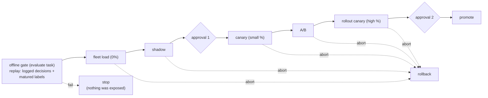

# 06 — Validation and promotion

The decision logic of the deployment job. One job, two docs:
`07_deployment_job.md` owns the mechanics (tasks, triggers, writes);
this doc owns what the tasks decide on — the offline gate, the per-state
readout verdicts, the guardrails, and where humans approve. The client's
own open questions ask how calibration should be evaluated and what
makes a model ready to launch; this doc defines exactly that, and the
Launch readiness section is written to be sent as the answer.

## Decision inputs

Everything a verdict reads comes from four places:

- the training run's own holdout metrics (`05_training.md`), already
  logged with the registered version. A version that failed training's
  export parity gate never registers, so the job can assume the
  artifact is sound and the holdout metrics are present.
- offline replay, computed by the evaluate task: champion and challenger
  scored on the same rows — logged decisions joined with matured labels
  — so the comparison holds the traffic constant and varies only the
  model.
- the per-arm readout tables (`09_monitoring.md` builds them): decision
  rows joined with matured labels, aggregated per model, version, arm,
  and revision.
- guardrail signals: spend, win rate, delivery, and the serving-side
  health metrics (latency, errors, defaulted-feature rates). Latency,
  errors, and defaulted-feature rate are agent-internal, continuous.
  Spend, win rate, and delivery depend on auction-outcome data the
  agent does not observe directly (open question 5) — the only
  confirmed path for win rate and delivery is the client's curated
  feed, hourly at best (`01_data_access.md`'s cadence tiers), not
  continuous.

The challenger, shadow, and routing capabilities this doc reads from
are the serving repo's target design; its v0 ships champion-only. The
doc designs against the target, consistent with the rest of the set.

## Rollout policy

The decision logic is parametrized per model by a rollout policy — a
sibling of the model configuration in the pipeline's definition folder,
registered with the model version alongside it
(`08_orchestration_repos.md`):

- thresholds — the gate and readout bounds listed in the sections below;
  values are per model because base rates and volumes differ per goal.
- bake times — minimum time in each state before a verdict, and the
  maximum hold (below).
- traffic — canary, A/B, and rollout-canary percentages.
- evidence mode — what promotion waits for: `full_window` or `proxy`
  (see Evidence modes). Per model and per change: a routine refresh of
  an incumbent can reasonably promote on proxy evidence, a new model or
  a changed feature set should wait for the full window. Lean, not a
  rule: recalibrate-only runs default to `proxy`, first versions of a
  model default to `full_window`.

Approval placement is fixed for all models and is not part of the
policy (see Approval gates).

## The offline gate (evaluate task)

Pass sets the registry's challenger alias; fail stops the run before
anything is exposed. The gate compares the challenger to the current
champion on the replay rows:

- ranking — PR-AUC not worse than the champion by more than the
  configured margin (a non-inferiority bound, not a
  must-beat-the-champion bound: a refresh that merely matches the
  champion on fresher data is a pass).
- calibration — absolute floors, not champion-relative: expected
  calibration error within bound, and the reliability curve within
  tolerance per decile. Calibration is held to absolute standards
  because the output is multiplied by money; a well-ranked but
  miscalibrated model fails here no matter how the champion looks.
- per-advertiser calibration — the same calibration bounds per
  advertiser, volume-tiered: advertisers with enough matured
  conversions are judged individually, the rest in aggregate tiers, so
  a tiny advertiser's noise can neither fail the gate nor hide a real
  miscalibration among large ones. This cut is also the standing signal
  for when per-advertiser calibration earns activation
  (`05_training.md`).
- score-distribution sanity — the challenger's score distribution on
  replay traffic within expected shape (no mass at the extremes, no
  degenerate constant output).
- ranking invariance — only when the version is a window variant
  calibrated up from a shorter window: the long-window conversion rate
  must be a stable monotone function of the score across segments
  (measured in `05_training.md`'s evaluation; re-checked here on replay
  rows).

Where the gate's inference runs: inside the evaluate task, on that
task's own Databricks job compute (CPU), never through the serving
fleet. The champion is not re-scored — its probabilities are already in
the decision rows. The challenger is batch-scored: the published
`model.onnx` loaded with ONNX Runtime over the logged inputs,
Spark-distributed when volume demands it — the same self-contained file
serving runs, so the replay scores match production's (the serving
repo's smoke test bounds the Go-versus-Python runtime difference at
1e-4).

First version of a model, where no ML champion exists (the incumbent is
the deterministic max-CPM path, which produces no probabilities to
compare against): the relative checks are replaced by absolute ones —
the calibration floors as above, plus plausibility against observed
baseline conversion rates (a standing ask to the client). The gate is
deliberately stricter in absolute terms when there is no champion to
lean on.

## Rollout states and readout

The advance and readout tasks loop through the states; each pass
produces one verdict: continue, hold, or abort.

The offline gate is part of the rollout, not of training: it runs inside
the deployment job, on values replayed through the registered model from
logged serving decisions. The training-time evaluation
(`05_training.md`) happened before registration, on the training
snapshot; passing it is what allowed the version to register at all.

- Fleet load (0% traffic) — the artifact loads fleet-wide without
  scoring anyone. Reads what is observable at 0%: the lib's
  reload-error counters, load failures the agent surfaces at startup,
  and fleet health (memory, restarts) from the serving-side monitoring.
  Continue when the fleet is healthy for the bake time.
- Shadow — the challenger scores real traffic out-of-band; no bid is
  affected. Reads, no labels needed: the challenger's score
  distribution against the champion's on the same traffic,
  defaulted-feature rates (a spike means a declared field is missing —
  a hot-feature job lagging the manifest, or the agent not sending a
  field), latency contribution, and sampling integrity.
  Continue when distributions are stable and health is green for the
  bake time.
- Canary (small percentage) — the first live bids. Reads: the delivery
  guardrails (spend, win rate against the champion arm), realized
  calibration on the shortest available window's labels (predicted
  versus observed conversion rate on the canary arm), and a
  sample-ratio check — the observed arm split must match the configured
  split; a mismatch means the routing is broken, which invalidates the
  readout rather than judging the model.
- A/B — the powered comparison, champion versus challenger at the
  configured split: per-arm realized calibration, cost per action
  against the goal — read as an expected-performance signal, since the
  client's objective is expected CPA, explicitly "not a guarantee of
  observed CPA in every reporting period" — plus spend and delivery per
  arm. The evidence mode decides which window this verdict waits for.
- Rollout canary (high percentage) — a regression check at scale before
  the full cut: checks the same metrics as the A/B state (per-arm
  calibration, cost per action, delivery), at a traffic level that
  exposes load- and mix-dependent problems.

Hold means the bake extends because the evidence is inconclusive — not
enough matured labels or volume yet — and is bounded: past the maximum
hold the run escalates to the humans instead of waiting forever.
Integrity rules apply throughout: the arms differ only in the model
(same features, same pacing), the routing salt stays fixed for the
experiment's lifetime, and any sample-ratio mismatch voids the state's
readout.

## Guardrails and automated abort

Always on, in every state, and never waiting for a human: spend
anomaly on the challenger arm, win-rate collapse, serving error or
latency breach, calibration blowout on early labels (realized
conversion rate off the prediction by more than the configured
multiple), defaulted-feature-rate spike. "Always on" holds without
qualification for the serving-side signals (error, latency,
defaulted-feature rate) — the agent observes those directly. Spend and
win-rate guardrails inherit whatever cadence the underlying data
arrives on, which is unconfirmed (open question 5); as specified they
cannot fire faster than that data updates. Any breach aborts: the
rollback branch of the promote task writes a config pointing at the
previous version (`07_deployment_job.md`). Aborting is cheap and
reversible by design — a rolled-back version can re-enter the loop
after a fix — so the guardrails are tuned to fire early.

## Approval gates

Two manual gates, fixed for all models:

1. shadow → canary: before the version affects its first live bid.
2. rollout canary → promote: before the version becomes the champion.

Every other transition advances automatically when its state's metrics
are green for the bake time. Aborts are always automated; a guardrail
never waits for approval. No version reaches live traffic or the
champion slot unattended, and nothing else requires a human.

## Evidence modes

The label windows set the clock: a 7-day goal's outcomes are not
measurable for a week, a 30-day goal's for a month. The evidence mode
in the rollout policy decides how promotion handles that:

- `full_window` — each labeled verdict (canary, A/B, rollout canary)
  waits until the goal's own window plus margin has matured for enough
  arm traffic. The strongest evidence and the slowest path; for a
  30-day goal, impractically slow for routine refreshes.
- `proxy` — verdicts read the shortest offered window's labels (the
  1-day variant the client's ML report names — absent from the batch-01
  data models, so confirming it is part of the windows question — or
  else the shortest that exists) plus the guardrails, and promotion
  proceeds on that fast evidence.
  The full-window readout does not stop at promotion: the promote task
  stamps a `trailing_until` tag on the model version, and the
  deployment job's own scheduled passes keep judging it against the
  full window's maturing labels until the tag expires — rollback armed
  if the matured picture contradicts the fast one
  (`07_deployment_job.md`).

The proxy mode's validity is not free: it rests on the long-window
outcome being predictable from the short-window one, which is the same
ranking-invariance evidence the training evaluation measures. A model
or goal that fails that check must use `full_window`, whatever the
policy says — the gate enforces it.

## Launch readiness

The compact statement, written to be sent to the client as our answer
to their calibration-evaluation and launch-readiness question:

A model version is ready to serve when, in order: its training run
passed the export parity gate and its holdout metrics were logged; the
offline gate passed against the incumbent on replayed production
traffic (ranking non-inferior, calibration within absolute bounds
overall and per advertiser tier); it ran in shadow on live traffic
without distribution or health anomalies; its realized calibration on
live, purchased impressions stayed within tolerance over the configured
evidence window; and the delivery guardrails stayed green through
canary, A/B, and rollout canary — with a human approving the first
live exposure and the final promotion. Calibration is evaluated on won
impressions: the readouts join served impressions to their outcomes,
which is the population cost per action is necessarily computed over
(spend only happens on wins). This covers the client's evaluation
question "including on purchased impressions" and their goal-CPA
assumption that the model is "appropriately calibrated for the
impressions purchased".

## Open questions

1. Threshold values and bake times: need label volumes per goal and
   window, and the client's observed baseline conversion rates. Set at
   EDA; the structure above does not wait for them.
2. The cost-per-action evaluation window and the treatment of fees —
   the client's ML report marks both as remaining to be defined,
   without assigning an owner.
3. Minimum arm sizes for a powered A/B per goal: needs volume data;
   until then A/B bake times are conservative.
4. Which role holds the two approvals — a team decision, recorded when
   the job goes live.
5. Spend and win-rate data provenance for the guardrails above: whether
   the ad server gives the agent a real-time win-notice/price signal
   (the client's own non-functional requirements list win/loss and
   spend/pacing as agent-monitorable, alongside clearly-synchronous
   metrics, which hints one exists) or whether the agent only ever
   learns win/spend outcomes through the hourly curated feed. The
   client can answer; until then, the spend and win-rate guardrails
   above are designed but their actual latency floor is unknown.
