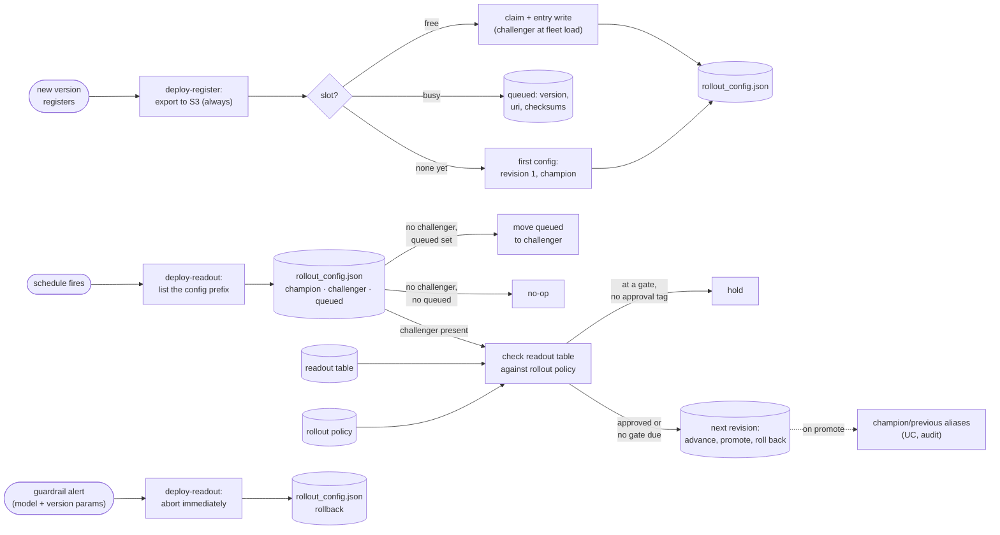

# 07 — Deployment jobs

The deployment side of the rollout: two standing Databricks jobs, what
triggers each, and the exact writes they make into the two touchpoints
serving reads (the artifact store and the rollout config). One
component, two docs: `06_validation_promotion.md` owns the decision
logic the readout runs on (gates, thresholds, approval placement); this
doc is the mechanics only.

## Execution model

Two standing single-task jobs, defined in the workload repo's bundle
(`08_orchestration_repos.md`). The trigger picks the job; neither job
branches.

- `deploy-register` — triggered by a new version registering in the
  Unity Catalog model registry, with the model name and version as run
  parameters (in Databricks terms, a Lakeflow deployment job attached
  to the registered model). It publishes the version's artifact and
  enters the version into the rollout: a config write, or the queue.
- `deploy-readout` — runs on a schedule, plus a third trigger: a
  monitoring alert (`09_monitoring.md`) starts a run through the jobs
  API, with optional model and version parameters, taking the abort
  path immediately so a guardrail breach never waits for the schedule.
  One pass reads the rollout state and moves it: advance, hold,
  promote, roll back, or consume the queue.

The attachment and that shape are our design choices; the serving
repo's adopted docs establish the responsibilities (evaluate, export,
advance, read out, promote or roll back) and that only these jobs write
the touchpoints, but specify no trigger mechanism. Registration is the
only trigger that starts a rollout — no MWAA DAG; the schedule and the
alert only move an already-started rollout along. Retraining cadence
lives upstream: `09_monitoring.md` owns the triggers, the training
pipeline executes them, and `deploy-register` only reacts to the
registration that results.

Compute is light in both jobs: registry reads/writes, a file copy, a
config write, or a query against pre-aggregated tables. No run performs
inference at the model's own scale — that work happens in training.
Serverless or a smallest-instance node covers both jobs regardless of
model size; an idle readout pass costs seconds. Both jobs set
`max_concurrent_runs: 1` (The writes, below).

## deploy-register

One run, two steps, in a fixed order:

1. Export — always first. Publish the ONNX artifact (named per the
   manifest's `onnx.file`; convention `model.onnx` — the rollout
   config's `checksums` map is keyed by on-disk filename, so the key
   must equal `onnx.file`, and the manifest's own filename is fixed as
   `manifest.json`) and `manifest.json` to an immutable S3 path,
   `<model_name>/v<version>/`. Every version is its own immutable
   folder, so exporting before the slot check costs nothing. Training
   (`05_training.md`) already produced and parity-checked this artifact
   as part of its own run; this step publishes that output, it does not
   re-run training or redo the parity check.
2. Entry — read the slot's config and enter the version:
   - slot free: claim (set the registry's challenger alias — no
     evaluation here, that already happened in training before the
     version was allowed to register) and write the next config
     revision with the version as challenger at fleet load.
   - slot busy: write the version's full artifact reference —
     version, uri, checksums — to `queued`, shaped to enter at fleet
     load when the readout consumes it. No claim: the challenger alias
     belongs to the version already in flight.
   - new slot (no config exists): write the slot's first config (A
     slot's first version, below).

The entry stage is always this job's choice, recorded in the write;
`deploy-readout` only moves a queued version in and then judges it.

A retried run repeats nothing: export skips when the published files
already match their checksums, the entry write skips when the config
already carries the version.

### A slot's first version

The lib rejects a config without a valid champion, so a slot's first
version cannot enter as challenger. The first registration writes the
slot's first config directly: revision 1, the version as champion,
skipping the rollout states and the approval tag. Nothing serves until
the serving side launches the goal, and that launch — deliberate by
nature — is the gate (`06_validation_promotion.md`, Approval gates).
The config must exist before any pod is configured for the slot. From
the second version on, the normal entry path applies unchanged.

## deploy-readout

One pass per run: read the config state, the model-version tags, and
the pre-aggregated per-arm tables (`09_monitoring.md`), then do at most
one of:

- advance — write the next rollout state's config revision. A rollout
  state is nothing more than a particular config content; advancing
  means writing a new revision with the next state's fields (fleet
  load, shadow, canary ramp — A/B nested inside the ramp when the
  policy enables it, `06_validation_promotion.md`).
- hold — exit without writing; at an active gate, notify the approver.
- promote — on a full pass through every state, move the champion and
  previous aliases and write the final config. A promotion under the
  `proxy` evidence mode also stamps a `trailing_until` tag on the model
  version, which keeps later passes judging it until the full window
  matures (`06_validation_promotion.md`).
- roll back — on abort at any state, write a config pointing at the
  previous version.
- consume the queue — no rollout in flight and a version in `queued`:
  move it to challenger in a plain config write — next revision,
  challenger alias set, `queued` cleared. The queued entry already
  carries the artifact reference and entry stage `deploy-register`
  recorded; later passes judge it like any challenger.

Gate 2, before final promotion, is fixed by
`06_validation_promotion.md` for every policy (one exception: a slot's
first version, above). Gate 1, before the first live exposure (shadow
to canary), is a policy parameter — off by default. Either way, an
active gate holds the pass until the model version carries the approval
tag.

Approvals are asynchronous: the approver sets a Unity Catalog tag on
the model version (`approved_canary`, `approved_promote`); a pass
holds, notifying the approver, until the tag exists. Who may set tags
is registry access control, so approval is audited for free.

State and idempotency: no state store exists beyond the touchpoints —
the rollout config's current content is the rollout state, and the
model version's tags carry the approvals. Every pass is idempotent;
each state transition happens in its own run; a pass advances at most
one state.

The schedule is a standing property of the job definition, never
paused or mutated at runtime (the bundle stays the source of truth).
Termination is logical: a terminal config has no challenger section and
no `queued` entry, so later passes no-op — with one exception: a model
version carrying an active `trailing_until` tag is still judged by each
pass (the trailing confirmation after a proxy-mode promotion; breach
writes the rollback, expiry ends the judging). One schedule serves
every model's rollout — the pass scans all slots' configs and the
trailing tags — while the registration trigger stays per model version.

Slot discovery: list the known config prefix — one
`rollout_config.json` per model slot, sibling to that slot's
`v<version>/` artifact folders.

## The writes

The two jobs are the only writers of both touchpoints. No other
process writes them, including by hand.

Artifact store — one write per version, at `deploy-register`'s export.
The S3 path is immutable once written: never overwritten, never
deleted. A bad version is abandoned, not erased; the rollout config
simply stops pointing at it.

Rollout config — written by both jobs: `deploy-register`'s entry write
(or queue write), `deploy-readout`'s advances, promotions, and
rollbacks. Every write:

- is an S3 conditional write: read the config and its ETag, validate
  the content, stamp `updated_at` and `updated_by`, then PUT with
  `If-Match` on the ETag — `If-None-Match: *` for a slot's first
  config. A 412 or 409 means another writer won the race: re-read and
  re-decide. With `max_concurrent_runs: 1` on each job, the
  conditional write is what closes the race between the two jobs (and
  between near-simultaneous registrations): the loser's PUT is
  rejected instead of silently clobbering the winner's revision.
- increases `revision` — every write, queued-only writes included. The
  lib reacts only to a revision change, so a write that does not bump
  it is invisible to serving.
- validates before writing: the referenced artifact exists at its S3
  path, its checksums match the bytes actually there, the config is
  well formed. A failed validation aborts the write and the previous
  revision keeps serving.
- carries real checksums (`sha256:<hex digest>`; the lib's verifier
  compares the full string, so the format is enforced in practice even
  while the config schema itself is still draft-for-review) computed
  from the published files, never placeholder values. The `queued`
  entry carries them too — the same `{version, uri, checksums}` shape
  the serving docs document.
- also checks that every hot feature the referenced manifest declares
  already has live keys in Redis. Not yet a contracted serving-side
  requirement: the serving repo lists a deploy-time check of a
  manifest's declared fields as a still-open need, and this implements
  the hot-feature half of it. It is also the handoff point with
  `04_features.md`'s feature-lifecycle rule: a manifest must never go
  live referencing a feature whose hot-feature job isn't running yet.

The config bucket has versioning enabled: every revision's object
version is the audit trail behind `updated_at`/`updated_by`.

Both writes land in the same installation the Bidding Agent runs in
(`00_overview.md`'s environments: dev and prod, each its own S3 prefix
and config path). No cross-account hop; the jobs need write access
scoped to the environment they run for.

## Rollback

Rollback is the readout pass taking the abort path: write a config
whose champion points at the previous version, with a new, higher
revision. The previous version's artifact is still at its immutable S3
path, never deleted, so rollback never re-exports anything, it only
rewrites the pointer. Every Bidding Agent process picks it up on its
next poll of the config.

## Where this runs

Databricks jobs, not MWAA DAGs. MWAA orchestrates the data, feature,
and training pipelines that feed into registration; registration is
the handoff point where MWAA's responsibility ends and these jobs'
begins.

## Concurrency and queueing

Only one challenger per model slot. Two things can make it busy when a
new version registers: an experiment's A/B freezing promotion for days
while scheduled or alert-triggered retrains keep happening underneath
(`06_validation_promotion.md`), or the fast policy itself being slower
than the retrain cadence even with no A/B involved.

Either way, `deploy-register`'s entry step is the mechanism: busy means
the version's artifact reference goes to `queued` on that slot's
`rollout_config.json`. `queued` holds at most one version, not a
growing backlog: a new registration while the slot is still busy
overwrites whatever was there, it doesn't add to it. When the slot
resolves (promote or abort), the next readout pass moves the queued
version in (deploy-readout, above) — the queue is consumable data, not
a trigger.

Superseding happens the moment a newer version registers, not when the
slot finally resolves: if N+1 is queued and N+2 registers while the
slot is still busy, N+2 overwrites N+1 right then — N+1 is gone well
before the slot ever resolves, not filtered out afterward. It never
aborts a version that's already running its entry or sitting through
shadow and canary — only "latest wins" among whoever is still waiting.
Aborting in-flight work instead would livelock a slot whose retrain
cadence outpaces its own bake time: nothing would ever finish.

## Open questions

None. The environment question (one definition vs one job per
environment) is settled by `08_orchestration_repos.md`: one definition
per job, instantiated per environment by Asset Bundle targets. The
queue race (two versions registering for the same slot
near-simultaneously) is closed by the conditional-write scheme in The
writes.
