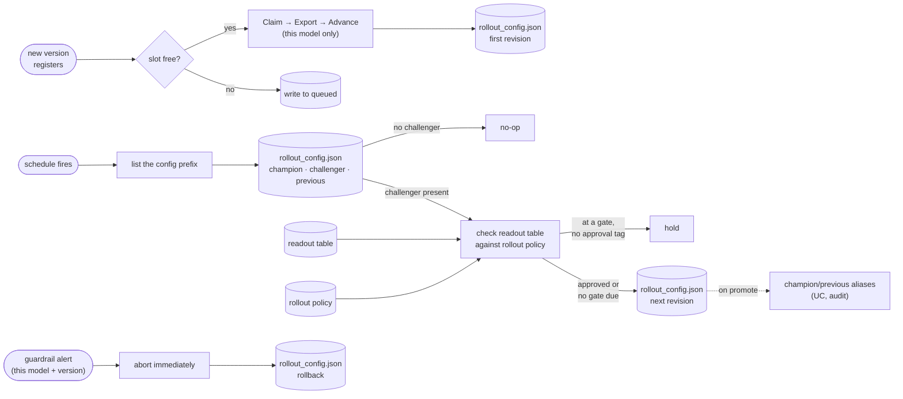
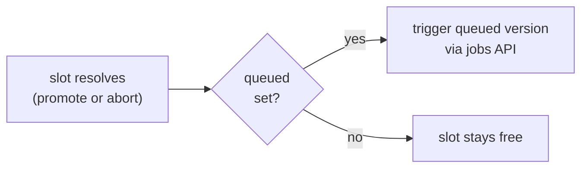

# 07 — Deployment job

The deployment job itself: what triggers it, its task structure, and
the exact writes it makes into the two touchpoints serving reads (the
artifact store and the rollout config). One job, two docs:
`06_validation_promotion.md` owns the decision logic each task runs on
(gates, thresholds, approval placement); this doc is the mechanics
only.

## Trigger

A new version registering in the Unity Catalog model registry starts
one run of the job, attached to that registered model (in Databricks
terms, a Lakeflow deployment job defined in Asset Bundles). The
attachment and that shape are our design choices; the serving repo's
adopted docs establish the job's responsibilities (evaluate, export,
advance, read out, promote or roll back) and that only it writes the
touchpoints, but specify no trigger mechanism.
Registration is the only trigger that starts a rollout — no MWAA DAG;
the schedule and alert triggers in the Execution model below only move
an already-started rollout along. Retraining cadence lives upstream:
`09_monitoring.md` owns the triggers, the training pipeline executes
them, and this job only reacts to the registration that results.

## Task structure

Five tasks. Tasks 3 and 4 loop: each pass through them is one rollout
state (fleet load at 0%, shadow, canary ramp — A/B nested inside the
ramp when the policy enables it, `06_validation_promotion.md`).

1. Claim — sets the registry's challenger alias on the newly
   registered version. There's no evaluation here: that already
   happened in training (`05_training.md`), before the version was
   allowed to register.
2. Export — publish the ONNX artifact (named per the manifest's
   `onnx.file`; convention `model.onnx` — the rollout config's
   `checksums` map is keyed by on-disk filename, so the key must equal
   `onnx.file`, and the manifest's own filename is fixed as
   `manifest.json`) and `manifest.json` to an immutable S3 path,
   `<model_name>/v<version>/`. Training (`05_training.md`) already
   produced and parity-checked this artifact as part of its own run;
   this task publishes that output, it does not re-run training or redo
   the parity check.
3. Advance — write the next rollout config revision. A rollout state is
   nothing more than a particular config content; advancing means
   writing a new revision with the next state's fields.
4. Read out — read the per-arm tables built from decision rows and
   matured labels and produce a verdict: continue to the next state,
   hold, or abort. Readout logic: `06_validation_promotion.md`.
5. Promote or roll back — on a full pass through every state, move the
   champion and previous aliases and write the final config. A
   promotion under the `proxy` evidence mode also stamps a
   `trailing_until` tag on the model version, which keeps the scheduled
   passes judging it until the full window matures
   (`06_validation_promotion.md`). On abort at any state, roll back
   instead: write a config pointing at the previous version.

Gate 2, before final promotion, is fixed by `06_validation_promotion.md`
for every policy. Gate 1, before the first live exposure (shadow to
canary), is a policy parameter — off by default. Either way, an active
gate holds the readout pass until the model version carries the
approval tag (Execution model, below).

## The writes

The job is the only writer of both touchpoints. No other process
writes them, including by hand.

Artifact store — one write per version, at export (task 2). The S3
path is immutable once written: never overwritten, never deleted. A
bad version is abandoned, not erased; the rollout config simply stops
pointing at it.

Rollout config — one write per advance (task 3) or per promote/rollback
(task 5). Every write:

- increases `revision`. The lib reacts only to a revision change, so a
  write that does not bump it is invisible to serving.
- stamps `updated_at` and `updated_by` (this job is the only writer, so
  these are the audit trail).
- validates before writing: the referenced artifact exists at its S3
  path, its checksums match the bytes actually there, the config is
  well formed. A failed validation aborts the write and the previous
  revision keeps serving.
- carries real checksums (`sha256:<hex digest>`; the lib's verifier
  compares the full string, so the format is enforced in practice even
  while the config schema itself is still draft-for-review) computed
  from the published files, never placeholder values.
- also checks that every hot feature the referenced manifest declares
  already has live keys in Redis. Not yet a contracted serving-side
  requirement: the serving repo lists a deploy-time check of a
  manifest's declared fields as a still-open need, and this implements
  the hot-feature half of it. It is also the handoff point with
  `04_features.md`'s feature-lifecycle rule: a manifest must never go
  live referencing a feature whose hot-feature job isn't running yet.

Both writes land in the same installation the Bidding Agent runs in
(`00_overview.md`'s environments: dev and prod, each its own S3 prefix
and config path). No cross-account hop; the job needs write access
scoped to the environment it is running for.

## Rollback

Rollback is task 5 taking the abort branch: write a config whose
champion points at the previous version, with a new, higher revision.
The previous version's artifact is still at its immutable S3 path,
never deleted, so rollback never re-exports anything, it only rewrites
the pointer. Every Bidding Agent process picks it up on its next poll
of the config.

## Where this runs

A Databricks job, not an MWAA DAG. MWAA orchestrates the data, feature,
and training pipelines that feed into registration; registration is
the handoff point where MWAA's responsibility ends and this job's
begins.

## Execution model

A Lakeflow deployment job is an ordinary multi-task Databricks job —
the same kind of job run the training pipeline executes as (though this
one is standing, the pipelines are submitted per run,
`08_orchestration_repos.md`), with the same compute,
environments (the Asset Bundle's wheel and dependencies), and
permissions — plus one special property: it is attached to the
registered model, so a new version registering triggers a run with the
model name and version as parameters.

The five tasks are the logical structure. Execution is one job
definition with two branches, chosen by a head condition task on the
trigger type, because a rollout spans days of bake time and no run
sleeps through them:

- registration-triggered branch — claim, export, advance (the first
  config revision); then the run exits.
- scheduled branch — one readout task: read the config state, the
  model-version tags, and the pre-aggregated per-arm tables; then write
  the next revision, write the rollback, or exit doing nothing. A
  third trigger, monitoring alerts, runs this branch's abort path
  immediately, so a guardrail breach never waits for the schedule.

Compute is declared per task, and every task here is light: registry
reads/writes, a file copy, a config write, or a query against
pre-aggregated tables. No task runs inference at the model's own
scale — that work happens in training. Serverless or a
smallest-instance node covers every task regardless of model size; an
idle pass costs seconds.

State and idempotency: no state store exists beyond the touchpoints —
the rollout config's current content is the rollout state, and the
model version's tags carry the approvals. Every pass is idempotent;
each state transition happens in its own run; a pass advances at most
one state.

Approvals are asynchronous: the approver sets a Unity Catalog tag on
the model version (`approved_canary`, `approved_promote`); a pass
holds, notifying the approver, until the tag exists. Who may set tags
is registry access control, so approval is audited for free.

The schedule is a standing property of the job definition, never
paused or mutated at runtime (the bundle stays the source of truth).
Termination is logical: a terminal config has no challenger section,
so later passes no-op — with one exception: a model version carrying an
active `trailing_until` tag is still judged by each pass (the trailing
confirmation after a proxy-mode promotion; breach writes the rollback,
expiry ends the judging). One schedule serves every model's rollout —
the pass scans all slots' configs and the trailing tags — while the
registration trigger stays per model version.

Slot discovery for the scheduled branch: list the known config prefix
— one `rollout_config.json` per model slot, sibling to that slot's
`v<version>/` artifact folders.

## Concurrency and queueing

Only one challenger per model slot. Two things can make it busy when a
new version registers: an experiment's A/B freezing promotion for days
while scheduled or alert-triggered retrains keep happening underneath
(`06_validation_promotion.md`), or the fast policy itself being slower
than the retrain cadence even with no A/B involved.

Either way, the slot-free check above is the mechanism: busy means the
new version's identity and registration time are written to `queued`
on that slot's `rollout_config.json`, and the run exits without
running claim or export — there's no free slot for either task to act
on yet. `queued` holds at most one version, not a growing backlog: a
new registration while the slot is still busy overwrites whatever was
there, it doesn't add to it.

When the slot resolves (promote or abort), the scheduled pass checks
`queued` and, if set, triggers that version's registration-branch work
through the jobs API — the same self-trigger pattern the alert branch
already uses.

Superseding happens the moment a newer version registers, not when the
slot finally resolves: if N+1 is queued and N+2 registers while the
slot is still busy, N+2 overwrites N+1 right then — N+1 is gone well
before the slot ever resolves, not filtered out afterward. It never
aborts a version that's already running its claim/export/advance or sitting through
shadow and canary — only "latest wins" among whoever is still waiting.
Aborting in-flight work instead would livelock a slot whose retrain
cadence outpaces its own bake time: nothing would ever finish.

## Open questions

1. Queue race condition: if two versions register for the same slot
   near-simultaneously, both could read the config, both see the slot
   as free, and both try to claim it. The write path already increases
   `revision` and validates before writing (The writes, above) — needs
   confirming that this actually rejects the loser and forces a retry,
   not just that revisions happen to increase under the assumption
   only one writer ever runs at a time.

Nothing else open. The environment question (one definition vs one job
per environment) is settled by `08_orchestration_repos.md`: one definition,
instantiated per environment by Asset Bundle targets.