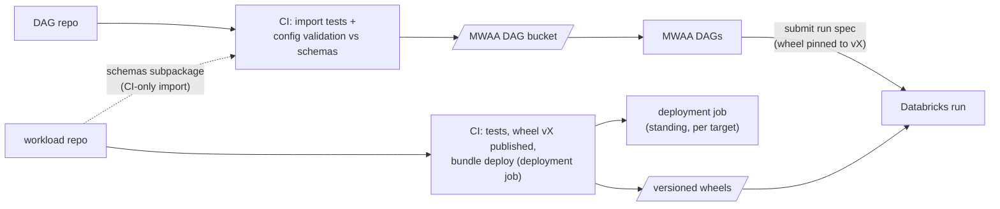

# 08 — Orchestration and repos

How code becomes running pipelines: the two repos, how pipelines are
defined and submitted, environments, CI/CD, and testing. Mechanics
only — what each pipeline does lives in its own doc.

## The two repos

The split follows one principle: the workload repo is the production
line, the DAG repo holds everything that says what gets built on it.

- Workload repo — pipeline-agnostic machinery: the versioned Python
  package (shared feature layer, cleaned ETL, label build, feature
  materialization, training pipeline stages, evaluation and readout
  logic — plus the config schemas those workloads consume), published
  as a wheel per release. It contains no job definitions and nothing
  model-specific, with one exception: the standing deployment job
  (below). Test fixtures are fixtures, not definitions.
- DAG repo — all definitions: a small framework (job-spec builders,
  parameter parsing — it renders Databricks run specs as data and never
  imports the workload package) and one folder per pipeline holding the
  DAG file, the pipeline YAML (parameters used at DAG rendering:
  schedule, compute tier, `package_version`), the model configuration
  the training run consumes, and the rollout policy the run passes
  through to the registry. Everything that defines Model A lives in its
  folder; adding Model B is a new folder, no workload change.

The MWAA parse-time environment decides the split on its own. The
scheduler imports every DAG file continuously, in its own constrained
Python environment: heavy imports slow every parse and every
development loop, a stray workload import can break the scheduler's
view of all DAGs, and changing MWAA's dependencies is a slow, risky
environment update. ML code is dependency-heavy and large — the wrong
tenant for that runtime. The workload package is never imported at
parse time; its only import into the DAG repo is the config-schema
subpackage, in CI (below).

Layouts:

```
dag-repo/                          workload-repo/
  framework/                         src/<package>/
    job_specs.py                       features/     (shared layer)
    params.py                          etl/          (cleaned)
    env.py                             labels/
  pipelines/                           training/     (pipeline stages)
    training_pixel_purchase/           evaluation/   (gate + readout logic)
      dag.py                           ingestion/    (decision-log ingest
      pipeline.yaml                      + readout-table build)
      training.yaml  (model            monitoring/   (metrics + trigger
        configuration)                   evaluation)
      rollout.yaml   (policy)          schemas/      (config schemas, light
    training_pixel_page_view/            import path: no ML deps)
    cleaned_etl/                     resources/
    labels/
    feature_materialization/           deployment_job.yml
    hot_features/                    databricks.yml  (bundle targets)
    decision_ingest/                 tests/  (incl. fixture configs)
    monitoring/     (per-model thresholds
      in its YAML)
    backfill/
  tests/
  requirements.txt  (minimal, pinned, rarely changes)
```

## Pipelines are submitted, not pre-created

The framework renders each run's full Databricks job spec at trigger
time — tasks, compute from the pipeline YAML's tier, the wheel pinned
to the YAML's `package_version` — and submits it through the Airflow
Databricks provider (submit and wait for terminal state). No standing
job objects exist for the pipelines; a pipeline is its folder.

Version coupling is explicit: a run executes exactly the package
version its pipeline pins, so deploying a new workload release changes
nothing until a pipeline opts in. One model can adopt a new version
while another stays. The inter-repo contract is therefore the workload
entry-point signatures and config schemas, versioned with the package
itself; changing them is a release plus a per-pipeline YAML bump — two
reviews by design, no deploy-ordering window.

| DAG | Trigger / cadence | Workload entry points | Depends on |
|---|---|---|---|
| cleaned ETL | inbound cadence per dataset (hourly/daily tiers) | etl | curated data arrival (sensor) |
| labels | daily, after attribution lands | label build | cleaned attribution + impressions |
| feature materialization | per bucket cadence | materialization | cleaned partitions |
| hot features | ~10 min | hot-feature compute | cleaned (freshness floor) |
| training (one per model) | `09_monitoring.md`'s triggers + manual | training pipeline stages | matured labels + feature tables |
| decision-log ingest + readout tables | ~30 min (proposal, `09_monitoring.md`) | ingestion and readout workloads | decision-log landing zone |
| monitoring | daily, after ingest and label maturation (`09_monitoring.md`) | monitoring workloads (metrics + trigger evaluation) | decisions, readout tables, matured labels |
| backfill | manual, parametrized (workloads, range) | the affected workloads, in dependency order | — |

The backfill DAG exists for the events that rewrite history: the client's
attribution reprocessing (rebuild cleaned attribution → labels →
downstream for the affected range, `02_datasets.md`), a new feature
definition version needing its history materialized
(`04_features.md`), or a fix in our own logic. It runs the same
workloads as the scheduled DAGs — reruns and backfills are the same
idempotent partition overwrite, only the range differs — but chains
them across pipelines for one range as a single operation.

Pipeline contents per doc: cleaned layer `02_datasets.md`, labels
`03_labels.md`, materialization and hot features `04_features.md`,
training `05_training.md`, decision ingest with the readout-table
build, and monitoring `09_monitoring.md`. The materialization,
hot-feature, decision-ingest, and monitoring pipelines are single DAGs
parametrized over the models: per-model ownership lives in the data
(each model's key prefixes, `derived.feature_<model>_*`, and
`derived.readout_<model>` tables), not in DAG multiplicity.

## Configs and how they reach their consumers

- Definitions live in the DAG repo (per-pipeline YAMLs); their schemas
  live in the workload package, because the code that consumes a config
  owns its shape. The model configuration's contents are
  `05_training.md`'s; the rollout policy's (evidence mode, gate
  thresholds, bake times, traffic percentages, guardrail bounds) are
  `06_validation_promotion.md`'s. The rollout policy defines how
  the rollout works (the deployment job's input, read from the
  registry); the rollout config is the rollout's current state (the
  serving touchpoint the job writes to S3).
- The DAG passes the workload YAMLs to the run; the run validates them
  against its own schemas at start.
- The training run registers the resolved model configuration and
  rollout policy with the model version (`05_training.md`). Runtime
  consumers that are not DAG-triggered — the deployment job — read them
  from the registry, never from the DAG repo.

## The deployment job

The one standing Databricks job, created from the one bundle in this
repo (the bundle is the job's definition files, not the job itself). It
is factory machinery: generic, model-agnostic, its per-model inputs
arriving from the registry — so it belongs to the workload repo.
`resources/deployment_job.yml` defines the job: its two execution
branches, picked per run by the trigger (registration → claim,
export, first advance; schedule → one readout pass that advances,
holds, or aborts — `07_deployment_job.md`, Execution model), the
per-task compute (every task is light — no task runs inference at the
model's own scale, that happens in training), and the schedule. A third
trigger exists at runtime: a monitoring alert (`09_monitoring.md`)
starts a run of this same job through the jobs API, executing the
abort path immediately instead of waiting for the next scheduled pass.
`databricks.yml` declares the dev and prod targets. The workload repo's
CI deploys it with the bundle per target; it runs the wheel its release
shipped, which is correct for machinery. One definition, instantiated
per environment by the bundle targets settles
`07_deployment_job.md`'s environment question. Attaching it to a newly
created model slot happens once, at the slot's first registration, from
the training pipeline.



## Environments

dev and prod. Working assumption: both live in the same AWS account —
separate S3 prefixes, possibly one MWAA instance per environment, and
separate Databricks environments; whether prod ends up in its own
account is open. The design does not hinge on it: every environment
parameter (catalog `ml_dev`/`ml_prod`, S3 prefixes, config paths,
workspace) comes from the framework's environment config and the bundle
targets, so an account split later changes deployment targets and the
read grants the client extends, not the design. Pipeline YAMLs may pin different `package_version` per
environment, so prod stays on a known release while dev tracks the
latest. The deployment job is instantiated per environment by its
bundle targets. Whether dev gets its own MWAA instance folds into the
standing client question of reusing the client's MWAA versus running our own.

## CI/CD

- Workload repo: lint + unit tests (including the light-import check:
  importing `schemas` must pull no ML dependencies) → build the wheel →
  publish it versioned (lean: a Unity Catalog volume) → bundle deploy
  of the deployment job to dev → smoke run on fixtures → prod on main.
- DAG repo: DAG import tests (parse must succeed without the workload
  package installed), config validation of every pipeline's YAMLs
  against the workload package's schemas (a CI-only import of the
  schema subpackage — never at DAG parse time), dependency assertions →
  sync to the environment's MWAA bucket. The bucket and requirements
  mechanics assume our own MWAA instance (the directed working
  assumption); under reuse of the client's instance those objects belong to
  their Terraform and our CI targets change accordingly.
- Secrets: one service principal per environment for Databricks and
  Unity Catalog; one MWAA-to-Databricks connection per environment; no
  secrets in either repo.

## Testing

- Workload units: feature definitions against golden vectors (including
  fixed-point key-rendering cases, `04_features.md`); label-build join
  and maturity edges; calibration math (the closed-form base-rate
  correction has an exact expected output); config schema validation
  against fixtures.
- Integration, in dev: each workload submitted against `ml_dev`
  fixtures; the training pipeline end to end on a small snapshot — the
  export parity gate executes inside it by construction.
- DAG repo: parse tests, config-vs-schema validation, dependency
  assertions. No business logic lives there to test.

## Open questions

1. MWAA: reuse the client's instance or run our own — the standing client
   question; decides where DAG code deploys and whether dev gets its
   own instance.
2. CI tooling: the client's core-app practice (CodePipeline) versus
   GitHub Actions; includes where versioned wheels are published (Unity
   Catalog volume is the lean).
3. Dev data: fixtures only, or a sampled slice of the curated datasets
   — gated on the privacy compliance review (`PLAN.md` open question 4)
   and the DE lane's access mechanics.
4. Repo hosting: the client's organization or ours.
5. Account topology for dev versus prod: same account (the working
   assumption) or separate accounts. Low design impact — it moves
   deployment targets, plus the cross-account read grants the client would need
   to extend to the new account — but tracked until settled.