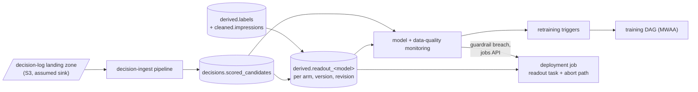
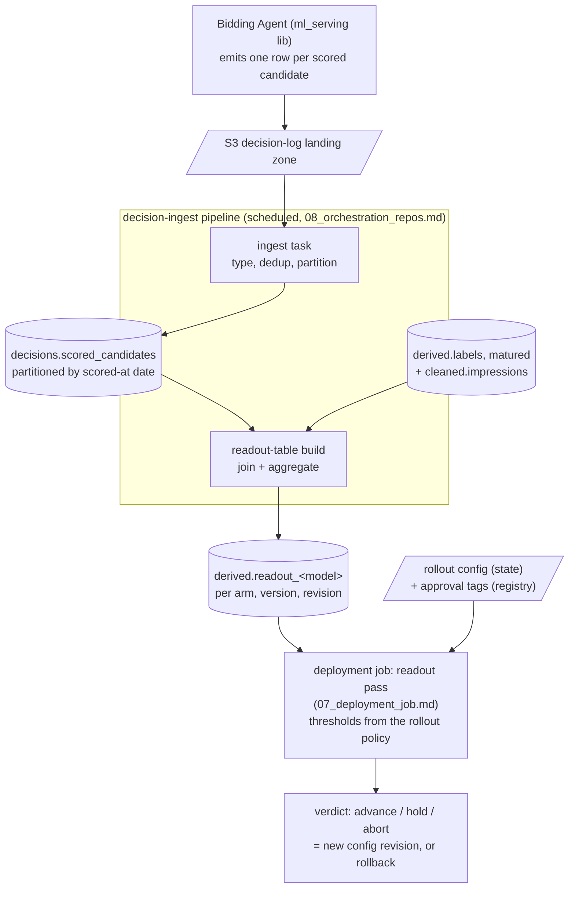
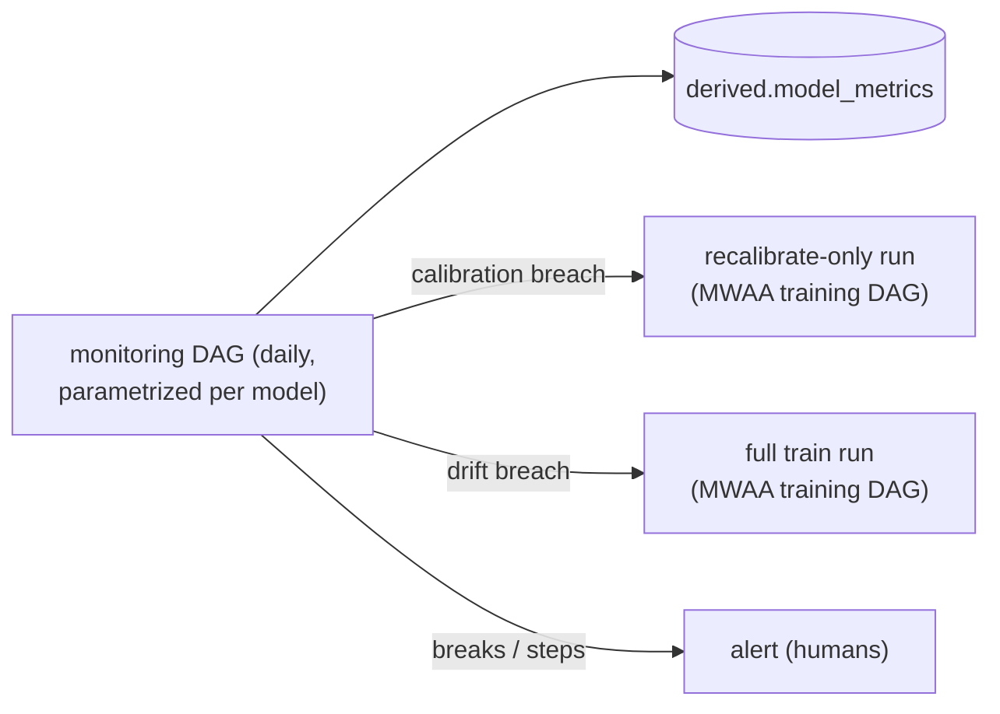

# 09 — Monitoring and decision-log ingestion

The loop-closing doc: ingest what serving emits, measure models and
pipelines, and decide when training runs again. Everything this doc
triggers is specified elsewhere — the training pipeline in
`05_training.md`, the verdict logic in `06_validation_promotion.md`,
the deployment job in `07_deployment_job.md`, the scheduling in
`08_orchestration_repos.md`. This doc owns the datasets built from
decision rows, the metrics, the alerts, and the triggers.

## Decision-log ingestion

Rows land in the S3 landing zone (which sink the Bidding Agent wires
the lib's logger to is the serving side's open choice; S3 is the
working assumption). The decision-ingest pipeline — scheduled and
defined like every other pipeline (`08_orchestration_repos.md`), every
30 minutes as the proposal — loads them into
`decisions.scored_candidates` (`02_datasets.md`): typed, deduplicated,
partitioned by scored-at date. The cadence keeps canary and shadow
readouts fresh during rollouts. Rows join served impressions and labels
by (`request_id`, `candidate_id`).

Retention: decision rows are kept for the replay and readout horizon —
long enough to replay against the longest attribution window plus the
rollout's trailing confirmation. Proposal: 3 months, sized against real
volumes before prod (`02_datasets.md` defers the number here).

## Per-arm readout tables

`derived.readout_<model>` — aggregates per model, version, arm, and
config revision, computed from decision rows joined with matured
labels: row counts, score-distribution statistics, realized conversion
rate per window, predicted-versus-realized calibration by decile, and
the observed arm shares the sample-ratio check reads.

Two steps share the word "readout". Naming them precisely:

| Name | Runs where | Reads | Writes / produces | Never does |
|---|---|---|---|---|
| readout-table build | task in the decision-ingest pipeline (this doc, scheduled per `08_orchestration_repos.md`) | `decisions.scored_candidates`, matured labels, impressions | `derived.readout_<model>` (incremental refresh of touched partitions) | decide anything |
| readout pass | the deployment job (`07_deployment_job.md`) | `derived.readout_<model>`, rollout-config state, approval tags | verdict — advance / hold / abort — as a config write, per the rollout policy (`06_validation_promotion.md`) | aggregate anything |

The trailing confirmation is the readout pass judging a promoted model
whose version carries an active `trailing_until` tag (stamped by the
promote task after a proxy-mode promotion): the full window's maturing
labels, rollback armed, until the tag expires.

The detailed dataflow — who produces what, where it lands, who reads
it (cylinders are tables, parallelograms are S3 objects, rectangles are
jobs or tasks):

Defaulted-feature rates come from the scored-versus-default flag each
decision row carries: the share of candidates scored with at least one
defaulted feature, per arm.

## Model monitoring

One monitoring DAG, parametrized over the models like the hot-feature
pipelines (`08_orchestration_repos.md`), scheduled daily after ingest
and label maturation. Per model it computes metric rows into
`derived.model_metrics` — one row per model, metric, cut, and day —
then evaluates each metric against its thresholds and fires the mapped
action. Thresholds live in the monitoring pipeline's workload YAML,
one entry per model (a per-model definition, so the DAG repo holds it;
`08_orchestration_repos.md`); reference distributions come from the
training run's logged artifacts (`05_training.md`).

| Metric | Computed from | Method | Threshold rule → action |
|---|---|---|---|
| calibration | champion decision rows joined with matured labels, per window | reliability by decile + expected calibration error; cuts: advertiser tier, campaign, time slice | error beyond bound for N consecutive days → recalibrate-only run; persistently high per-advertiser-tier error → flag for advertiser-layer activation (human review, `05_training.md`) |
| score drift | live score distribution from decision rows vs. the training run's logged holdout distribution | population stability index (a bucketed divergence score) | sustained drift beyond bound → a full train run + alert |
| input drift | logged inputs and hot-feature values vs. the training run's logged input distributions | per-feature divergence + null shares | sustained drift on high-importance features → a full train run; a single broken feature → alert the feature pipeline, no retrain |
| defaulted-feature rate | the scored-versus-default flag per candidate | share of candidates defaulted, per model over time | step change → alert (a feature job or the agent's fields drifted from the manifest); never a retrain trigger |
| cost per action | readout tables, per goal | realized cost against the goal, as an expected-performance signal (never a guarantee of observed CPA per period — the client's framing) | reported only; business signal, not a trigger |

## Data-quality monitoring

The checks the other docs assigned, owned here: each lands in 
`derived.data_quality` (one row per check, dataset, and day). Recording
is distributed, judging is centralized: each data-producing pipeline
(cleaned ETL, label build, materialization, hot features) records its
own numbers as the last step of its run — the table's "Written by"
column — while the monitoring DAG computes the two checks that are no
pipeline's byproduct and alone evaluates every alert rule. Those two
guard the feed itself: freshness catches data not arriving (newest
partition age vs. the expected cadence, per dataset), reconciliation
catches data arriving wrong (our cleaned totals vs. The client's own hourly
rollups, on normalized units). The training pipeline and the deployment
job write nothing here. No separate data-quality DAG exists.

| Check | Written by | Computed from | Rule → action |
|---|---|---|---|
| inbound schema conformance | cleaned ETL, per run | inbound columns and types vs. the expected schema per curated dataset | mismatch → alert; the affected partitions do not load |
| inbound-feed freshness (`01_data_access.md`) | monitoring job, daily | latest partition age per curated dataset vs. The client's proposed cadence | age beyond cadence + margin → alert |
| orphan-conversion rate (`03_labels.md`) | label build, per run | conversions whose impression key matches no impression row, per day | rising rate → alert: the impressions and attribution feeds disagree about what was served |
| null-`ad_id` share (`03_labels.md`) | label build, per run | attribution rows with null `ad_id`, per day | tracked and reported with rollups; alert on step change |
| label coverage per goal | label build, per run | matured impressions and positive labels per goal and window, per day | collapse in volume or positives → alert: measurement or feed problem upstream of any model |
| reconciliation (`02_datasets.md`) | monitoring job, daily | cleaned totals vs. the aggregate performance dataset, on normalized units | divergence beyond tolerance → alert: a cleaned pipeline or the inbound feed is wrong |
| feature-table staleness (`04_features.md`) | materialization pipeline, per run | latest bucket age per model and grain | lag beyond the bucket cadence → alert |
| Redis keyspace health (`04_features.md`) | hot-feature pipeline, per run | key count per model prefix vs. expected combinations | shrinking count → priority alert: a hot-feature job is failing and serving is silently defaulting |

## Pipeline alerting

DAG and job failures, run-duration anomalies, and every freshness or
data-quality breach above alerts; hot-feature job failures alert with
priority, because their failure mode is silent defaulting in serving.
Routing lean, not decided: one pane consistent with the client's stack
(CloudWatch alarms, Slack routing, Datadog APM), fed by Databricks and
MWAA alerting — the client expects the bidder's monitoring to be
managed independently, so the choice is ours; Databricks-native SQL
alerts are the fallback shape if a second pane is acceptable.

Rollout guardrails on serving health have a named producer: alert rules
we define in the observability stack, whose action starts the
deployment job's abort path through the jobs API
(`07_deployment_job.md`). They never route through the daily monitoring
job.

## Retraining triggers

This doc owns when training runs; the pipeline executes
(`05_training.md`). Two kinds: a scheduled cadence per model, set in
the pipeline YAML (`08_orchestration_repos.md`), and the
degradation triggers from the model-monitoring table above
(calibration breach → recalibrate-only; drift breach → a full train
run, or tune and train per the model's tuning spec; threshold values
set at EDA). Mechanically, the monitoring workload records the verdict
and the monitoring DAG triggers the model's training DAG in MWAA. Guardrail breaches during a rollout
take the faster path: they start the deployment job's abort branch
directly through the jobs API (`07_deployment_job.md`), never waiting
for a readout schedule.

## Bidder response dataset

The outbound dataset the client proposed, with a stated need for visibility
into how the bidder decided. Assembled as a derived table plus an
export job on the same pipeline mechanics: our
`decisions.scored_candidates` provides the model side (scores, model
version, timestamps, candidate identity, with the client and DSP ids as
output columns via the identity triplets); the Bid Decision service's
own logs provide the bid side (bid price, bid/no-bid, no-bid reason)
and the agent supplies latency and the selected strategy; the shared
request and candidate ids stitch them. Assembly crosses lanes, since
the agent side owns its fields, and the client's required field list and
cadence are still their call.

## Open questions

1. The decision-log sink: which store the Bidding Agent wires the
   lib's logger to. S3 is the working assumption everything above
   builds on.
2. Alert routing: the single pane for the bidder account's monitoring
   (the client manages the bidder's monitoring independently of the client's) —
   lean stated above.
3. Drift and degradation thresholds, and the minimum volumes behind
   them — set at EDA.
4. Bidder response dataset: required fields, cadence, and consumers —
   the client's call, plus the bid-decision lane's fields.
5. The decisions retention horizon — the 3-month proposal needs real
   volumes (readout and monitoring tables follow the derived layer's
   retention rule, `02_datasets.md`).
