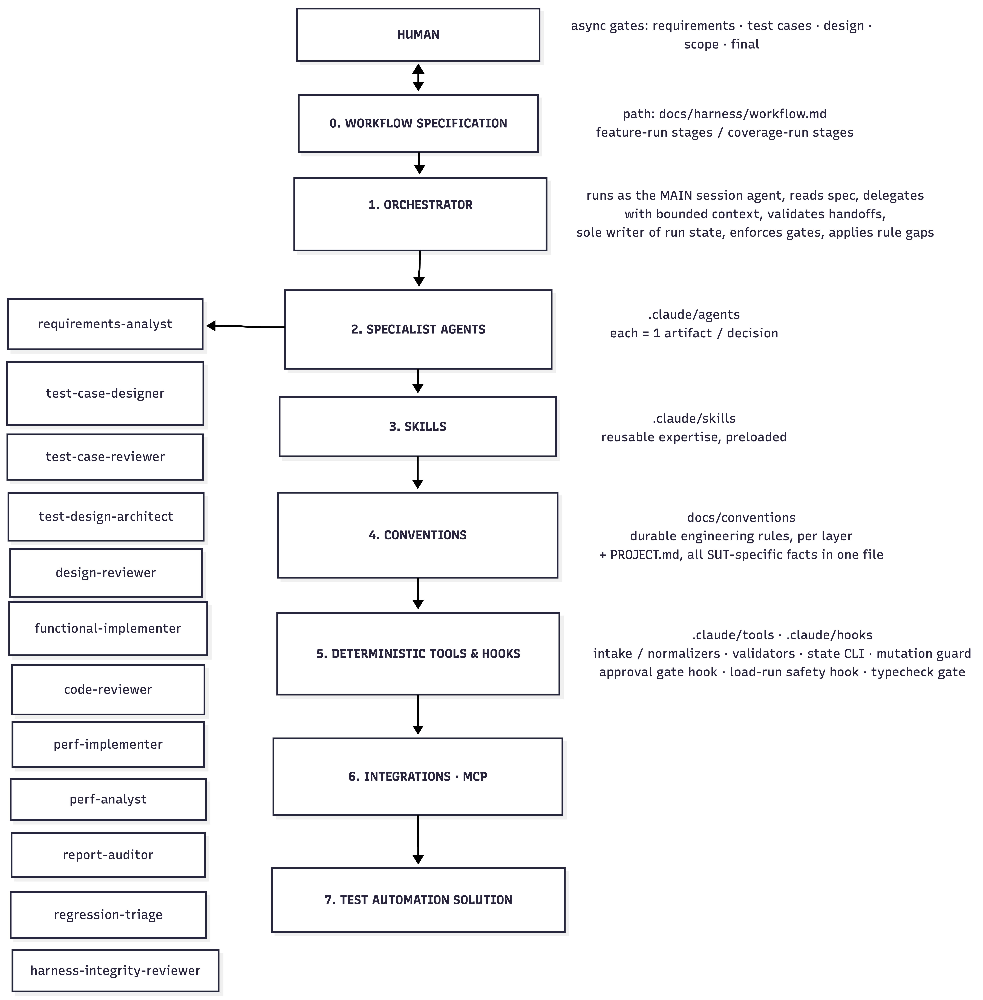
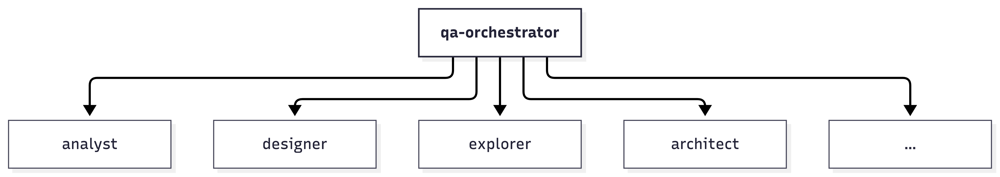
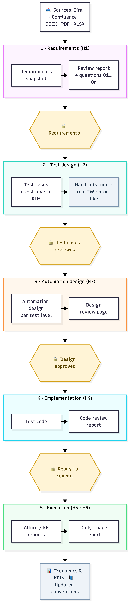
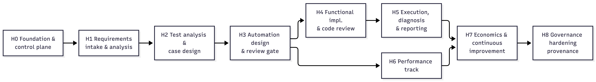

## 1. Purpose

The AI harness is an **agentic layer on top of the Test Automation solution** that uses Claude Code to carry testing work from **raw requirements to reviewed, running, reported automated tests**. Human approval gates sit at every decision that matters.

It does not replace TA engineers. It removes repetitive analysis and authoring work, makes every decision traceable, and keeps humans in control of what is tested, how, and what ships.

The harness serves the Test Strategy objectives directly:

|  |  |
|----|----|
| **Strategy objective / principle** | **How the harness contributes** |
| *Detect defects as early as possible* / *shift-left* | Requirements are analysed for testability **before** development. Ambiguities, missing ACs and unmeasurable NFRs come back as structured questions to Product, Architecture or SRE. |
| *Risk-based testing* | Each requirement gets a risk rating and an allocation to a test level, with a recorded rationale. |
| *Test at the lowest effective level* | An explicit **test-level allocation** step chooses unit, component/integration, E2E-emulator, UI, performance, real-ad-server or production-like, and records why. |
| *Unclear or incomplete acceptance criteria* (strategy risk) | The requirements gate refuses to progress while BLOCKING questions are open. |
| *Measurable quality gates* | Every harness stage ends in a checkable artifact plus a human decision, and the run state records it. |
| *Continuous improvement* | A rule-gap loop turns every correction into a durable convention, and economics and KPI tracking measure the effect. |

## 2. Scope: what the harness covers per test level

The harness covers **all planned test levels**. For some it automates; for levels owned by other teams it *allocates and hands off*.

|  |  |  |
|----|----|----|
| **Test level (from strategy)** | **Owner** | **Harness role** |
| Unit testing | Dev Team | **Allocate + hand off.** Requirements allocated to unit level are exported as a checklist or Jira sub-tasks for the Dev team. The harness does not write unit tests (optional later extension). |
| Component / Integration (Redis, Model Registry, pipelines, API/protobuf contracts) | TA Engineer | **Full cycle:** analyse → design → implement (@tests/functional, Playwright test runner, API/gRPC clients) → run → report |
| E2E functional (deterministic ad-server emulator) | TA Engineer | **Full cycle** |
| UI (Admin portal) | TA Engineer | **Full cycle** (page objects plus live-UI exploration via Playwright MCP) |
| Performance & reliability (latency, load, stress, spike, soak, degraded dependency) | TA Engineer (+Dev, SRE) | **Full cycle (separate track):** workload design → k6 implementation (@tests/performance) → controlled run → analysis against NFR thresholds and baseline |
| Real ad-server integration | the ad-server vendor's integration team | **Allocate + hand off:** a scenario checklist plus traceability |
| Production-like / real-traffic (shadow, canary, blue/green, progressive) | Shared TA/ML/SRE | **Allocate + hand off:** KPI and rollback-criteria checklists traced to requirements |
| Cross-cutting: data quality, model validation, contract, fallback, resilience | — | Treated as **analysis dimensions** in requirements review and test design, never as a separate level (aligned with the strategy) |

## 3. Design principles

1.  **One authoritative workflow specification.** A single document defines the stages, their order, owners and gates. Agents execute it; skills never redefine it.

2.  **Orchestrator as hub, specialists as spokes.** Only the orchestrator delegates. Specialists never call each other, and context is passed explicitly, never "discovered" on disk.

3.  **Bounded specialists.** Each agent owns one artifact or decision, has the minimal tool grant, and preloads one skill that holds its expertise.

4.  **Durable, deterministic state.** A run state file records exactly where a run is (stage / substep / status), so work can resume days later in a new session.

5.  **Structured handoffs.** Every delegated result returns a small versioned envelope, and the orchestrator validates it before accepting a stage.

6.  **Human gates are real gates.** Approval is explicit and asynchronous; silence is never approval. No test code is written before the test design is approved.

7.  **Governance is mechanical where it matters.** Hooks enforce who may write what and which commands may run (e.g. load tests only against allowlisted environments). Prose rules cover the rest.

8.  **Project facts live in one file.** PROJECT.md holds every SUT-specific fact. Conventions stay generic and portable.

9.  **Every correction becomes a rule.** Specialists propose rule gaps; the orchestrator applies them to the conventions; the next run benefits.

10. **Measured from day 1.** Every run records minutes, prompts, corrections and token cost against a **manual baseline**, so ROI is evidence, not opinion.

## 4. Architecture

### 4.1 Layers

### 

### 

### 4.2 Four concepts that must never be merged

|  |  |  |
|----|----|----|
| **Concept** | **What it is** | **Owner** |
| **Workflow spec** | Which transition is allowed next | docs/harness/workflow.md |
| **Handoff envelope** (qa-agent-handoff/v1) | Result and status of *one* specialist invocation | Each specialist returns it; the orchestrator validates it |
| **Run state** (feature-run/v1, coverage-run/v1) | Durable current position of *the whole run* | Orchestrator only, through the state CLI |
| **Task UI** | User-visible projection of run state | Orchestrator |

### 

Domain artefacts (requirement reviews, test cases, designs, code, reports) are human-readable files. They are never replaced by JSON metadata.

### 4.3 Hub-and-spoke

**NEVER: explorer ──► architect (no specialist-to-specialist calls)**

The orchestrator selects verified facts and evidence references from one handoff and passes them into the next delegation. A shared filesystem is storage, not a message channel.

The orchestrator runs as the **main session agent** (claude --agent qa-orchestrator), not as a subagent, for two reasons:

1.  Claude Code subagents cannot spawn further subagents.

2.  An asynchronous human gate needs the human's next message to reach the orchestrator directly.

### 4.4 Two run types

|  |  |  |  |
|----|----|----|----|
| **Run** | **Unit of work** | **Stages** | **Produces** |
| **Feature run** (fr-\*) | A feature, epic or requirement set (Jira epic, Confluence page, document) | fr-1 intake & normalization → fr-2 requirements analysis & **async requirements gate** → fr-3 test analysis & **level allocation** → fr-4 test-case design & review → fr-5 automation selection & hand-offs | Requirements review, clarification log, RTM, test cases per level, critical-flow inventory, hand-off lists, and the list of items for automation |
| **Coverage run** (cr-\*) | One test item (or a small cohesive group) selected at fr-5 | cr-1 init/branch → cr-2 automation design (+ contract/browser exploration) → cr-3 **design review gate** → cr-4 impact scan & **scope approval** → cr-5 implementation + typecheck gate + code review → cr-6 run & diagnose → cr-7 report audit → cr-8 cost review & **final approval** → cr-9 economics → cr-10 commit + PR | Reviewed design, approved code, passing test, audited report, metrics, PR |

### 

Performance items use the same cr-\* spine, with perf-specific specialists (perf-implementer, perf-analyst) and an extra safety gate around load execution.

### 4.5 Artifact flow

## 5. Harness parts (incremental build units)

Each part is a **build increment**. Every increment delivers value on its own, is usable standalone (a human can call its agent directly), and extends the workflow spec with its stages. Each also brings its own **governance slice** (§6) and **KPIs** (§10).

<table>
<colgroup>
<col style="width: 12%" />
<col style="width: 17%" />
<col style="width: 35%" />
<col style="width: 19%" />
<col style="width: 15%" />
</colgroup>
<tbody>
<tr>
<td><strong>Phase</strong></td>
<td><strong>Purpose</strong></td>
<td><strong>Deliverables</strong></td>
<td><strong>Standalone value</strong></td>
<td style="text-align: left;"><strong>Efforts, days</strong></td>
</tr>
<tr>
<td><h3 id="h0-foundation-control-plane">H0 — Foundation &amp; control plane</h3></td>
<td style="text-align: left;">The skeleton every later part plugs into.</td>
<td style="text-align: left;">The project's working setup for Claude Code: one place for all SUT facts, the workflow rules, and connections to Jira/Confluence and the browser. A lightweight orchestrator, a tool that tracks the state of every run, and guards that stop agents from changing files they don't own.</td>
<td>A consistent, resumable working environment, with metrics captured from the first day.</td>
<td style="text-align: left;">4</td>
</tr>
<tr>
<td><h3 id="h1-requirements-intake-analysis">H1 — Requirements intake &amp; analysis</h3></td>
<td style="text-align: left;">Turn requirements from any source into a testability review with actionable questions, before development.</td>
<td style="text-align: left;">Requirements are read from Jira, Confluence or documents and checked for testability, including whether NFRs such as latency and throughput are measurable. The output is a review report with clear BLOCKING / NON_BLOCKING questions. The work waits for human answers and approval before continuing, and every answer is recorded.</td>
<td style="text-align: left;">A requirements review service for every backlog item, usable well before any automation framework exists. It directly mitigates the strategy risks "Unclear or incomplete acceptance criteria" and "Undefined performance requirements".</td>
<td style="text-align: left;">5-7</td>
</tr>
<tr>
<td><h3 id="h2-test-analysis-test-case-design">H2 — Test analysis &amp; test-case design</h3></td>
<td style="text-align: left;">Derive risk-based test conditions and allocate each one to the lowest effective test level.</td>
<td style="text-align: left;">Test cases produced with standard test design techniques, each assigned to the right test level, with a traceability matrix back to the requirements. An independent AI review checks the test cases before a human accepts them. Hand-off lists go to the teams that own unit, real-ad-server and production-like testing.</td>
<td style="text-align: left;">A traceable test basis for manual testing and Dev-team unit coverage, and a basis for sizing the automation backlog.</td>
<td style="text-align: left;">3-5</td>
</tr>
<tr>
<td><h3 id="h3-automation-design-review-gate">H3 — Automation design &amp; review gate</h3></td>
<td style="text-align: left;">Convert reviewed test cases into an automation design grounded in real interfaces, approved by a human before any code is written.</td>
<td style="text-align: left;">An automation design for each test level, based on the real service contracts and Admin UI. A review page shows manual and automated steps side by side for human approval. No test code can be written until the design is approved.</td>
<td style="text-align: left;">Reviewed designs make automation effort predictable and expose testability gaps (missing hooks, missing observability) early, while Dev team can still fix them cheaply.</td>
<td style="text-align: left;">5-8</td>
</tr>
<tr>
<td><h3 id="h4-functional-implementation-code-review">H4 — Functional implementation &amp; code review</h3></td>
<td style="text-align: left;">Generate framework-conformant code in @tests/core and @tests/functional.</td>
<td style="text-align: left;">The functional test framework (API/gRPC clients, test data, emulator control, UI page objects, reporting), set up once. Tests are generated from the approved design, then pass an automatic type and lint check and an AI code review before a human approves the commit.</td>
<td style="text-align: left;">The first automated tests per level, built to consistent conventions.</td>
<td style="text-align: left;">6-10</td>
</tr>
<tr>
<td><h3 id="h5-execution-diagnosis-reporting">H5 — Execution, diagnosis &amp; reporting</h3></td>
<td style="text-align: left;">Make results trustworthy, not merely green, and keep the regression signal reliable.</td>
<td style="text-align: left;">Test runs whose failures are classified by cause (test, product, environment or requirement problem), with only test defects fixed automatically and within limits. PR smoke and nightly regression pipelines. A daily AI triage report that groups failures, tracks flaky tests and drafts bug reports for human approval.</td>
<td style="text-align: left;">Supplies the strategy KPIs "Flaky test rate" and "Regression execution reliability", and reduces morning triage time.</td>
<td style="text-align: left;">4-6</td>
</tr>
<tr>
<td><h3 id="h6-performance-track">H6 — Performance track</h3></td>
<td style="text-align: left;">The same disciplined flow for performance and reliability testing.</td>
<td style="text-align: left;">The k6 performance framework, with thresholds linked to the NFRs and a weekly performance pipeline. AI analysis of each run against thresholds and the previous baseline. A safety rule that allows load tests only against approved environments.</td>
<td style="text-align: left;">Repeatable performance evidence for the P99 &lt; 10 ms and throughput requirements, and early detection of performance regressions.</td>
<td style="text-align: left;">5-8</td>
</tr>
<tr>
<td><h3 id="h7-economics-metrics-continuous-improvement">H7 — Economics, metrics &amp; continuous improvement</h3></td>
<td style="text-align: left;">Prove and steer value.</td>
<td style="text-align: left;">Effort and cost tracking for every run, compared with the manual baseline, shown in an ROI dashboard and fed into the strategy KPIs. Lessons from each run are turned into updated conventions.</td>
<td style="text-align: left;">Management-ready ROI evidence and visible continuous improvement.</td>
<td style="text-align: left;">2-4</td>
</tr>
<tr>
<td><h3 id="h8-governance-hardening-provenance">H8 — Governance hardening (provenance)</h3></td>
<td style="text-align: left;">An audit-grade trail for decisions that might be contested: approvals, scope exclusions, clarifications.</td>
<td style="text-align: left;">A tamper-resistant record of every human decision and review. An independent check that each recorded decision matches what the person actually said. A separate maintenance mode for harness changes, and automated self-tests of the harness.</td>
<td style="text-align: left;">Compliance and auditability, and lower risk when many people and agents work in parallel.</td>
<td style="text-align: left;">4-6</td>
</tr>
</tbody>
</table>

## 6. Governance model — distributed across stages

Governance is **not a final phase**. Each part ships the controls its own new capability needs. H8 only adds the forensic and provenance layer on top.

|  |  |  |  |
|----|----|----|----|
| **Slice** | **Introduced with** | **What it guarantees** | **How it is enforced** |
| **G0** | H0 | Each agent may change only the files it owns. Nobody changes the harness itself (agents, rules, workflow) while a run is in progress. Only the orchestrator records the run's progress, and every agent result is checked before it is accepted. | A hook blocks any file change outside the agent's zone. Run progress can only be changed through the state tool. |
| **G1** | H1 | Nothing moves forward without explicit human approval: silence is never approval. Approval is refused while a BLOCKING question is open. Every finding becomes a question, and every human answer is recorded word for word. Nothing is posted to Jira or Confluence without approval. | A validator rejects incomplete review reports. The state tool refuses an approval while a blocking question is open. Agents have no permission to write to Jira or Confluence. |
| **G2** | H2 | Reviewers only point out problems; they never rewrite the work themselves. An approval is valid only for the exact version reviewed: any later change cancels it. Every test-level choice has a written reason. | The state tool checks the reviewed version. Reviewer agents cannot edit the artifacts they review. |
| **G3** | H3 | No test code is written before a human approves the design. Exploring the SUT is read-only. | A hook blocks code changes until the current design is approved, and blocks them again if the design is edited afterwards. |
| **G4** | H4 | Code changes stay within the scope the human approved; changes to shared framework parts need separate approval. Code passes an automatic type and lint check and a code review before commit. Nothing is committed without final human approval. | File-ownership rules, orchestrator checkpoints and the PR template. |
| **G5** | H5 | Every failure diagnosis is backed by evidence. Tests are never weakened to make them pass. Product code is never touched. Automatic fixes are limited to 3 attempts. Bug reports reach Jira only after human approval. | The SUT code is outside every agent's write zone. The attempt count is recorded in the run state. |
| **G6** | H6 | Load tests run only against approved environments, with human approval and recorded parameters (load level, duration). No load is ever sent to shared or production environments. | A hook blocks any k6 run whose target is not on the allowlist in PROJECT.md. |
| **G7** | H7 | ROI figures come from one consistent source; rates and metrics are never duplicated or edited by hand. | Schema validation; only the orchestrator writes metrics. |
| **G8** | H8 | Every human decision and review leaves a tamper-resistant record. An independent check confirms that each recorded decision matches what the person actually said. Harness maintenance happens only in a separate mode that a human must switch on. | Hooks capture reviewer evidence directly from Claude Code. An integrity-reviewer agent checks the recorded decisions. |

A guard is a **repository mutation boundary, not an OS sandbox**. Bash-capable agents are additionally bound by behavioural rules in their definitions, and that limitation is documented explicitly.

## 7. Integration with the CI execution approach

|  |  |
|----|----|
| **CI tier (strategy)** | **Harness contribution** |
| **PR smoke** | Tags assigned at design time (@smoke, @component:\<svc\>) drive selection. regression-triage can comment a classification on red PR runs (optional). |
| **Nightly regression** | regression-triage produces a morning triage report with failure classification, flaky list, new and recurring failures, and draft defects. The output feeds the KPIs *Flaky rate* and *Regression reliability*. |
| **Weekly performance** | perf-analyst compares the run against thresholds and the previous baseline and produces a regression verdict and report. |
| **Real ad-server / production-like stages** | The harness supplies traced scenario and KPI checklists (from H2). Execution stays with the owning teams. |

## 

## 8. Mapping to strategy KPIs

|  |  |
|----|----|
| **Strategy KPI** | **Harness data source** |
| Production issues & root-cause statistics → "earliest stage that could have detected it" | RTM plus level allocation make it possible to answer "was this requirement covered, and at which level?" |
| Unit test coverage | Unit hand-off list (H2) gives the *expected* unit coverage scope per component |
| Critical flow / integration coverage | Critical-flow inventory (H2) is the denominator; automated & passing items (H4/H5) are the numerator |
| PR validation feedback time | Smoke tag discipline (H4) keeps the smoke scope deliberately small |
| Flaky test rate | Reproducibility axis (H5) plus regression-triage history |
| Regression execution reliability | Classification split between product, environment and automation (H5) |

## 

## 9. Built-in lessons from a previous harness implementation

These lessons come from building a similar harness on an earlier project. They are designed in from day 1 instead of being retrofitted.

|  |  |
|----|----|
| **Lesson** | **Built-in response** |
| A large "do-everything" skill became a second, competing definition of the process. | The workflow spec is the only authority. Skills are expertise, and entry-point skills only delegate. |
| Ad-hoc agent output formats let incomplete results slip through. | The versioned handoff envelope is mandatory from H0 and validated by the orchestrator. |
| A flat "current step number" could not tell running, waiting, blocked and failed apart, so resume was guesswork. | State carries current = {stage_id, substep, status, reason, waiting_on} with a fixed status vocabulary from H0. |
| MCP tools were deferred and **did not reach subagents**, so a browser-exploration agent silently lost tools. | Shared .mcp.json marks the Playwright MCP server alwaysLoad: true, and a capability check runs at H0. |
| .mcp.json used OS-specific launch commands and failed on other machines. | Cross-platform MCP config, verified on every team OS in H0. |
| Resuming a review regenerated the artifact and lost the reviewer's context. | Resume and inspect are **read-only** by contract. |
| Findings were "noted" in reports but never asked, so they were silently lost. | The validator refuses any unsurfaced finding, and every finding becomes a question with a stable ID. |
| Governance was bolted on at the end and needed about 30 hardening iterations. | Governance is distributed per stage (§6), and H8 is only the provenance top layer. |
| Economics existed but **had no manual baseline**, so ROI could not be stated, and hourly rates differed across files. | A baseline register is captured *before* each part goes live, with a single rate source (H0/H7). |
| Scoped docs drifted from code (paths, phases). | The session-end skill checks the docs referenced in the diff, and strategy-sync regenerates the strategy chapter. |

## 10. ROI model

Based on the current planning assumptions, the AI-assisted test harness is expected to reach break-even in approximately 8-9 months from the start of implementation and ROI of 100% in approximately 16 months in the reference operating scenario. The result is primarily sensitive to the frequency of new regression root causes that require investigation. A high-volume scenario, where fresh triage is required almost every working day, shortens the projection to approximately 6.6 months for break-even and 10 months for ROI of 100%. These values are planning estimates rather than commitments and will be recalibrated after the H1 and H5 pilots using measured effort, epic throughput, and nightly-run triage data.

The detailed calculation please find in AI-Test_Harness-ROI-Model-v.2.0 document.

## 11. Assumptions & risks (harness-specific)

|  |  |  |
|----|----|----|
| **Risk / dependency** | **Impact** | **Mitigation** |
| Atlassian MCP access (Jira/Confluence) not approved | H1 is limited to file-based intake | Export to DOCX/PDF/XLSX works as a fallback; raise the access request in week 1 |
| Requirements arrive without ACs or NFR numbers | The harness produces many BLOCKING questions and the gate stalls | This is the intended effect, so make it visible: report the question backlog as a KPI to Product |
| SUT contracts (protobuf) change often | Designs and code churn | contract-explorer re-verifies at cr-2; contract-compatibility checks in CI (strategy) |
| Performance environment unavailable | H6 is blocked | Build H6 design and implementation against a local or containerized target; the analysis waits for the environment |
| Token cost growth | ROI is eroded | Track tokens per item; use smaller models for mechanical agents; bound context through the orchestrator |
| Over-trust in AI output | Wrong tests pass review | Hard human gates; reviewers flag only; failure classification needs evidence |
| Claude Code platform changes (hooks, agents, MCP behaviour) | Harness breakage | Harness self-tests (H8, introduced early for hooks); pin the version in PROJECT.md; the maintenance-mode process |
| Knowledge concentrated in one person | Bus factor | Everything lives in the repo (docs, conventions, progress tracker); prompts are reproducible from the playbook |

## 
