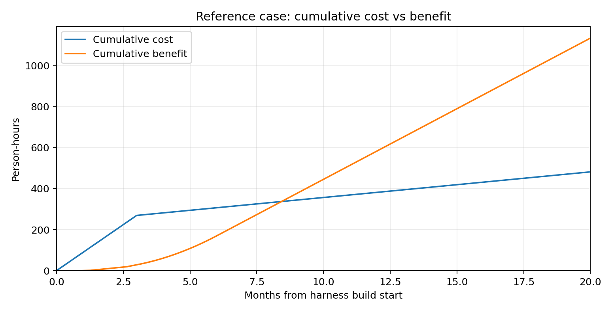

**AI Test Harness - ROI Model**

*Status: Draft - to be recalibrated with pilot measurements*

|  |  |
|:---|----|
| **Reference case** | 2 equivalent epic-throughput streams; 10 fresh triage events/month; typical triage event = 30 failed tests / 6 root causes |
| **Break-even** | approximately 8.4 months from harness build start |
| **ROI = 100%** | approximately 16.1 months from harness build start |
| **Interpretation** | The previous 6.5 / 10 month result is retained as an upper-bound high-triage-volume scenario, not as the default forecast. |

Question answered: After how many months does the AI harness pay back its investment, and how sensitive is that answer to actual QA workload?

Basis: the source testing estimates. Per-epic effort estimates are retained.

**1. Executive answer**

The AI harness still has a credible business case, but the payback point should be presented as a scenario-based projection rather than a single committed date.

|  |  |  |  |
|:--:|----|----|----|
| **Scenario** | **Fresh triage events / month** | **Break-even month** | **ROI = 100% month** |
| No triage benefit | 0 | 21.7 | \>240 |
| Low fresh-triage volume | 2 | 14.8 | 60.5 |
| Moderate-low volume | 5 | 10.9 | 27.5 |
| Reference case | 10 | 8.4 | 16.1 |
| Upper bound: fresh triage nearly every working day | 21 | 6.6 | 10.1 |

Reference case: break-even is approximately 8.4 months and ROI = 100% is approximately 16.1 months. The 6.5 / 10 month result is reproduced only when the model assumes fresh triage work on almost every working day. That should be treated as an upside / high-volume boundary until real nightly-run data exists.

Without triage, the two-stream reference workload still breaks even at roughly 22 months.

**2. Inputs retained from the testing estimate**

**2.1 Per-epic recurring effort**

|  |  |  |  |
|:--:|----|----|----|
| **Activity** | **S: without -\> with** | **M: without -\> with** | **L: without -\> with** |
| **Requirements analysis** | 2.5 -\> 1.1 | 4.0 -\> 2.25 | 6.0 -\> 4.0 |
| **Test design** | 5.0 -\> 0.75 | 8.0 -\> 1.5 | 11.0 -\> 2.25 |
| **Test implementation** | 4.25 -\> 1.15 | 12.5 -\> 4.15 | 34.5 -\> 12.45 |
| **Total per epic** | 11.75 -\> 3.0 | 24.5 -\> 7.9 | 51.5 -\> 18.7 |
| **Saving per epic** | 8.75 h (74%) | 16.6 h (68%) | 32.8 h (64%) |

The source assumptions for item counts are the following: S = 1 API client / 4 API tests / 2 contract schemas / 1 page object; M = 2 / 10 / 5 / 2; L = 4 / 20 / 10 / 4. These must be replaced with actual counts after pilots.

**2.2 Epic mix and throughput**

|  |  |
|:--:|----|
| **Parameter** | **Value used** |
| **Epic duration** | S 1.5 sprints; M 3 sprints; L 5 sprints; sprint = 2 weeks |
| **Epic size mix** | 30% S / 50% M / 20% L |
| **Steady-state saving per equivalent stream** | approximately 12.7 h/month: requirements 1.4 h + design 5.0 h + implementation 6.3 h |
| **Reference workload** | 2 equivalent epic-throughput streams |

Equivalent epic throughput means the amount of independent QA workload generated by the delivery stream. It must not be interpreted as the number of epics that happen to be open at the same time. For a single QA FTE, two open epics may still represent only one equivalent stream if the work is sequential or heavily overlapping.

**3. Revised regression-triage model**

**3.1 Event definition**

A fresh triage event is a regression run that introduces one or more new or materially changed root causes that require actual investigation. Repeated failures already linked to a known issue do not create a new full triage event.

The source model remains useful for estimating the effort inside an event:

|  |  |  |  |  |  |
|:--:|----|----|----|----|----|
| **Event type** | **Failed tests** | **Distinct root causes** | **Manual** | **With AI** | **Saved/event** |
| Low | 10 | 4 | 4.3 h | 1.9 h | 2.4 h |
| Typical | 30 | 6 | 7.2 h | 2.85 h | 4.35 h |
| Mass breakage | 150 | 2 | 9.4 h | 2.3 h | 7.1 h |

**3.2 Why daily fresh triage is an upper bound**

The v0.1 typical case effectively applied the 4.35 h saving to 21 working days per month, producing approximately 91 h/month of triage saving. The corresponding manual triage effort is 7.2 h x 21 = 151.2 h/month. Assuming an 8-hour workday, that is about 90% of a 168-hour QA month before requirements work, test design, automation, meetings, and other activities are included.

That level can occur during an unstable period, but it is too aggressive as a default planning assumption. This revision therefore uses 10 fresh triage events/month as the reference case and keeps 21 events/month as an upper-bound scenario.

**4. Cost assumptions**

|  |  |  |
|:--:|----|----|
| **Cost / timing item** | **Value used** | **Treatment** |
| **Harness build H0-H5\*** | 192 h low / 256 h reference / 320 h high / 384 h stress (+50%) | Build cost spread over first 3 months for timing calculations. |
| **Maintenance after H5\*** | 8 h/month base | Sensitivity also calculated at 16 h/month. |
| **Tool subscription** | 4.5 h/month per seat - temporary placeholder | Replace with monthly cash cost / loaded hourly rate. Seats = equivalent streams / 2, rounded up, minimum 1. |
| **Triage start** | T_run = month 3 reference | Savings start only when nightly regression runs against real SUT code. |
| **Triage ramp** | Linear over 3 months | Represents regression-suite growth after first useful nightly runs. |

\* please see AI harness architecture document for the phase reference

**5. Method**

All values below are person-hours. The model uses continuous calendar time so that week-based go-live points do not have to be rounded to whole months.

> Per epic size s: Saving_s = Effort_without_s - Effort_with_s
Epic benefit/month = Equivalent_streams x (Req + Design + Implementation savings as chunks go live)
Triage benefit/month = Fresh_triage_events/month x Saved_hours/event x Ramp(t)
Cost(t) = Build effort + Tool allowance + Maintenance
Break-even = first t where cumulative benefit \>= cumulative cost
ROI(t) = (cumulative benefit - cumulative cost) / cumulative cost
ROI = 100% = first t where cumulative benefit \>= 2 x cumulative cost

**6. Results**

**6.1 Reference case**

Reference case: 2 equivalent epic-throughput streams, 10 fresh typical triage events/month, 256 h build, T_run at month 3, 8 h/month maintenance, one tool seat at a 4.5 h/month effort-equivalent allowance.

|  |  |  |  |  |  |
|:--:|----|----|----|----|----|
| **Month** | **Cumulative cost** | **Cumulative benefit** | **Net** | **ROI** | **Comment** |
| 1 | 90 | 1 | -89 | -99% |  |
| 3 | 270 | 29 | -241 | -89% |  |
| 6 | 307 | 170 | -137 | -45% |  |
| 8 | 332 | 308 | -24 | -7% |  |
| 9 | 345 | 377 | +32 | +9% | Break-even already crossed (~8.4) |
| 12 | 382 | 583 | +201 | +53% |  |
| 16 | 432 | 859 | +427 | +99% |  |
| 17 | 445 | 928 | +483 | +109% | ROI = 100% already crossed (~16.1) |
| 18 | 457 | 997 | +540 | +118% |  |

*Figure 1. Reference-case cumulative cost and benefit.*

**6.2 Sensitivity to fresh-triage frequency**

|  |  |  |  |
|:--:|----|----|----|
| **Fresh typical triage events/month** | **Steady-state triage saving/month** | **Break-even** | **ROI = 100%** |
| 2 | 8.7 h | 14.8 | 60.5 |
| 5 | 21.8 h | 10.9 | 27.5 |
| 10 | 43.5 h | 8.4 | 16.1 |
| 21 | 91.3 h | 6.6 | 10.1 |

This is the most important sensitivity in the current model. The reference result should therefore be recalibrated as soon as the project has several weeks of nightly-run history.

**6.3 Throughput and triage matrix**

|  |  |  |  |  |  |
|:--:|----|----|----|----|----|
| **Equivalent epic streams** | **0 events** | **2 events** | **5 events** | **10 events** | **21 events** |
| **1** | \>72 / \>72 | 33.1 / \>72 | 16.1 / 62.0 | 10.3 / 21.9 | 7.3 / 11.4 |
| **2** | 21.7 / \>72 | 14.8 / 60.5 | 10.9 / 27.5 | 8.4 / 16.1 | 6.6 / 10.1 |
| **4** | 9.7 / 33.3 | 8.6 / 23.5 | 7.7 / 17.0 | 6.8 / 12.5 | 5.9 / 9.0 |

Each cell is break-even month / ROI = 100% month. Values shown as \>72 mean the threshold is not reached within six years; in the one-stream/no-triage case the economics are effectively flat because recurring benefit is only marginally above recurring cost.

**6.4 Build-cost sensitivity**

|                |                  |                |                |
|:--------------:|------------------|----------------|----------------|
| **Build case** | **Build effort** | **Break-even** | **ROI = 100%** |
|      Low       | 192              | 7.3            | 13.2           |
|   Reference    | 256              | 8.4            | 16.1           |
|      High      | 320              | 9.6            | 19.0           |
|  Stress +50%   | 384              | 10.7           | 21.9           |

**6.5 Other sensitivity checks**

|                                          |                |                |
|:----------------------------------------:|----------------|----------------|
|      **Change from reference case**      | **Break-even** | **ROI = 100%** |
|         Maintenance = 16 h/month         | 9.3            | 23.6           |
| Tool allowance doubled to 9 h/month/seat | 9.2            | 20.3           |
|         T_run delayed to month 6         | 10.7           | 19.1           |
|   Fresh triage volume = 5 events/month   | 10.9           | 27.5           |
|  Fresh triage volume = 21 events/month   | 6.6            | 10.1           |

**7. Interpretation for the plan**

> 1\. H1 and H2 still create early shift-left value, but their direct effort savings are modest. Their strongest benefit is quality: finding requirement defects before implementation. That upside is intentionally not monetised here.
>
> 2\. H4 creates meaningful recurring automation savings. Even without triage, the reference workload can recover the build investment in roughly 22 months.
>
> 3\. H5 is the main financial accelerator only when regression runs generate genuinely new investigation work. Repeated known failures should not be counted as full new savings.
>
> 4\. The previous 6.5 / 10 month result is a valid high-volume scenario, not a reliable default. It assumes fresh triage work on nearly every working day.
>
> 5\. Moving T_run earlier remains a strong lever. A walking skeleton, ad-server emulator, test environment, and nightly regression should be available as early as practical because triage cannot save effort before real SUT failures exist.
>
> 6\. Equivalent epic throughput must be measured from actual QA workload, not from the count of simultaneously open Jira epics.
>
> 7\. The model should be recalculated after the H1 pilot and again after several weeks of H5/nightly-run data. At that point the output can move from projection to evidence-based forecast.

**8. What to measure**

|  |  |  |
|:--:|----|----|
| **Measure** | **When** | **Replaces / validates** |
| Actual hours with harness per activity and epic size | H1/H2/H4 pilots | Per-epic savings |
| Items per epic: tests, clients, schemas, page objects | Each completed epic | Implementation volume assumptions |
| Failed tests per run | Every nightly run | Run complexity |
| Distinct root causes per run | Every nightly run | Clustering quality / complexity |
| New or materially changed root causes | Every nightly run | Fresh-triage event frequency - primary ROI driver |
| Manual vs AI triage hours | Before and after H5 | Saved hours per event |
| Equivalent epic throughput | Monthly / quarterly | Volume multiplier |
| Harness build hours by chunk | During implementation | Build-cost calibration |
| Harness maintenance hours | Monthly | Recurring cost |
| Actual tool subscription cost and loaded hourly rate | At procurement / finance review | Effort-equivalent tool cost |
| Requirement-originated defects prevented | Per release | Shift-left upside not currently monetised |

**9. Bottom line**

Based on the current planning assumptions, the AI-assisted test harness is expected to reach break-even in approximately 8-9 months from the start of implementation and ROI of 100% in approximately 16 months in the reference operating scenario. The result is primarily sensitive to the frequency of new regression root causes that require investigation. A high-volume scenario, where fresh triage is required almost every working day, shortens the projection to approximately 6.6 months for break-even and 10 months for ROI of 100%. These values are planning estimates rather than commitments and will be recalibrated after the H1 and H5 pilots using measured effort, epic throughput, and nightly-run triage data.
