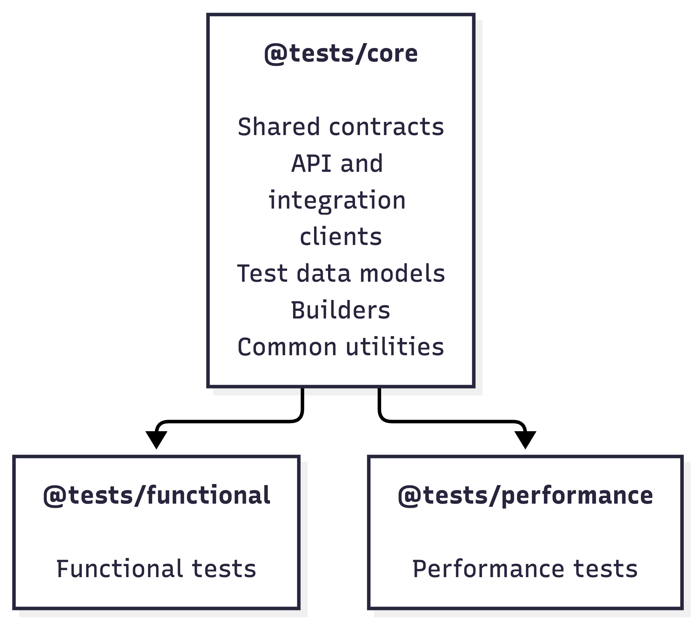
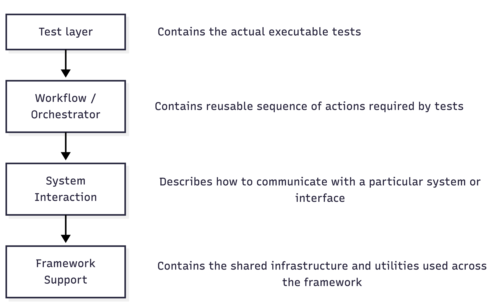
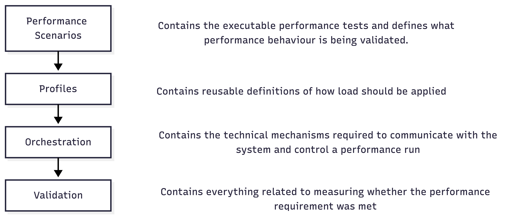

[Purpose and Quality Objectives [1](#purpose-and-quality-objectives)](#purpose-and-quality-objectives)

[Quality objectives [1](#quality-objectives)](#quality-objectives)

[Testing principles [1](#testing-principles)](#testing-principles)

[Testing Risks, Constraints and Dependencies [2](#testing-risks-constraints-and-dependencies)](#testing-risks-constraints-and-dependencies)

[Testing Levels and Execution Strategy [4](#testing-levels-and-execution-strategy)](#testing-levels-and-execution-strategy)

[Testing types [4](#testing-types)](#testing-types)

[CI execution approach [5](#ci-execution-approach)](#ci-execution-approach)

[Quality Metrics and Testing Effectiveness [6](#quality-metrics-and-testing-effectiveness)](#quality-metrics-and-testing-effectiveness)

[Test Automation Solution [7](#test-automation-solution)](#test-automation-solution)

[Technology Selection [8](#technology-selection)](#technology-selection)

[Test Automation Framework Architecture [10](#test-automation-framework-architecture)](#test-automation-framework-architecture)

[Solution Structure [10](#solution-structure)](#solution-structure)

[Functional Test Automation Framework Architecture [11](#functional-test-automation-framework-architecture)](#functional-test-automation-framework-architecture)

[Performance Test Automation Framework Architecture [12](#performance-test-automation-framework-architecture)](#performance-test-automation-framework-architecture)

[Assumptions [12](#assumptions)](#assumptions)

## Purpose and Quality Objectives

The purpose of this Test Strategy is to define how the product will be validated throughout the SDLC to maintain the required level of quality and to establish quality gates that detect functional, integration, data, ML, performance and reliability issues as early as possible.

The strategy defines the major quality risks, testing stages, ownership, environments, automation approach, measurable quality indicators, and release criteria required to provide confidence in each product increment before it progresses to the next stage.

### Quality objectives

The testing strategy aims to:

- **Provide confidence in product quality** – verify that critical functionality, integrations, data flows, performance and reliability meet the agreed expectations.

- **Detect defects as early as reasonably possible** – introduce automated validation throughout the SDLC and prevent issues from propagating to later stages.

- **Manage quality risks through focused validation** – prioritize testing effort based on business impact, technical complexity and likelihood of failure.

- **Provide objective evidence for release decisions** – use measurable test results and quality gates to determine whether a change is ready to progress.

- **Continuously improve the testing process** – use production issues, root-cause analysis, coverage and automation metrics to identify gaps and improve the strategy over time.

### Testing principles

The quality approach is based on the following principles:

- **Shift-left testing** – introduce automated coverage as early as reasonably possible. If expected behaviour is already clear, tests can be prepared before implementation is complete and initially remain red.

- **Risk-based testing** – prioritize testing effort based on business impact, technical complexity, and probability of failure.

- **Test at the lowest effective level** – functionality should be covered at the lowest test level that can validate it reliably.

- **Automation-first for repeatable validation** – automate checks that need to run frequently and provide fast feedback.

- **Continuous quality validation** – quality is assessed throughout development and delivery, not only during a dedicated test phase.

- **Measurable quality gates** – progression through the SDLC should be based on agreed, observable criteria rather than subjective confidence.

- **Integration-focused validation** – treat service boundaries, data transitions, transformations, and downstream interpretation as first-class test targets.

## Testing Risks, Constraints and Dependencies

This section identifies the conditions that could limit our ability to validate the product effectively and to provide reliable evidence that the defined quality objectives have been met.

The focus is not on product defects themselves, since those are expected to be identified through the testing process, but on factors that may reduce the effectiveness, completeness, or reliability of testing. These may include limitations in test environments, unavailable external dependencies, insufficiently representative data or traffic, unclear acceptance criteria, or missing observability.

Identifying these risks early allows the team to address the required dependencies, define appropriate mitigations, and make any remaining limitations visible when assessing product quality and release readiness.

| **Risk / dependency** | **Impact on quality validation** | **Required action / mitigation** |
|:--:|----|----|
| **Performance environment availability or representativeness does not meet testing needs** | Load and latency results may not represent production behaviour, so requirements such as P99 \< 10 ms cannot be validated with sufficient confidence. | Provide an environment with production-comparable infrastructure, configuration, scaling behaviour and dependencies, or explicitly document differences and their expected impact. |
| **No agreed production traffic profile** | Performance tests cannot model realistic normal, peak and spike conditions. A latency result without representative load has limited value. | Define expected RPS, peak RPS, traffic distribution, request characteristics and expected growth. |
| **Limited access to real ad-server services** | Emulator-based E2E tests can validate our behaviour but cannot verify assumptions about the actual ad-server protocol, latency, errors and runtime behaviour. | Provide an the ad server integration environment and define a stage for controlled validation against real ad-server services. |
| **Insufficient representative test data** | Data transitions, ML inference and traffic-shaping decisions may work on synthetic cases while failing on real traffic characteristics and edge cases. | Establish representative datasets/traffic samples and rules for safe use of production-derived data where applicable. |
| **Unclear or incomplete acceptance criteria** | Tests can verify implementation behaviour but cannot determine whether the behaviour is acceptable. | Agree measurable functional and non-functional acceptance criteria before the corresponding quality gates are introduced. |
| **Undefined performance requirements beyond the known latency target** | We may validate P99 latency but still lack criteria for throughput, error rate, scalability, degradation or recovery behaviour. | Define the remaining performance and reliability targets with Architecture/Product/SRE. |
| **Unstable or frequently changing service contracts** | Integration automation can become unreliable or constantly require rework, and incompatibilities may only be found late. | Version interfaces/protobuf contracts and introduce automated compatibility checks as early as possible. |
| **Insufficient testability/observability** | Failures may be visible only as an incorrect final response, making integration and data-transition defects difficult to diagnose and some conditions impossible to assert automatically. | Ensure that required logs, metrics, correlation IDs, model/version information and other diagnostic signals are available for testing. |
| **Unavailable or unstable shared test environments/dependencies** | Integration and E2E feedback becomes slow or unreliable and cannot serve as an effective quality gate. | Define environment ownership, availability expectations and where dependencies can be replaced with deterministic emulators/containers. |
| **Production behaviour cannot be fully reproduced before release** | Some traffic, ML and ad-server-related issues may remain undetectable in pre-production environments. | Use controlled real-traffic validation such as shadow/canary stages and define the metrics used to evaluate them. |

## Testing Levels and Execution Strategy

Testing will be performed at several complementary levels throughout the SDLC. Each testing type addresses a different area of product risk and provides a different level of confidence.

The intention is not to repeat the same validation at every level. Tests should be implemented at the level where they provide the most effective and reliable feedback, while maintaining sufficient coverage of cross-service integrations, data transitions, complete business flows, performance characteristics, and behaviour under production-like conditions.

Automated tests should be integrated into CI/CD according to their execution time, infrastructure requirements, and dependency on deployed environments or external systems. Fast and deterministic tests should provide early feedback, while more expensive and production-representative validation should be performed at later delivery stages.

### Testing types

- **Unit testing** – covers business logic, filtering logic, feature calculations, transformations and fallback logic.

- **Component / Integration testing** – covers interactions between services and dependencies such as Redis, Model Registry, pipelines, APIs/protobuf contracts.

- **E2E functional testing** – represents complete flow testing, including positive, negative and fallback scenarios.

- **UI testing** – Admin portal; exploratory/manual testing plus automation of critical and stable flows.

- **Performance & reliability testing** – includes latency, load, stress, spike, soak/endurance, scalability/capacity and degraded-dependency testing.

- **Real ad-server integration testing** – validation of the complete flow against real ad-server services, including protocol compatibility, error handling, timeout behaviour and end-to-end latency. (Can be covered by the ad-server vendor's integration testing team)

- **Production-like / real-traffic validation** – validation of system and model behaviour using real or representative traffic before full production rollout. This includes:

  - **Shadow testing** – process real traffic and generate decisions without affecting the actual bidding flow; compare predicted decisions and KPIs with the current production behaviour.

  - **Canary testing** – enable the new system/model for a small percentage of traffic and validate technical, ML and business KPIs before increasing exposure.

  - **Blue/Green validation** – deploy and validate a new application/model version in parallel with the current version, verify readiness and KPIs, then switch traffic with the ability to roll back quickly.

  - **Progressive rollout validation** – gradually increase traffic exposure while continuously checking agreed quality gates and rollback criteria.

Data-quality validation, model validation, contract testing, fallback validation and resilience scenarios are treated as cross-cutting testing concerns and are covered within the applicable testing levels rather than defined as separate testing types.

Automated E2E functional testing should use a deterministic ad-server emulator for the majority of scenarios, while actual ad-server behaviour is validated separately through Real ad-server Integration Testing.

### CI execution approach

CI execution should combine **fast PR-level validation**, **scheduled full regression coverage** and **dedicated performance validation**.

The **Smoke Pipeline** should run for each PR/commit and provide fast feedback using a lightweight default scope, including critical integration, E2E and UI smoke tests. The scope should be extendable through component/domain tags or equivalent selection mechanisms so that changes affecting a specific service can trigger the relevant additional tests for that component.

The **Regression Pipeline** should run nightly against the latest master build and execute the complete automated regression scope across unit, component/integration, E2E and UI tests. It should also support manual execution against a selected feature branch when broader validation is required before merge or release.

The **Performance Testing Pipeline** should run against a dedicated production-representative performance environment. On a weekly basis, the latest stable master build should be deployed to this environment and the agreed performance test suite executed.

The pipeline should also support on-demand execution for significant releases, infrastructure changes, performance-sensitive changes or investigation of suspected performance regressions.

<table>
<colgroup>
<col style="width: 15%" />
<col style="width: 20%" />
<col style="width: 64%" />
</colgroup>
<thead>
<tr>
<th style="text-align: center;"><strong>Testing level / type</strong></th>
<th style="text-align: center;"><strong>Ownership</strong></th>
<th style="text-align: center;"><strong>CI execution</strong></th>
</tr>
</thead>
<tbody>
<tr>
<td style="text-align: center;"><strong>Unit testing</strong></td>
<td><u>Owner:</u> Dev Team</td>
<td><strong>Per PR/commit</strong> – unit tests for the affected components. <strong>Nightly</strong> – full unit test suite across all components.</td>
</tr>
<tr>
<td style="text-align: center;"><strong>Component / Integration testing</strong></td>
<td><u>Owner:</u> TA Engineer 
<u>Support</u>: TA Engineer Dev Team</td>
<td><strong>Per PR/commit</strong> – component-related tests selected based on the affected service and its integration boundaries. <strong>Nightly</strong> – full component/integration regression suite.</td>
</tr>
<tr>
<td style="text-align: center;"><strong>E2E functional testing</strong></td>
<td><u>Owner</u>: TA Engineer</td>
<td>
<strong>Per PR/commit</strong> – lightweight smoke/critical E2E scope, including scenarios related to the affected component where applicable.

<strong>Nightly</strong> – full E2E regression suite.
</td>
</tr>
<tr>
<td style="text-align: center;"><strong>UI testing</strong></td>
<td><u>Owner</u>: TA Engineer</td>
<td>
<strong>Per PR/commit</strong> – UI smoke scope for relevant changes/deployments.

<strong>Nightly</strong> – full automated UI regression suite.
</td>
</tr>
<tr>
<td style="text-align: center;"><strong>Performance &amp; reliability testing</strong></td>
<td><u>Owner</u>: TA Engineer <u>Support</u>: Dev Team, SRE</td>
<td>
<strong>Weekly</strong> – deploy the latest master build to a dedicated performance environment and execute the agreed performance/regression suite.

<strong>On demand</strong> - additional execution may be triggered before significant releases or performance-sensitive changes.
</td>
</tr>
<tr>
<td style="text-align: center;"><strong>Real ad-server integration testing</strong></td>
<td><u>Owner</u>: the ad-server vendor's integration testing team</td>
<td>Executed as a <strong>dedicated integration stage</strong> when a build is ready for ad-server validation; frequency depends on ad-server environment availability and integration-team process.</td>
</tr>
<tr>
<td style="text-align: center;"><strong>Production-like / real-traffic validation</strong></td>
<td>Shared between TA, ML, Platform/SRE and relevant engineering/product teams</td>
<td>Not part of the standard PR/nightly CI cycle. Executed as part of the controlled deployment and rollout process using <strong>Shadow, Canary, Blue/Green and Progressive Rollout</strong> validation.</td>
</tr>
</tbody>
</table>

## Quality Metrics and Testing Effectiveness 

The metrics defined in this section should help identify gaps in test coverage, ineffective quality gates, excessive defect leakage, unstable automation, and delays in feedback. They should also be used to continuously improve the testing approach as the product and its architecture evolve.

| KPI | **What to collect** | **Why** |
|:--:|----|----|
| **Production issues and root-cause statistics** | Number/severity of production defects, affected component, root cause, defect category, and the earliest test stage where the issue could reasonably have been detected | Primary measure of gaps in the testing strategy. Allows us to identify recurring weaknesses in unit, integration, E2E, performance, data, or environment coverage |
| **Unit test coverage** | Unit-test coverage per component, preferably statement/line and branch coverage where available | Provides visibility into how much implementation logic is exercised by unit tests and helps identify components with insufficient low-level coverage |
| **Critical flow / integration coverage** | Coverage of identified critical E2E flows, integrations, and important data transitions | Complements code coverage by measuring whether the important system behaviours are actually validated |
| **PR validation feedback time** | Time from triggering PR validation until actionable test results are available | Shows whether shift-left validation provides feedback quickly enough to be useful |
| **Flaky test rate** | Number/rate of non-deterministic test failures | Measures reliability of test automation; high flakiness reduces confidence in CI results |
| **Regression execution reliability** | Nightly regression completion rate and failures caused by test/environment/infrastructure issues rather than product defects | Shows whether the regression process itself is reliable enough to provide a trustworthy quality signal |

## Test Automation Solution

The Test Automation solution is designed to provide automated validation across functional, integration, E2E, UI and performance testing while keeping the framework maintainable and suitable for high-scale execution.

The solution is based on a **TypeScript-oriented technology stack** and consists of two independently executable automation frameworks (functional and performance) supported by a shared core package.

The main architectural objectives are to:

- support the required functional and performance testing scope;

- provide a common technology stack where technically appropriate;

- reuse contracts, domain models, test-data utilities, and common integration logic without coupling the functional and performance frameworks;

- isolate runner-specific implementation and dependencies;

- allow functional and performance tests to be installed, built, executed, and evolved independently;

- provide consistent reporting and observability across automated validation;

- support execution through the CI/CD pipelines defined in the Testing Levels and Execution Strategy section.

The selected tool stack contains:

| **Technology** | **Area** | **Purpose** |
|:--:|----|----|
| **TypeScript** | Common | Main **programming language** for the Test Automation solution. Used across shared framework components, functional automation, integration clients, test-data utilities, and performance test implementation |
| **pnpm workspace** | Common | **Monorepo and dependency-management mechanism** used to organize the Test Automation solution into independent core, functional, and performance sub-projects |
| **Playwright** | Functional testing | **Functional Test Automation framework**, used for component/integration tests, E2E functional tests, API-level validation, and Administration UI automation. |
| **Allure Report** | Functional testing | **Reporting solution** used to provide execution results, test history, failure details, steps, and attachments for Playwright-based test suites. |
| **k6** | Performance testing | **Performance and load testing tool** used to define workload scenarios, generate controlled load against supported system interfaces, collect performance metrics, and enforce automated performance thresholds. |
| **Prometheus** | Performance testing | **Metrics collection and time-series storage** used to collect performance-test, application and infrastructure metrics during performance executions. |
| **Grafana** | Performance testing | **Performance monitoring and reporting dashboard** used to correlate generated workload with E2E latency, internal component latency, throughput, error rate, application behavior, and infrastructure utilization. |

### Technology Selection

Two primary technology options were considered for the Test Automation solution:

|  | **Functional automation tool set** | **Performance testing tool set** |
|----|----|----|
| **Option 1** | TypeScript + Playwright | k6 |
| **Option 2** | Python + pytest + Playwright | Locust |

Both options are capable of covering the main functional automation needs, including API, integration, E2E and UI testing.

The main differentiating factor is the performance-testing requirement. The system is expected to support load of up to approximately **1M RDS**, therefore the ability of the performance framework to generate high throughput efficiently and in a distributed manner is a critical technology-selection criterion.

**k6** provides a better fit for this requirement due to its efficient load-generation model, native arrival-rate executors, distributed execution through k6 Operator and strong support for HTTP and gRPC workloads.

**Locust** remains a viable alternative, but its Python-based execution model may require significantly more load-generator resources to reach the required throughput. This creates a higher risk that the load-generation infrastructure itself becomes a limiting factor during high-scale performance testing.

At the same time, the TypeScript ecosystem can cover the critical functional automation requirements of the project.

Thus, **Option 1** has been chosen as a main tool stack for the TA solution.

| **Criterion** | **k6** | **Locust** |
|:--:|----|----|
| Test language | JS / TS | Python |
| HTTP | Excellent | Excellent |
| gRPC / protobuf | Native | Supported, but requires Python gRPC integration |
| Complex business scenarios | Excellent | Excellent |
| Open workload / fixed arrival rate | Excellent | Possible, but less natural |
| Distributed execution | k6 Operator | Locust master/workers + K8s Operator |
| Generator efficiency | High | Medium |
| 1M RPS suitability | Strong candidate | Possible, but infrastructure-heavy |
| Built-in report | Good | Good live UI/statistics |
| Detailed historical analysis | Prometheus + Grafana | OTel/custom backend/Grafana |
| CI/CD | Excellent | Excellent |
| Kubernetes | Very good | Very good |
| Framework complexity | Low–medium | Low |
| Cost | OSS / optional Cloud | OSS |

The final achievable RPS is dependent not only on the selected tool but also on scenario complexity, protocol, payload size, load-generator resources, network capacity, and Kubernetes configuration. The load-generation topology therefore needs to be benchmarked before the final performance environment capacity is defined.

## Test Automation Framework Architecture

The Test Automation solution will be implemented as a **TypeScript-based monorepo** containing shared test automation components and two independently executable automation frameworks: functional and performance.

The main architectural goals are:

- avoid duplication of contracts, test-data models and integration logic;

- keep Playwright-specific and k6-specific implementation isolated;

- allow functional and performance suites to be installed, built, and executed independently;

- support additional integrations without coupling tests directly to the underlying test runner;

- maintain clear ownership boundaries between shared test logic and runner-specific implementation.

### Solution Structure

The Test Automation solution consists of three sub-projects:

*@tests/functional* and *@tests/performance* may both consume shared components from *@tests/core*, but they **must not depend on each other**.

This provides two important properties:

- common functionality can be reused without duplication;

- changes to Playwright-specific dependencies do not affect the performance framework, and changes to k6-specific dependencies do not affect the functional framework.

Each sub-project has its own package.json, while pnpm workspace manages them as one repository. Framework-specific dependencies are isolated and cannot unintentionally leak from one automation framework into another.

### Functional Test Automation Framework Architecture

The functional framework is organized into the following logical layers:

### Performance Test Automation Framework Architecture

This separation allows workload models, business flows and technical execution configuration to evolve independently and makes it possible to reuse the same performance flow across load, stress, spike, and other performance scenarios.

## Assumptions

1.  **A production-representative performance testing environment is available.** The environment is expected to represent the production-ready setup closely enough in terms of infrastructure, configuration, scaling model, and relevant dependencies to provide meaningful performance results.

2.  **Required application services and their test dependencies can be started in isolated containers.** Tests should be able to create independent instances of the required services and dependencies without relying on a shared mutable environment.
