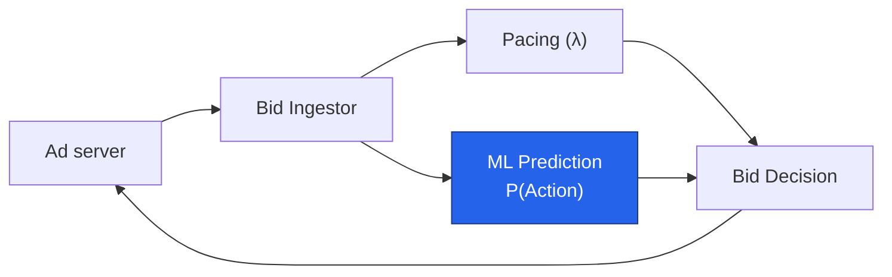
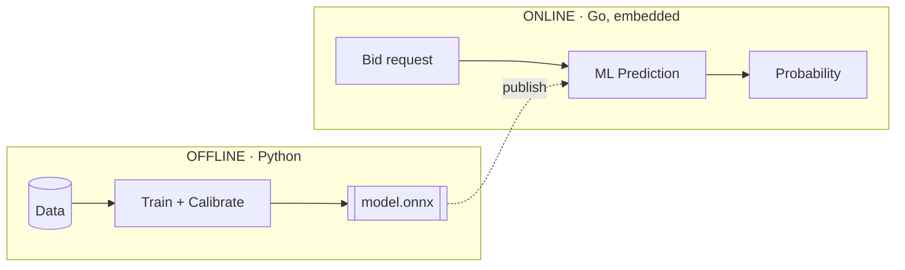
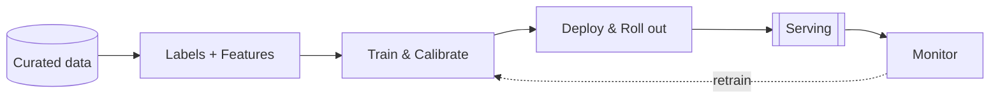
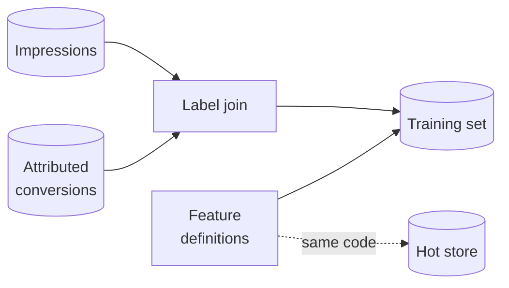
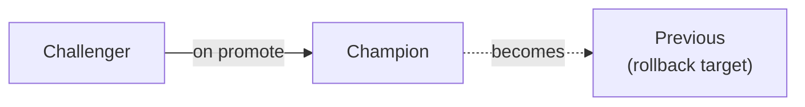
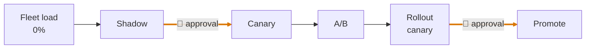
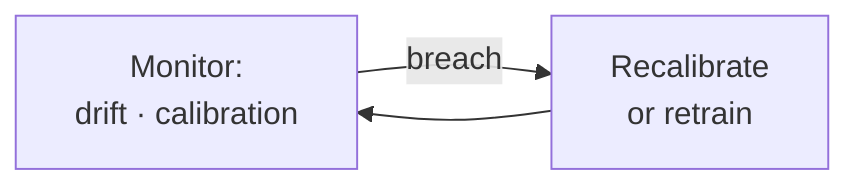
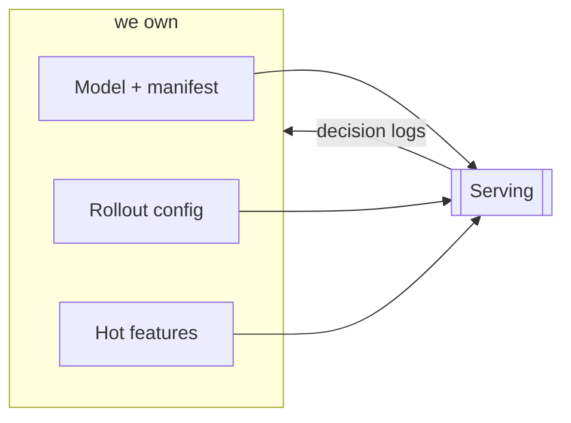
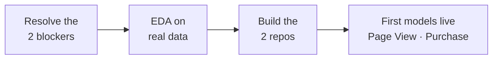

<!--
FORMAT: one slide per `---`. Bullets/bold = ON-SCREEN content (low text).
HTML comments (like this one) = SPEAKER NOTES (Slidev presenter notes),
invisible to the audience. English. Slides are visual cues — the talk
carries the content. No client/vendor names, no ADR numbers or file
paths on-screen — those stay in these notes for Q&A backup.
-->

# ML Offline Design
## Where We Stand

**Rodrigo Cunha** — Principal ML Engineer 
Custom Bidding Agent · ML Lane · 2026

<!--
- ~1min, set the tone
- This is the ML lane's offline design: how we build and refresh P(Action)
- 30-45 min + 15 min Q&A, interrupt any time
-->

---

## What you'll know by the end

- What's already **decided**, and why
- What the offline design is actually **made of**
- What it needs from the team
- What's still **open** — and what's blocking it

<!--
- ~1.5min, agenda as questions
- Myth 1: it's a pipeline + a serving contract, not a notebook artifact
- Myth 2: almost everything is settled; two named client answers unlock the rest
- Audience: DE, ML, platform/Go dev, QA — I'll flag which parts matter most to whom as we go
-->

---
layout: section
---

# Part 1
## The system today

---

## Today vs. tomorrow

**Today** — every advertiser bids on awareness:

`Final Bid = λ × Max CPM`

**Tomorrow** — this project unlocks performance bidding:

`Final Bid = λ × Max CPA × `**`P(Action)`**

<!--
- ~2min
- λ = pacing's discount factor, already live
- Max CPM/CPA = advertiser's bid value
- P(Action) is new — probability the impression converts (page view / purchase)
- Today P=1 everywhere (awareness only); this is the whole reason the project exists
-->

---

## Four services, one request

our lane: <strong>ML Prediction</strong>

<!--
- ~2min
- Request comes in, ingestor fans out to pacing and ML in parallel
- Pacing and Bid Decision are other lanes — we touch them only at this boundary
- We own: turning "will this impression convert" into a calibrated number
- Must answer inside the ad server's hard timeout — next section
-->

---
layout: section
---

# Part 2
## What's already decided

---

## Four decisions, locked in

| Decision | Status |
|---|---|
| ML returns a **probability**, not a dollar value | Settled |
| Served as **ONNX**, embedded in the Go agent — no separate server | Settled |
| **Calibration is mandatory**, versioned with the model | Settled |
| Served artifact is **one self-contained file** (prep + model + calibration) | Settled |

<!--
- ~2.5min, don't read the table — narrate the shape
- Probability not EV: value/λ logic stays out of the ML boundary
- Embedded ONNX, no server: lowest latency, simplest ops, no separate fleet
- Calibration mandatory: the number gets multiplied by real money
- One self-contained file: nothing hand-written in Go can drift from training
- These are "Accepted" architecture decisions — revisable, but this is where we stand
-->

---

## Two worlds, one bridge

ONNX is the only thing that crosses the bridge

<!--
- ~1.5min
- Offline: full Python, Databricks — training, calibration, feature engineering
- Online: Go, no Python at all, loads ONNX in-process
- No RPC to a Python service in the hot path — that's the "no server" decision
-->

---

## The latency budget

| Budget | Whose |
|---|---|
| **10 ms**, end-to-end HTTP | the ad server's hard timeout — whole agent |
| **~3 ms**, p99 | the ML step's own slice — our firm target |

a budget inside a budget — ingestor, pacing, and decision share the rest

<!--
- ~1.5min
- 10ms is for the WHOLE bidding agent, not just us
- 3ms is our own allocation within it — confirmed firm target, not a guess
- Tabular model inference itself is microseconds; the cost is hops, lookup, serialization
-->

---
layout: section
---

# Part 3
## What the offline design is made of

---

## The whole pipeline, end to end

five stages — each one gets a slide, briefly

<!--
- ~1.5min, this is the map for the rest of Part 3
- Closed loop: monitoring can trigger retraining or recalibration
-->

---

## Data in

- Impression-level training data
- Attribution labels (conversions)
- Aggregate performance data
- Decisions (from serving)

the first three: from the client, requirements fixed, delivery still open · decisions: ours already, via the serving contract

<!--
- ~2min, DE-lane audience cares most here
- Three client-sourced curated datasets, proposed split, not yet finalized
- Open: does the client deliver these directly, or does our Data Engineer curate
  them from internal tables — that's one of the two real blockers (Part 6)
- We only state requirements on the client-sourced datasets, we don't design their provenance
- Decisions = decision logs, already ours via the serving contract (Part 4) — not
  a client dependency, listed here because it's a genuine pipeline input
- Dropped from this slide on purpose: delivery-control feed (that's Pacing's
  input, not ours) and bidder-response dataset (that's an OUTPUT we assemble
  from decisions + other lanes' fields and send back to the client, not an input)
-->

---

## Building a training set

one feature definition feeds both training and serving — no drift

<!--
- ~2min
- Labels: join served impressions to attributed conversions (web pixel / app MMP)
- Labels mature late — windows stay open up to 30 days, tracked explicitly
- Features: shared definition compiled once, used by the training join AND
  to populate the live Redis store — this is what prevents train/serve skew
-->

---

## Train & calibrate

- Gradient-boosted trees, exported to **ONNX**
- Calibration **baked in**, versioned with the model as one pair
- Gate before anything ships: ranking must not regress, calibration must
  clear an absolute bound

<!--
- ~2min, MLE audience cares most here
- LightGBM/XGBoost-style tabular model
- Calibration: post-hoc (Platt/isotonic) + a base-rate correction if we
  downsample negatives for training
- Calibration is held to an ABSOLUTE bound, not just "better than before" —
  the output gets multiplied by real money
-->

---

## Model versions: three roles, always

- **Champion** — serving all traffic today
- **Challenger** — moving through the states below
- **Previous** — yesterday's champion, kept for rollback

<!--
- ~1.5min, sets up the next slide
- At any moment, up to 3 named versions exist for a model slot
- On promote: challenger becomes champion, old champion becomes previous
- On abort: config just points back at previous — cheap, no retrain needed
- First version of a new model/goal: no champion yet, incumbent is the
  non-ML baseline (bid = λ × Max CPM, i.e. P=1)
-->

---

## Deploy & roll out

the challenger's path to becoming champion · auto-abort anywhere on a guardrail breach

<!--
- ~2min, QA audience cares most here
- One deployment job owns the whole rollout, always in this order
- Human approval: before first live traffic (shadow→canary), and before
  final promotion. Everything else advances automatically on passing readouts
- Guardrail breach (spend, latency, errors) aborts and rolls back, no human needed
-->

---

## Monitor & retrain

- Calibration breach → cheap **recalibrate-only** refresh
- Drift breach → **full retrain**

<!--
- ~1.5min
- Daily monitoring job computes calibration error, score drift, input drift,
  defaulted-feature rate
- Not every breach means retraining the trees — recalibration is cheaper and
  handles most calibration drift
-->

---
layout: section
---

# Part 4
## The contract with serving

---

## Four touchpoints

this is the whole interface — nothing else crosses the boundary

<!--
- ~2min, platform/Go audience cares most here
- Artifact + manifest: the ONNX file + what it needs, immutable per version
- Rollout config: which version is live, at what traffic split
- Hot features: Redis, we write, the lib mirrors it
- Decision logs: serving emits one row per scored candidate, we ingest it
-->

---

## Who writes, who reads

| Touchpoint | We write | Serving reads | Changes on |
|---|---|---|---|
| Artifact + manifest | ✓ | ✓ | new model version |
| Rollout config | ✓ | ✓ | new rollout state |
| Hot-feature store | ✓ | ✓ | every 5–10 min |
| Decision logs | ✓ (ingest) | ✓ (emits) | every scored candidate |

<!--
- ~1.5min
- We're always the writer on the first three; serving is always the writer on the fourth
- This is a stable contract — either side can build against it without
  waiting on the other, as long as the shape doesn't change
-->

---
layout: section
---

# Part 5
## Infra this needs

---

## The stack

| Layer | Status |
|---|---|
| Cloud platform | confirmed |
| ML compute, tracking, model registry | confirmed |
| Specific tooling choices within it | ours to pick |
| Our own orchestration instance | ours; reuse-vs-new still open |
| Fast key-value store for hot features | needed; exact service deferred |

<!--
- ~2min
- "Confirmed" = the client told us this is the platform
- "Ours to pick" = within that platform, specific tool choices are our call,
  not something the client mandated — worth being precise about this split
- Orchestration: whether we reuse the client's instance or stand up our own
  is itself an open question
-->

---

## New things to stand up

- A **pipeline-framework repo** — one folder per model pipeline
- A **versioned workload package** — training, calibration, ETL, feature code
- A **fast store** reachable by both our jobs and the serving agent
- No standing compute — pipelines submitted at trigger time only

<!--
- ~1.5min
- Two new repos, separate from the serving repo
- Nothing model-specific lives in the workload package — keeps it reusable
- "No standing compute": we don't keep clusters running between runs
-->

---
layout: section
---

# Part 6
## What's still open

---

## The two real blockers

1. **Attribution window + method** — what exactly we're training on

2. **Cross-boundary data-access mechanism** — tables are named, how they
   move isn't

both need an answer from the client

<!--
- ~2.5min, the single most important slide
- #1: which attribution window(s) per goal, and click- vs. view-through —
  this defines the training label itself
- #2: owned by our Data Engineering lane, but the mechanism (push vs. pull,
  cross-account access) is still open with the client
- Everything downstream of these two is designed and ready, not blocked
-->

---

## Everything else

| Category | Roughly |
|---|---|
| Needs the client | ~13 items |
| Settles once EDA runs on real data | ~10 items |
| Ours to decide, no dependency | ~7 items |
| Asks on the serving side | ~8 items |

full list lives in the design register, not here

<!--
- ~1.5min, don't enumerate — the point is the shape, not the list
- Client items: mostly volumes, samples, confirmations — not architecture
- EDA items: thresholds, lookback windows, sizing — need real data first
- Serving-side asks: small additive changes to the Go lib, not redesigns
-->

---
layout: section
---

# Part 7
## What happens next

---

## The path forward

no fixed dates yet — still discovery phase

<!--
- ~2min
- Once the client answers the two blockers, EDA starts on real data/samples
- Build runs in parallel with EDA where it doesn't depend on answers
- Small serving-side asks get scheduled alongside their roadmap, not blocking us
-->

---
layout: center
---

## Takeaways

- The design is **complete and concrete** — not a sketch
- **Two client answers** unlock EDA and the build
- The contract with serving is **fixed** — both sides build in parallel

**Thank you — questions?**

<!--
- Q&A seeds:
  - What's the fastest path to a sample of real data?
  - Which of the two blockers can move first?
  - Anything in the serving-side asks that changes the Go roadmap?
-->
