<!--
FORMAT: one slide per `---`. Bullets/bold = ON-SCREEN content (low text).
HTML comments (like this one) = SPEAKER NOTES (Slidev presenter notes),
invisible to the audience. English. Slides are visual cues — the talk
carries the content. No client/vendor names, no ADR numbers or file
paths on-screen — those stay in these notes for Q&A backup.
-->

# ML Offline Design
## Where We Stand

**Rodrigo Cunha** — Principal ML Engineer<br>
Custom Bidding Agent · ML Lane · 2026

<!--
- ~1min, set the tone
- This is the ML lane's offline design: how we build and refresh P(Action)
- 30-45 min + 15 min Q&A, interrupt any time
-->

---

## What you'll know by the end

<div class="h-8"></div>

- What's already **decided**, and why
- What the offline design is actually **made of**
- What it needs from the team (help to review, please!)
- What's still **open** — and what's blocking it

<!--
- ~1.5min, agenda as questions
- Myth 1: it's a pipeline + a serving contract, not a notebook artifact
- Myth 2: almost everything is settled; two named client answers plus AWS access unlock the rest
- Audience: DE, ML, platform/Go dev, QA — I'll flag which parts matter most to whom as we go
-->

---
layout: section
---

# Part 1
## The system today

---

## Today vs. tomorrow

<div class="h-8"></div>

<div class="text-xl">

**Today** — every advertiser bids on awareness:

`Final Bid = λ × Max CPM`

</div>

<div class="h-6"></div>

<div class="text-xl">

**Tomorrow** — this project unlocks performance bidding:

`Final Bid = λ × Max CPA × `**`P(Action)`**

</div>

<!--
- ~2min
- λ = pacing's discount factor, already live
- Max CPM/CPA = advertiser's bid value
- P(Action) is new — probability the impression converts (page view / purchase)
- Today P=1 everywhere (awareness only); this is the whole reason the project exists
-->

---

## Four services, one request

<div class="h-8"></div>

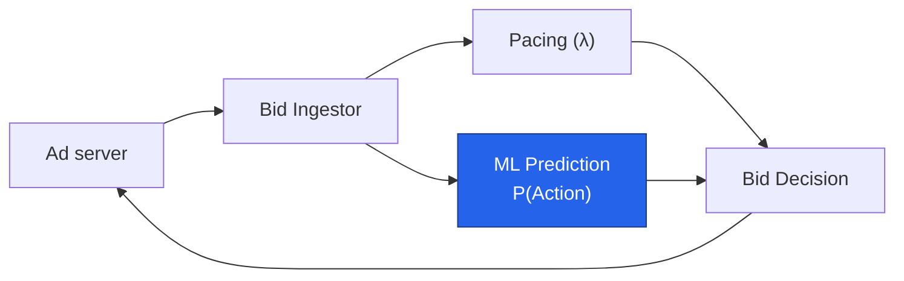

<div class="opacity-70 mt-4">our lane: <strong>ML Prediction</strong></div>

<!--
- ~2min
- Request comes in, ingestor fans out to pacing and ML in parallel
- Pacing and Bid Decision are other lanes — we touch them only at this boundary
- We own: turning "will this impression convert" into a calibrated number
- Must answer inside the ad server's hard timeout — next section
-->

---
layout: section
---

# Part 2
## What's already decided

---

## Four decisions, locked in

<div class="h-6"></div>

| Decision | Status |
|---|---|
| ML returns a **probability**, not a dollar value | Settled |
| Served as **ONNX**, embedded in the Go agent — no separate server | Settled |
| **Calibration is mandatory**, versioned with the model | Settled |
| Served artifact is **one self-contained file** (prep + model + calibration) | Settled |

<!--
- ~2.5min, don't read the table — narrate the shape
- Probability not EV: value/λ logic stays out of the ML boundary
- Embedded ONNX, no server: lowest latency, simplest ops, no separate fleet
- Calibration mandatory: the number gets multiplied by real money
- One self-contained file: nothing hand-written in Go can drift from training
- These are "Accepted" architecture decisions — revisable, but this is where we stand
-->

---

## Two worlds, one bridge

<div class="h-6"></div>

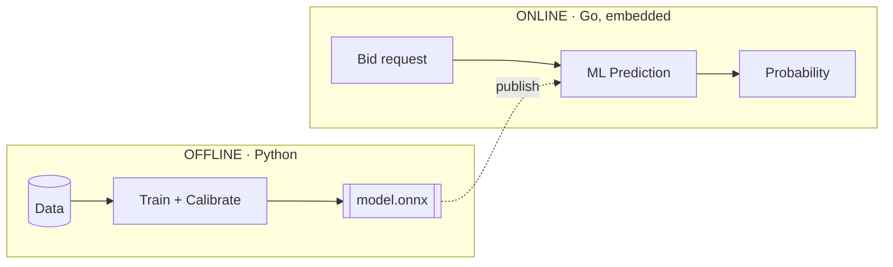

<div class="opacity-70 mt-4">ONNX is the only thing that crosses the bridge</div>

<!--
- ~1.5min
- Offline: full Python, Databricks — training, calibration, feature engineering
- Online: Go, no Python at all, loads ONNX in-process
- No RPC to a Python service in the hot path — that's the "no server" decision
-->

---

## The latency budget

<div class="h-6"></div>

| Budget | Whose |
|---|---|
| **10 ms**, end-to-end HTTP | the ad server's hard timeout — whole agent |
| **~3 ms**, p99 | the ML step's own slice — our firm target |

<div class="opacity-70 mt-4">a budget inside a budget — ingestor, pacing, and decision share the rest</div>

<!--
- ~1.5min
- 10ms is for the WHOLE bidding agent, not just us
- 3ms is our own allocation within it — confirmed firm target, not a guess
- Tabular model inference itself is microseconds; the cost is hops, lookup, serialization
-->

---
layout: section
---

# Part 3
## What the offline design is made of

---

## The whole pipeline, end to end

<div class="h-6"></div>

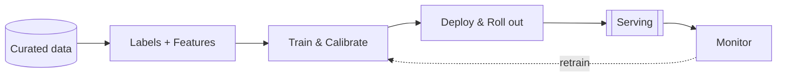

<div class="opacity-70 mt-4">the map for what follows — deploy & roll out gets the most depth</div>

<!--
- ~1.5min, this is the map for the rest of Part 3
- Closed loop: monitoring can trigger retraining or recalibration
-->

---

## Data in

<div class="h-6"></div>

- Impression-level training data
- Attribution labels (conversions)
- Decisions (from serving)

<div class="opacity-70 mt-4">the first two: from the client, requirements fixed, delivery still open · decisions: ours already, via the serving contract</div>

<!--
- ~2min, DE-lane audience cares most here
- Three client-sourced curated datasets, proposed split, not yet finalized
- Open: does the client deliver these directly, or does our Data Engineer curate
  them from internal tables — that's one of the two real blockers (Part 6)
- We only state requirements on the client-sourced datasets, we don't design their provenance
- Decisions = decision logs, already ours via the serving contract (Part 4) — not
  a client dependency, listed here because it's a genuine pipeline input
- Dropped from this slide on purpose: delivery-control feed (that's Pacing's
  input, not ours) and bidder-response dataset (that's an OUTPUT we assemble
  from decisions + other lanes' fields and send back to the client, not an input)
-->

---

## Building a training set

<div class="h-6"></div>

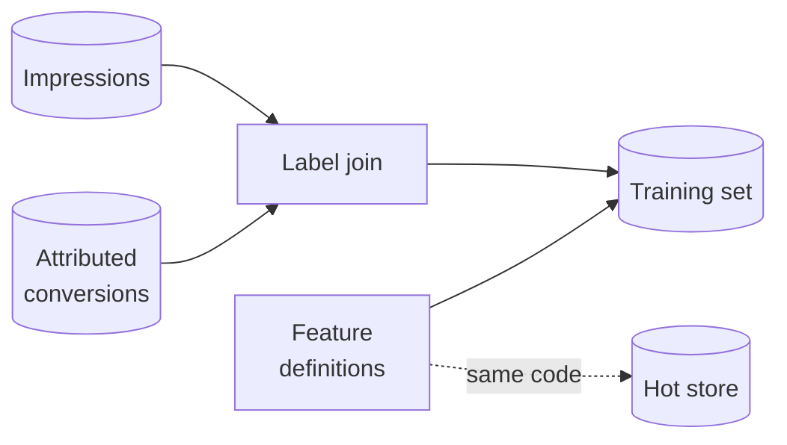

<div class="opacity-70 mt-4">one feature definition feeds both training and serving — no drift</div>

<!--
- ~2min
- Labels: join served impressions to attributed conversions (web pixel / app MMP)
- Labels mature late — windows stay open up to 30 days, tracked explicitly
- Features: shared definition compiled once, used by the training join AND
  to populate the live Redis store — this is what prevents train/serve skew
-->

---

## Train & calibrate

<div class="h-4"></div>

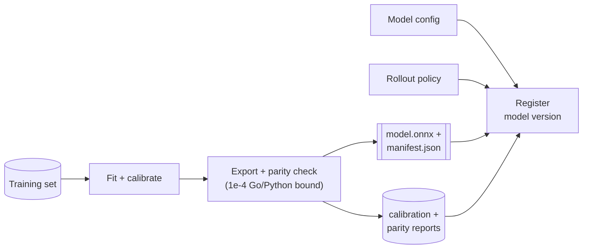

<div class="opacity-70 mt-4">everything a model version needs ships together — nothing hand-written can drift from what trained</div>

<!--
- ~2.5min, MLE audience cares most here
- Gradient-boosted trees (LightGBM/XGBoost-style), fit then calibrated
  (Platt/isotonic + a base-rate correction if we downsample negatives)
- Export composes the full graph (prep + model + calibration) into one
  ONNX file and checks it scores within 1e-4 of the Python reference —
  that's the parity gate, training's own correctness check
- Model config and rollout policy are read in from the DAG repo
  (previous slide's training.yaml / rollout.yaml) and ride along,
  registered onto this same model version
- Registering the version is the hand-off: it's what triggers the
  deployment job's registration branch ("What drives the rollout", later)
- Ranking/calibration non-inferiority is a DIFFERENT, later gate — the
  deployment job's offline evaluate task, not something training itself
  decides. Training measures and logs metrics here; it doesn't gate
-->

---

## Two repos, one training pipeline

<div class="h-6"></div>

- **DAG repo** — the pipeline framework + every model's own definition
  (schedule, model config, **rollout policy**)
- **Workload repo** — one versioned, pipeline-agnostic package (training,
  calibration, ETL, feature code) + the one deployment job

<div class="opacity-70 mt-4">nothing model-specific lives in the workload repo — that's what keeps it reusable</div>

<!--
- ~1.5min
- These are the two repos a training run comes out of: DAG repo holds
  this model's definition (what/when/with what config), workload repo
  holds the code that actually trains and calibrates
- DAG repo: one folder per model pipeline, everything that differs model
  to model lives here, including each model's rollout policy
- Workload repo: the code itself, shared across all models, imported by
  whichever pipeline needs it; also bundles the single standing deployment job
- Separate from the serving repo entirely
-->

---

## The training pipeline's files

<div class="opacity-70 mb-2">inputs from the DAG repo, outputs registered onto the model version</div>

DAG repo — per-model pipeline folder (input)

```
pipelines/training_pixel_purchase/
├── dag.py
├── pipeline.yaml          schedule, compute tier
├── training.yaml          model configuration
└── rollout.yaml           rollout policy
```

<div class="h-2"></div>

S3 — model storage (output, once published)

```
<model_name>/
├── v1/model.onnx          trained + calibrated, immutable
├── v1/manifest.json       input schema, feature join spec
├── v2/model.onnx
├── v2/manifest.json
└── rollout_config.json    champion · challenger · previous, mutable
```

<div class="opacity-70 mt-3">rollout policy is authored in the DAG repo, registered with the model version at training time — the deployment job reads it from the registry, not this repo</div>

<!--
- ~2min, sets up the next slide
- Input side: the DAG repo folder is what the training run reads at
  start — one folder per model pipeline, rollout.yaml sits next to
  training.yaml (model config), same lifecycle, both model-specific
- Output side: training produces model.onnx + manifest.json and
  registers the version — the S3 layout shown here is the end state,
  once the deployment job has published it (next slide)
- One S3 folder per model slot. Version folders are immutable, one per
  trained version, holding the artifact pair (model + manifest)
- rollout_config.json is the one mutable file, sibling to the version
  folders, not nested inside any of them — it doesn't belong to one version,
  it points at whichever versions are champion/challenger right now
- Important distinction: the DAG repo is where the policy is written and
  versioned (git), but the deployment job never reads the DAG repo at
  runtime — training registers the policy onto the model version, the
  job reads it back from there. Same pattern as everything else the job
  reads: always the registry or the touchpoints, never a repo checkout
-->

---

## The deployment job is the bridge

<div class="h-10"></div>

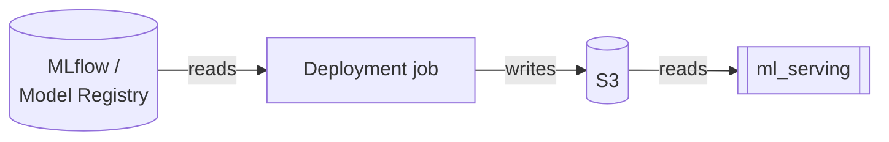

<div class="opacity-70 mt-6">ml_serving only ever talks to S3 — MLflow stays entirely on our side</div>

<!--
- ~1.5min
- This is what turns the previous slide's input/output into the S3
  layout shown there: training registers, the deployment job publishes
- Deployment job is the only thing that reads MLflow/Unity Catalog
  (aliases, approval tags) and the only thing that writes S3
- ml_serving has no MLflow client, no Databricks dependency at all —
  it only reads the rollout config and artifact files from S3
- This is deliberate isolation: serving's dependency surface stays
  Go + S3, nothing Python/Databricks-side can break it
-->

---

## Model versions: three roles, always

<div class="h-6"></div>

- **Champion** — serving all traffic today
- **Challenger** — moving through the states below
- **Previous** — yesterday's champion, kept for rollback

<div class="h-4"></div>

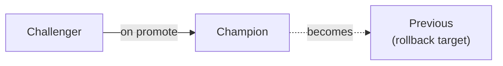

<!--
- ~1.5min, sets up the next slide
- At any moment, up to 3 named versions exist for a model slot
- On promote: challenger becomes champion, old champion becomes previous
- On abort: config just points back at previous — cheap, no retrain needed
- First version of a new model/goal: no champion yet, incumbent is the
  non-ML baseline (bid = λ × Max CPM, i.e. P=1)
-->

---

## Deploy & roll out

<div class="h-6"></div>

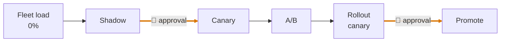

<div class="opacity-70 mt-4">the challenger's path to becoming champion · auto-abort anywhere on a guardrail breach</div>

<!--
- ~2min, QA audience cares most here
- One deployment job owns the whole rollout, always in this order
- Human approval: before first live traffic (shadow→canary), and before
  final promotion. Everything else advances automatically on passing readouts
- Guardrail breach (spend, latency, errors) aborts and rolls back, no human needed
-->

---

## What drives the rollout

<div class="h-6"></div>

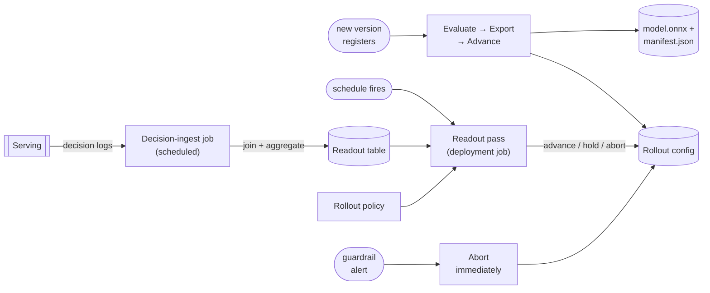

<div class="opacity-70 mt-4">one job, three triggers · nothing here is manual except the two gates</div>

<!--
- ~2.5min, platform/Go + QA audience cares most here
- One deployment job, three things can trigger a run of it:
  - a new version registering — runs evaluate/export/advance for that one
    model. Export is what copies model.onnx + manifest.json to S3 — this is
    the moment "The training pipeline's files" tree's version folders get
    created. Advance writes the first rollout-config revision, then the
    run exits
  - the standing schedule — the readout pass, sweeps every model's config,
    checks it against the rollout policy and the readout table, advances/
    holds/aborts
  - a guardrail alert — skips the schedule, runs the abort path immediately
    for that one model/version
- Separately: decision-ingest job (own schedule) lands decision logs and
  builds the readout table the readout pass reads — never decides anything
- Rollout config is what serving actually reads — this is the only thing
  that writes it (besides the two human approval gates from the last slide)
-->

---

## Monitor & retrain

<div class="h-4"></div>

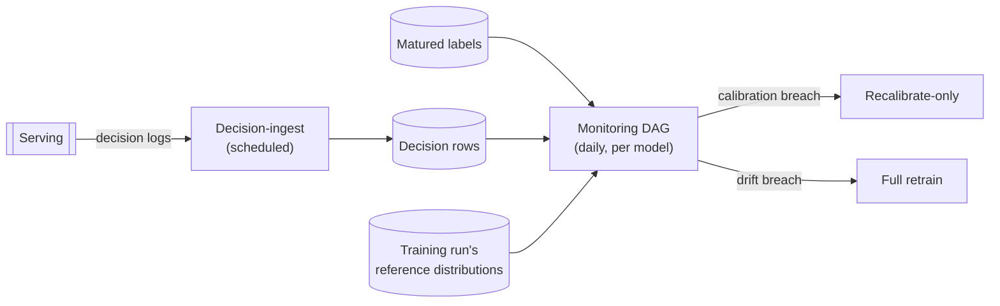

<div class="opacity-70 mt-4">model quality, daily — serving-health guardrails (spend, latency, errors) run continuously in the observability stack, a separate system entirely</div>

<!--
- ~2min
- Same decision-ingest job as the readout loop — one ingest, two
  consumers (per-arm readout tables for rollouts, this for model quality)
- Daily monitoring DAG, parametrized per model, runs after ingest and
  label maturation. Computes: calibration error (reliability + ECE),
  score drift (population stability index vs. the training run's logged
  holdout distribution), input drift, defaulted-feature rate, cost per
  action (reported only, never a trigger)
- Thresholds live in that model's own workload YAML (DAG repo), not
  hardcoded — same per-model pattern as the rollout policy
- Calibration breach → cheap recalibrate-only (refit the calibrator,
  reuse the trees). Drift breach → full retrain. Not every breach
  retrains — recalibration handles most calibration drift
- Two independently-scheduled systems, not one feeding the other: this
  DAG runs once a day and only ever decides retraining — it never
  touches a live rollout. Serving-health guardrails (spend/latency/
  errors) are evaluated continuously by the observability stack
  (CloudWatch/Datadog-style alerting), not this DAG, specifically
  because an abort has to act in seconds, not wait for tomorrow's run.
  That's why "What drives the rollout" draws the guardrail alert as its
  own trigger, with no edge from this monitoring DAG at all
-->

---

## How the guardrail alerts work

<div class="h-10"></div>

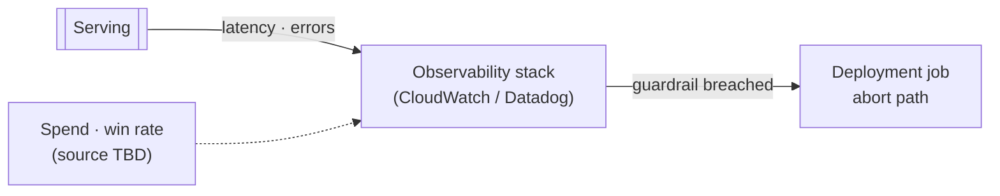

<div class="opacity-70 mt-6">latency + errors: continuous, agent-internal · spend + win rate: guardrails designed, data source still open with the client</div>

<!--
- ~2min
- The named producer is the observability stack's own alert rules, not
  any of our pipelines — the alert rule's action calls the deployment
  job through the jobs API, which runs the abort path immediately
- Latency, errors, defaulted-feature rate: the agent observes these
  directly, genuinely continuous
- Spend and win-rate guardrails are designed (spend anomaly, win-rate
  collapse) but we don't yet know how fast that data reaches the agent.
  We don't run the auction — win/delivery data's only confirmed path is
  the client's curated feed, hourly at best. Whether a faster win-notice
  signal exists is an open question for the client
- Scoped to whichever model/version is currently mid-rollout — this
  protects against a bad challenger, the champion isn't being watched
  this way, it's the stable baseline
- This is the third, independent alerting path in the design: pipeline
  alerting (DAG/job failures), model-quality monitoring (this slide's
  predecessor, daily), and this one — serving-health guardrails. None
  of the three routes through either of the others
-->

---
layout: section
---

# Part 4
## The contract with serving

---

## Four touchpoints

<div class="h-6"></div>

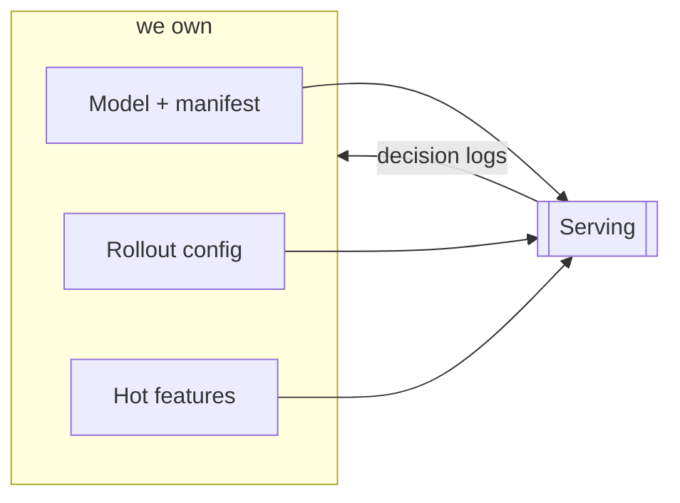

<div class="opacity-70 mt-4">this is the whole interface — nothing else crosses the boundary</div>

<!--
- ~2min, platform/Go audience cares most here
- Artifact + manifest: the ONNX file + what it needs, immutable per version
- Rollout config: which version is live, at what traffic split
- Hot features: Redis, we write, the lib mirrors it
- Decision logs: serving emits one row per scored candidate, we ingest it
-->

---

## Who writes, who reads

<div class="h-6"></div>

| Touchpoint | We write | Serving reads | Changes on |
|---|---|---|---|
| Artifact + manifest | ✓ | ✓ | new model version |
| Rollout config | ✓ | ✓ | new rollout state |
| Hot-feature store | ✓ | ✓ | every 5–10 min |
| Decision logs | ✓ (ingest) | ✓ (emits) | every scored candidate |

<!--
- ~1.5min
- We're always the writer on the first three; serving is always the writer on the fourth
- This is a stable contract — either side can build against it without
  waiting on the other, as long as the shape doesn't change
-->

---
layout: section
---

# Part 5
## Infra this needs

---

## The stack

<div class="h-6"></div>

| Layer | Status |
|---|---|
| Cloud platform | confirmed |
| ML compute, tracking, model registry | confirmed |
| Specific tooling choices within it | ours to pick |
| Our own orchestration instance | ours; reuse-vs-new still open |
| Fast key-value store for hot features | needed; exact service deferred |

<div class="opacity-70 mt-4">no standing compute — pipelines submitted at trigger time only, nothing idle between runs</div>

<!--
- ~2min
- "Confirmed" = the client told us this is the platform
- "Ours to pick" = within that platform, specific tool choices are our call,
  not something the client mandated — worth being precise about this split
- Orchestration: whether we reuse the client's instance or stand up our own
  is itself an open question
- "No standing compute": we don't keep clusters running between runs
-->

---
layout: section
---

# Part 6
## What's still open

---

## The two real blockers

<div class="h-6"></div>

<div class="text-xl">

1. **Attribution window + method** — what exactly we're training on
</div>

<div class="h-4"></div>

<div class="text-xl">

2. **Cross-boundary data-access mechanism** — tables are named, how they
   move isn't

</div>

<div class="opacity-70 mt-6">both need an answer from the client</div>

<!--
- ~2.5min, the single most important slide
- #1: which attribution window(s) per goal, and click- vs. view-through —
  this defines the training label itself
- #2: owned by our Data Engineering lane, but the mechanism (push vs. pull,
  cross-account access) is still open with the client
- Everything downstream of these two is designed and ready, not blocked
-->

---

## Everything else

<div class="h-6"></div>

| Category | Roughly |
|---|---|
| Needs the client | ~13 items |
| Settles once EDA runs on real data | ~10 items |
| Ours to decide, no dependency | ~7 items |
| Asks on the serving side | ~8 items |

<div class="opacity-70 mt-4">full list lives in the design register, not here</div>

<!--
- ~1.5min, don't enumerate — the point is the shape, not the list
- Client items: mostly volumes, samples, confirmations — not architecture
- EDA items: thresholds, lookback windows, sizing — need real data first
- Serving-side asks: small additive changes to the Go lib, not redesigns
-->

---
layout: section
---

# Part 7
## What happens next

---

## The path forward

<div class="h-4"></div>

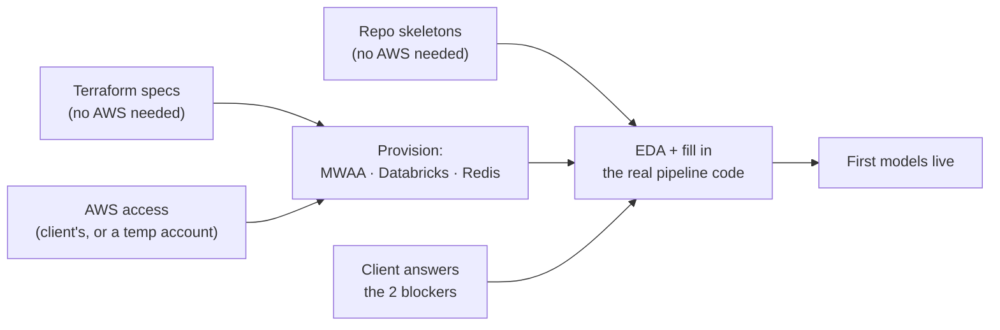

<div class="opacity-70 mt-4">two independent blockers, not one — access itself isn't the finish line either</div>

<!--
- ~2.5min
- Two separate things block real progress, not one: the client's
  answers to the two open blockers, AND AWS access — we don't have the
  client's account yet, and the temp sandbox account we're planning to
  stand up for ourselves isn't secured either
- Resolving the two blockers alone doesn't unlock anything without
  account access too — that's why this isn't one chain
- What moves regardless, starting now: the two repos' skeletons
  (framework, schemas, CI — no real data or account needed) and
  Terraform specs for provisioning, ready to apply the moment an
  account exists
- Getting AWS access isn't the finish line either — once we have it,
  we still have to provision: apply the Terraform, stand up our MWAA
  instance, configure the Databricks workspace (catalogs, compute,
  MLflow/UC registry), get Redis reachable. That's why provisioning is
  its own step, not folded into "access"
- Once provisioned and the client has answered: EDA runs on real data,
  and the skeletons get filled in with the actual processing code
- Small serving-side asks get scheduled alongside their roadmap, not blocking us
-->

---
layout: center
---

## Takeaways

<div class="h-6"></div>

- The design is **complete and concrete** — not a sketch
- **Two client answers, plus AWS access** unlock EDA and the real build
- The contract with serving is **fixed** — both sides build in parallel

<div class="h-10"></div>

**Thank you — questions?**

<!--
- Q&A seeds:
  - What's the fastest path to a sample of real data?
  - Which of the two blockers can move first?
  - Anything in the serving-side asks that changes the Go roadmap?
-->
