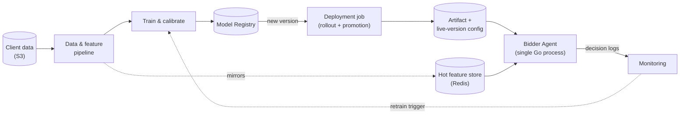
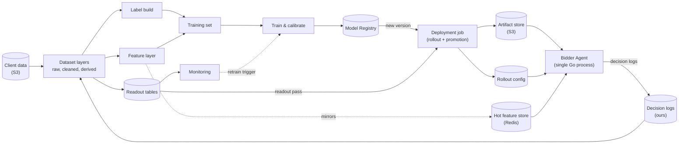
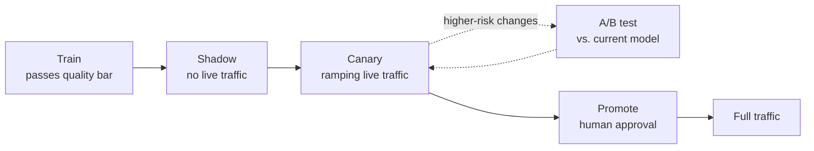
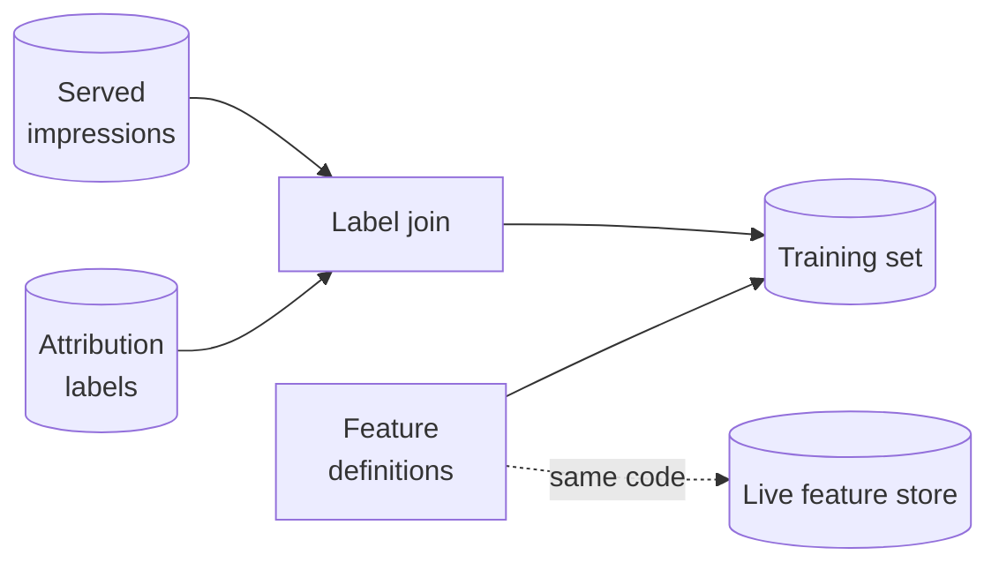

<!--
FORMAT: one slide per `---`. Bullets/bold = ON-SCREEN content.
HTML comments = SPEAKER NOTES for Georgiy, invisible to the audience.
No intro/outro slides — these drop into another deck. No internal file
paths, ADR numbers, or team names on-screen; those stay in these notes.
Rodrigo won't be in the room, so on-screen text carries more of the
explanation than usual — don't rely on narration to fill gaps.
-->

## Architecture: an embedded model

- Not microservices: the bidder agent runs as one process. ML Serving
  is a library it imports and calls directly, not a separate service
  it talks to over the network.
- Only versions that clear a quality gate get registered. A deployment
  job then promotes the registered version through rollout (next
  slide) before it reaches the live store.
- The agent only ever reads two things, both small: the live artifact
  and its config, and the hot feature store. Never the registry,
  training, or monitoring directly.

<!--
- Corrects a possible assumption: no service-to-service hop for
  scoring, which is also why the latency budget is achievable
- Sets up the next slide: how the deployment job promotes a version
  safely before it ever reaches that live store
-->

---

## Architecture: an embedded model (draft 2, more detail)

- Not microservices: the bidder agent runs as one process. ML Serving
  is a library it imports and calls directly, not a separate service
  it talks to over the network.
- Only versions that clear a quality gate get registered. A deployment
  job then promotes the registered version through rollout (next
  slide) before it reaches the live store.
- The agent only ever reads two things, both small: the live artifact
  and its config, and the hot feature store. Never the registry,
  training, or monitoring directly.

<!--
- Draft 2 of this slide — more detailed than draft 1 above, closer to
  the full System Map (`00_overview.md`). Comparing the two to pick
  one; this one may be too dense once scaled to slide width.
- Corrects a possible assumption: no service-to-service hop for
  scoring, which is also why the latency budget is achievable
- Sets up the next slide: how the deployment job promotes a version
  safely before it ever reaches that live store
-->

---

## Promoting a model to production safely

| Stage | What it checks |
|---|---|
| Train | prediction-quality metrics (ranking, calibration) — fully offline, before any live exposure |
| Shadow | runs on live request patterns with no live risk — catches integration issues training can't see |
| Canary | ramping live traffic — guardrails on spend, latency, and errors confirm it survives production |
| A/B (risk-dependent) | a live, head-to-head comparison against what's currently serving |
| Promote | human sign-off before full traffic |

Guardrails can abort and roll back automatically at any point — including after promotion — no human needed to catch a regression.

<!--
- This is the slide that answers "how do we know a model is safe
  before it touches real spend" — the deployment job from the
  previous slide, in detail
- A/B is conditional, not mandatory — it's reserved for changes risky
  enough to need a live comparison, not every routine retrain
- Guardrails being always-on (not just during rollout) is worth
  pausing on if asked
-->

---

## What feeds the model

one feature definition feeds both training and live serving — no drift

- Two inputs, both yours: served impressions and attributed
  conversions. These are the required inputs — the next slide covers
  exactly what we still need confirmed about them.
- The same feature code populates the training set and the live
  store, so what the model learned matches what it sees in production.

<!--
- Labels mature over days, not instantly — the pipeline tracks that
  lag explicitly rather than assuming data is final on arrival
- Decision logs also feed monitoring and the rollout readout, but
  that's a deeper discussion than this slide needs — leave it out
  unless asked
- Sets up the blockers slide: data access and attribution window are
  exactly what this slide depends on
-->

---

## Open questions

**1. Data access and schemas** — which tables we read from, the
mechanism to access them across the account boundary, and the exact
contract per dataset: fields, identifiers, delivery cadence. This
defines what we can build and when we can start building it.

**2. Attribution window and method** — which attribution window(s)
apply per goal (and whether advertisers get to choose one), and
whether click-through and view-through conversions can be told apart.
This defines exactly what the model is trained to predict.

everything downstream of these two is designed and ready to build

<!--
- Both need an answer before real-data work can start
- A fuller, itemized question list exists if the room wants to go
  deeper on either point
-->
