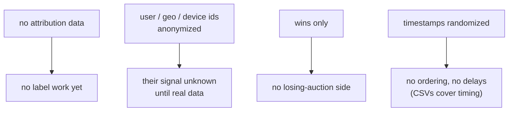
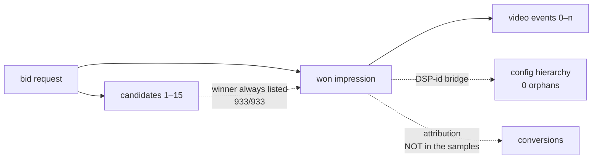
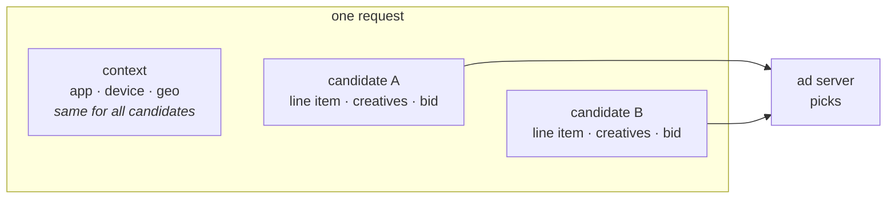
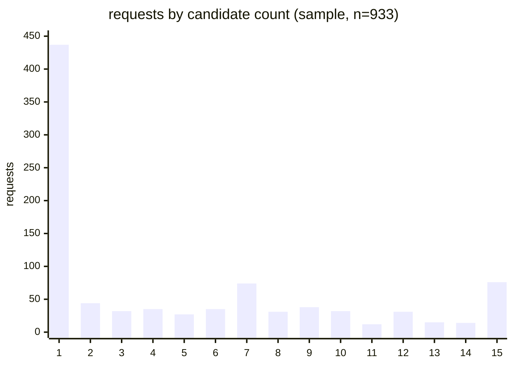
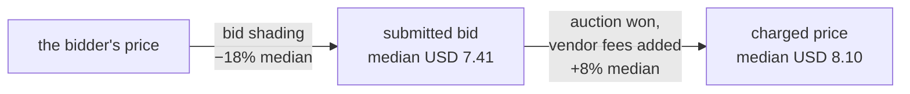
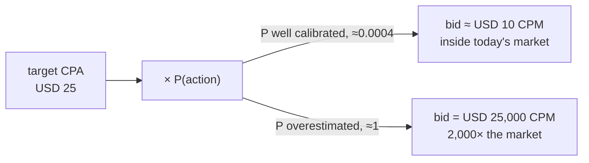

<!--
FORMAT: one slide per `---`. Bullets/bold = ON-SCREEN content (low text).
HTML comments (like this one) = SPEAKER NOTES (Slidev presenter notes),
invisible to the audience. English. Slides are visual cues — the talk
carries the content. No client/vendor names, no file paths on-screen —
those stay in these notes for Q&A backup.
-->

# UA Data Samples
## What we learned so far

**Rodrigo Cunha** — Principal ML Engineer 
Custom Bidding Agent · ML Lane · 2026-11

<!--
- ~1 min. First real client data landed (batch-03); we ran a full EDA.
- Everything shown here comes from eda/notebooks/01_eda_dossier.ipynb —
  the notebook is the deep-dive reference, this is the summary.
- EDA environment: eda/ folder, docker compose up, loaders ready.
-->

---

## What we received

  
Joined stream sample

  
933

  
won impressions

  
request · candidates · impression · video events

  
→ the full auction lifecycle, minus attribution

  
Delivery-control export

  
130

  
entities

  
org → account → campaign → ad set → ad

  
→ config reality

  
Traffic & workload CSVs

  
29 days

  
full volume, Oct 1–29

  
auctions · bids · wins · delays · active lines

  
→ volumes & timing

<!--
- Three sources, three different questions they answer.
- Stream sample: the upstream DSP's joined log, anonymized by the client.
- Export: the client's campaign-management config, matched to the sample.
- CSVs: client-measured, the only volume/timing ground truth.
- Sources on disk: docs/batch_03/ (+ md/ conversions); loaders in eda/.
-->

---

## What the sample cannot answer

<!--
- Say it before anyone asks: these are the sample's hard limits.
- Anonymization kept joins consistent inside an event but destroyed
  values: all-unique random tokens; timestamps uniform 2002-2286.
- Labels: attribution tables exist client-side, pending data access.
- So: no CVR, no class balance, no user features from this sample.
-->

---

## The data connects end to end

**Keys clean** · zero duplicates · every frame joins

<!--
- All join checks passed: auction key + request id unique; activity
  joins 100%; winner among candidates in all 933 events.
- Bridge: DSP integer ids <-> client UUIDs works both ways; export
  covers 45% of impression rows (matched high-volume subset).
- The dashed attribution edge is the future label join — the only
  missing piece, waits on data access.
-->

---

## Feature availability

  
Usable now

  
app / content identity

  
content metadata — genre · rating · length

  
video specs

  
auction context — deals · floor · seller

  
Present, signal unknown

  
device · geo · user

  
anonymized in the sample — judged only on real data

  
Excluded

  
~25 constant fields

  
same value everywhere — no signal to learn from

  
<b>Ad-set config</b> — targeting breadth · frequency caps · budgets

  
→ day-one features for brand-new ad sets

<!--
- ~65 bid-time fields at full coverage; the usable core is the
  app/content/video/auction side.
- Device/geo/user: available at bid time, value judged only on real data.
- Config-derived features = cold-start answer for the sparse-signal
  requirement; derived offline, served via feature tables + Redis —
  no new serving mechanics.
- Deliberate pending decision: bid/target-CPA as feature (feedback loop).
-->

---

## Inside a bid request

Scores are separated by **candidate-side** information: the candidate's identity plus everything we attach to it — **precomputed per-ad-set features** (rolling metrics, config) — the shared request context raises or lowers all candidates together, never reorders them

**The ad server picks the winner** — top bid wins only **42%**: bid influences, does not decide

<!--
- Within a request only candidate identity + bid vary (100% / 91%);
  request fields are context — confirms advertisers-as-features.
- Winners bid higher (median 7.41 vs 6.41 USD CPM) but rank-1 bid wins
  only 42.5%; winners seen down to bid rank 13.
- Implication: raising our bid buys probability, not certainty; a
  win-rate model must condition on more than price.
-->

---

## Traffic reality: scale

| per second | average | p50 | p90 | p99 | max |
|---|---|---|---|---|---|
| **auctions** | 444 K | 440 K | 564 K | 693 K | **1.92 M** |
| **bids** | 21 K | 4.3 K | 66 K | 142 K | 373 K |

Oct 1–29 totals: **1.11 T** auctions → **52.6 B** bids (4.75%) → **465 M** wins (0.88%) → **USD 4.63 M** spend

<!--
- Client-measured, full population, Oct 1-29.
- Peak is ~4.3x the average — whatever we size must survive 1.92 M/s.
- Bids are ~20x fewer and far spikier (p25 is 811/s!) — that's pacing,
  next slide shows it.
-->

---

## Traffic reality: bids follow budgets, not viewers

**The 444 K/s is the request stream the Bidder Agent inherits** — the **ad server's pacing filters the candidates** before the request (auctions losing all candidates are never sent); the low bid count follows from that

<!--
- Auctions peak 0-5 UTC = US prime time (viewers).
- Bids peak 15-20 UTC = middle of the budget day (resets at US-local
  midnight, right after prime time): budgets fresh in the US morning,
  spent by prime time -> upstream pacing throttles exactly at the peak.
- Corroboration: per-interval bid rate swings 0.09%-34%; sample ad sets
  carry business-hours dayparting.
- When our λ-pacing replaces the upstream α, this bid curve will change.
-->

---

## Traffic reality: candidates per request

**47% carry exactly 1** · median 2 · spike at **15 — looks like a cap**, true max pending from the vendor

<!--
- Bimodal: half the requests are single-candidate; a quarter carry 8+.
- The 76 requests at exactly 15 are NOT a tail — a spike at the edge,
  consistent with the DSP truncating candidate lists at 15. If so, the
  real maximum is unknown — exactly the number still pending from the
  ad-server vendor.
- Client-measured averages (full population): 1.3 with the upstream
  pacing filter, 13.9 without — the sample sits between (mean 4.9).
-->

---

## Traffic reality: the scoring stream

  
with the upstream pacing filter (1.3 candidates/auction)

  
0.6 M/s

  
candidates to score, average

  
without it (13.9 candidates/auction)

  
6 M/s

  
candidates to score, average

A **10×** swing decided upstream — and the roadmap moves pacing to our side

<!--
- Exact averages from client two-week totals (candidates before/after
  the upstream probabilistic-pacing elimination, divided by the period).
- Not a forecast of ML load: awareness lines skip the model today.
  It bounds the candidate stream, not the model calls.
- Peaks run ~4x the average on top of this.
-->

---

## Traffic reality: how fresh is spend/win data

Spend-based signals see **complete** data only **~1–1.5 h** after the fact

<!--
- Delay from bid to impression event in the win log; client's own
  histogram (their prose said "90% in 15 min" — actual: 81%; p90=24 min).
- p50 2.3 min / p90 24 min / p99 78 min.
- Floors pacing inputs, rollout spend guardrails, early readouts;
  irrelevant for daily label builds.
-->

---

## Traffic reality: summary

- **444 K auctions/s** average · **1.92 M/s** peak
- **Half the requests carry a single candidate**; spike at 15 looks like a cap — true max pending
- Candidate stream, **average**: **0.6 M/s** with the upstream pacing filter, **6 M/s** without it — a **10×** swing; peaks run ~4× the average
- Bids follow **budgets**, not viewers — the **ad server's pacing filters candidates** upstream; the bid volume follows from that
- Win-log freshness floor: **p50 2.3 min · p90 24 min**

<!--
- One breath: huge scale, a 10x swing we don't control, a bid curve
  shaped by pacing, and spend data that is always ~an hour behind.
-->

---

## Economics: price levels

| USD CPM, per impression | median | mean | min | max |
|---|---|---|---|---|
| **submitted bid** (post-shading) | 7.41 | 8.54 | 5.00 | 50 |
| **charged price** | 8.10 | 8.98 | 5.42 | 50 |

Agrees with the 29-day whole-period CPM of **USD 9.95** — the sample's economics are not exotic

<!--
- Sample: 933 won impressions, 14 ad sets. Single-digit CPM market.
- "Submitted bid" = what went to the exchange, already shaded.
- Cross-check vs the traffic profile totals: USD 4.63M / 465M wins.
-->

---

## Economics: the charge includes fees

Charged > bid on **2 of 3** impressions (median **+8%**) — and **budgets are consumed by this charged, fee-inclusive amount**, not by the bid · to confirm with the client

<!--
- Spike at 1.0 = charged exactly the bid (294 impressions); below 1.0
  is rare (14).
- All-in cost matches the win-log contract wording ("media plus
  targeting and other fees") AND budget_type "spend including vendor
  fees" — one coherent gross basis, so spend reconciliation needs no
  fee math.
-->

---

## Economics: shading and who sets the price

  
bid shading, median cut

  
−18%

  
USD 1.60 CPM, on ~70% of impressions — our agent's prices may be shaded too

  
charged price vs best losing bid

  
1.01×

  
the winner pays its best competitor's price — a shaded first-price market

<!--
- Shading cut reported per impression by the stream; permission flag on
  for 12/14 sample ad sets.
- Win/best-loser median 1.01 (p90 1.21), on the 496 requests that had
  losing candidates — clears at the second-highest bid.
- The bid we compute is not the price that competes — one more reason
  the win-rate research models P(win | price, context) separately.
-->

---

## Economics: why a max-bid cap

Today's market: **USD 5–15 CPM** — a cap is cheap insurance against a miscalibrated model

<!--
- The contract asks who caps CPA bids: if the ad server has no max_bid
  on CPA lines, the agent applies its own.
- Today's price levels give the cap its natural scale.
- This is the bid-decision lane's knob; our lane's contribution is
  calibration — the cap is the backstop, not the fix.
-->

---

## Economics: summary

- Market lives at **USD 5–15 CPM** (charged median **8.10**)
- Charge **includes vendor fees** — one gross basis everywhere
- Bid shading cuts **~18%** median · winner pays its **best competitor's price**
- Overestimated P(action): USD 25 target → **USD 25,000 CPM** — the **max-bid cap** case

<!--
- One breath: cheap inventory, fees baked into every money number,
  shading between our bid and the paid price, and a cap as insurance.
-->

---

## What flows onward

  
Client follow-ups

  
budget consumption: always the charged price + fees, or do other consumption types exist?

  
a sample of attribution / conversion data, if possible

  
Design inputs

  
feature list → model design

  
traffic numbers → serving capacity

  
price levels → max-bid-cap scale

  
<b>EDA environment ready</b> — dockerized notebook · data loaders · the dossier

  
→ anyone can open it and explore the data

<!--
- Follow-ups go through the client-questions channel.
- Timestamps: order-preserving exports are off the table before we are
  inside the client's infra (data protection) — timing analysis waits
  for access, not for a better sample.
- Feature list feeds the features design; capacity numbers feed serving
  sizing; the cap case feeds the contract discussion.
- ENV: eda/ folder — docker compose up, two notebooks: 00 = data
  context (read first), 01 = the dossier. Matheus: this is the data
  ramp-up path after the design docs.
-->
