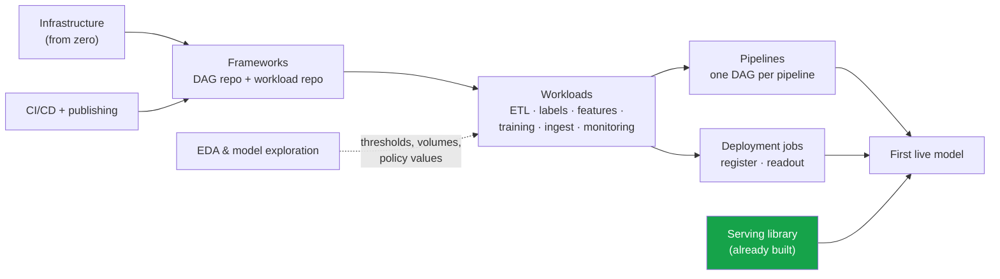
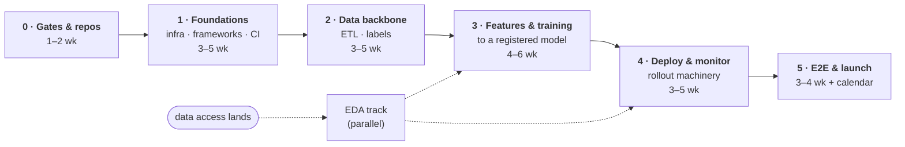
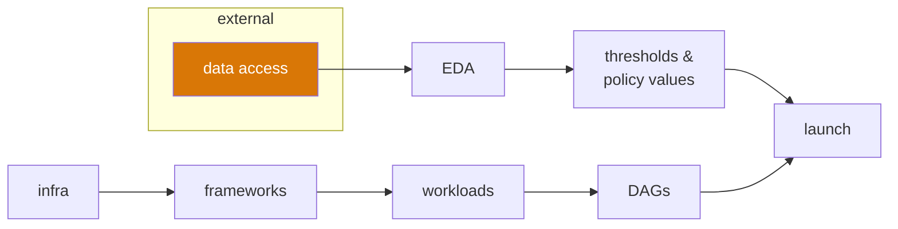

<!--
FORMAT: one slide per `---`. Bullets/bold = ON-SCREEN content (low text).
HTML comments = SPEAKER NOTES (Slidev presenter notes), invisible to the
audience. No client/vendor names on-screen. Source of truth: roadmap/
(01_current_state, 02_workstreams, 03_phases, 04_databricks_alternative),
snapshot 2026-11-19.
-->

# ML Lane Roadmap
## ML platform — from design to first live model

**Rodrigo Cunha** — Principal ML Engineer 
Custom Bidding Agent · ML Lane · 2026-11

<!--
- ~30s. Design phase is done; this is the plan to BUILD it.
- Full detail lives in the repo's roadmap/ folder — this is the summary.
- Durations are rough planning ranges, not commitments.
-->

---

## Where we are today

  
Design

  
✅

  
platform design 00–09, audited + the two code repos fully specified

  
Serving library

  
✅

  
cross-lane work list delivered scores, shadow, rollout config, decision logs

  
DAG repo

  
🟡

  
skeleton + dev tooling exist no framework, no pipelines yet

  
Workload repo

  
⬜

  
not created yet everything is design-only

  
Infrastructure

  
❌

  
no provisioning code anywhere no CI/CD in any repo

  
Data access

  
⏳

  
datasets named, mechanism open blocks EDA at scale

<!--
- Design: ml_offline design_docs complete + the frodo/gandalf scaffold
  design, reviewed and decision-dated.
- Serving: ml_serving shipped all 14 agreed items — incl. shadow scorer,
  full decision record with hot values, and reading config straight
  from S3 (no sync component needed).
- gandalf: created last week — lint/test/tooling, zero logic.
- frodo: repo creation imminent.
- Infra: no Terraform/CDK anywhere; IaC approach itself undecided.
- Data access: the DE-lane/client question; the single biggest external
  dependency.
-->

---

## What the roadmap will build

- Green is **done**; the rest is ahead of us
- **EDA will run in parallel** — its outputs are config values, not code
- The serving side is already built — considering we can keep using ONNX

<!--
- Ten workstreams in roadmap/02; this is the dependency skeleton.
- Infra feeds everything; frameworks before workloads before DAGs.
- EDA is the parallel track: label volumes, baseline conversion rates,
  gate thresholds, bake times — all deferred to EDA by design.
- Deployment jobs: the two standing jobs writing artifacts + rollout
  config; serving reads both straight from S3.
-->

---

## Six phases

**≈ 17–27 engineering weeks** · plus launch calendar time

<!--
- Phase 0 is mostly external: client answers + repo creation + the
  IaC and stack decisions.
- Each phase has an exit proof (next slide).
- The ranges assume current team capacity and the parallelism drawn.
- EDA starts the moment access lands, whenever that is.
-->

---

## Each phase proves something

| Phase | Exit proof |
|---|---|
| **1 · Foundations** | one trivial stage runs end to end: DAG → submitted run → pinned wheel |
| **2 · Data backbone** | labels table populated, reconciling against the source rollups |
| **3 · Features & training** | a registered, parity-checked model from real data, hot features live |
| **4 · Deploy & monitor** | a version flows fleet load → shadow in dev, readout tables filling |
| **5 · E2E & launch** | first champion serving; shadow → canary on live traffic |

<!--
- Not milestones for reporting — each proof de-risks the next phase.
- Phase 1's proof sounds small but it validates the whole execution
  model: Airflow chaining single-task runs on a versioned wheel.
- Phase 4's proof exercises the rollout machinery without touching
  live bids.
-->

---

## The critical path

the highest-leverage action now: **land data access**

<!--
- Two chains: the external one (data access → EDA → the values every
  gate and policy needs) and the internal one (infra → … → DAGs).
- The internal chain is ours to pace; the external one is not — hence
  the ask. Everything EDA-gated can be built with placeholder values,
  but launch criteria need the real ones.
-->

---

## Plan B: losing the managed ML platform

**The scenario: we must build on raw cloud services instead.** What that does to the plan:

  
Survives unchanged

  
the design itself · Python↔Go split · ONNX artifact · S3/Redis contracts · Airflow chaining · the two repos · model / feature / DAG code

  
We build & operate ourselves

  
Spark compute · table governance · experiment tracking + model registry · job triggers & bundles · notebook environment (EDA & exploration) <b>→ this is where the added work lives</b>

**+10 weeks minimum**, one-time · **+ a permanent ops tax** · cheapest to decide **before Phase 1**

<!--
- Pre-study numbers, low confidence — a real evaluation precedes any
  decision.
- The biggest single hit is the registry/tracking service: either we
  operate it ourselves forever, or we port the integration.
- The design was built stack-agnostic on purpose; the cost is in who
  operates what, not in rework of the ML design.
-->

---

## What we need now

  
1 · Data access

  
the transfer mechanism for the curated datasets — heads the critical path

  
2 · Platform decisions

  
managed stack or not (Databricks?) · account topology

  
3 · Start the foundations

  
both our repos (workload + DAG) · CI from zero · infrastructure — design is ready, but the stack decision (2) shapes this work

  
4 · ONNX Runtime watch

  
the inference engine's repo went private (security investigation) — settle our contingency; could change the serving lib a lot

<!--
- 1 is the ask to push hardest — everything EDA-gated waits on it,
  and once data lands we compute baseline conversion rates ourselves.
- 2: only the genuinely open ones. Settled, not repeated here:
  orchestrator is Airflow; a package index will be used (not blocking);
  repo hosting is the client's enterprise GitHub.
- 3: Phase 1 in full — create the workload repo, build the DAG repo's
  framework (today it's a skeleton), stand up CI (none exists in any
  repo) and the dev infrastructure.
- 4: Microsoft took the ONNX Runtime repo private (malicious-content
  investigation, 2026-11). Our serving artifact executes on it. State
  today: all 1.30.0 artifacts archived locally with checksums,
  cross-verified against a second official channel; fresh image builds
  are broken (pull from the gone GitHub release) until we mirror.
  Contingency ladder: vendored source build (MIT, zero design change)
  is primary; alternate engine (Tract) is the only tested-able
  fallback pending an op-coverage check; single-file artifact is
  non-negotiable, so the pure-Go scorer path is ruled out. Watch for
  the investigation outcome before any version bump.
-->
