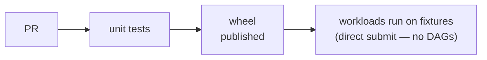
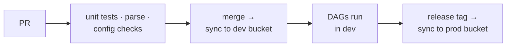
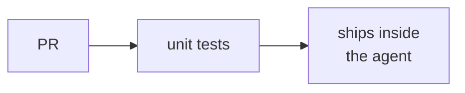
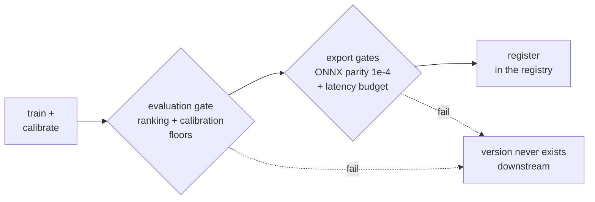
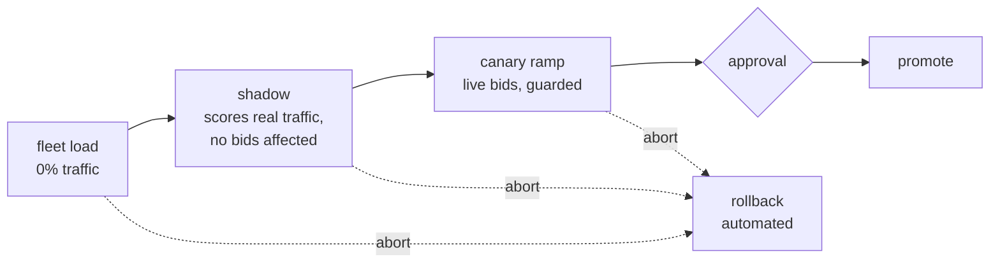

<!--
FORMAT: one slide per `---`. Bullets/bold = ON-SCREEN content (low text).
HTML comments = SPEAKER NOTES, invisible to the audience. No
client/vendor names on-screen. Sources: design_docs 05/06/07/08/09,
the repos' scaffold design, ml_serving.
-->

# CI/CD for the ML Lane
## Repos · models · rollout

**Rodrigo Cunha** — Principal ML Engineer 
Custom Bidding Agent · ML Lane · 2026-11

<!--
- ~30s. The ML lane's CI/CD is fully planned, rollout included.
- Goal of this talk: show the whole chain, then draw the boundary
  with the Bidder Agent's own CI/CD (which is not settled yet).
-->

---

## CI/CD · Workload repo (pipeline logic)

- Pure Python logic — unit-testable with **no infrastructure**
- Every PR publishes a dev wheel; a release tag publishes the real one
- The fixture runs go **straight to the compute platform**, fast and light

<!--
- Unit tests cover workload logic, config schemas, golden feature
  vectors, calibration math (closed-form expected outputs).
- Fixture runs: each workload submitted as a one-off run with the
  just-built wheel, small test fixtures, minutes not hours — proves
  install + execution on the real runtime, nothing about production
  data.
- Adoption flow: a new wheel changes nothing until a DAG-repo PR bumps
  that pipeline's package_version; that PR's CI validates configs
  against the new wheel's schemas, and the dev DAG runs after merge
  are the DAG-level integration test. No DAG is ever triggered by the
  workload repo's CI.
-->

---

## CI/CD · DAG repo (orchestration)

- Configs validated against the **pinned wheel's schemas** — before anything deploys
- Integration = the DAGs actually running on the dev environment
- **Prod is the same sync, gated by a release tag** — nothing reaches prod from a merge alone

<!--
- Parse must succeed without the workload package installed (the
  scheduler's constraint).
- Config validation is a CI-only import of the schema subpackage from
  the exact wheel version each pipeline pins.
-->

---

## CI/CD · ML serving lib (Go)

- A **library**, not a service — it deploys by being inside the Bidder Agent
- Its production proving ground is the **rollout process** (two slides ahead)

<!--
- The lib's own test suite runs on every PR as plain go test.
- The model's path (training gates, then rollout) is deliberately
  separate from repo CI/CD — next slides.
-->

---

## Per-repo CI/CD

| Repo | Every PR (CI) | Deploy (CD) | Integration |
|---|---|---|---|
| **Workload repo** (pipeline logic) | lint + unit tests: workload logic, config schemas, golden feature vectors, calibration math | wheel to the package index (dev wheel per PR, release on tag) + deployment-jobs bundle | workloads run on fixtures — direct submit to the platform, no DAGs |
| **DAG repo** (orchestration) | DAG parse test, unit tests, config validation against the pinned wheel's schemas | sync to the environment's DAG bucket (dev on merge, prod on tag) | run the DAGs on the dev environment |
| **ML serving lib** (Go) | unit tests | ships inside the Bidder Agent as a library | the rollout process (two slides ahead) |

<!--
- Workload repo: pure Python logic — unit-testable without any
  infrastructure; golden vectors pin feature definitions; calibration
  math has closed-form expected outputs.
- DAG repo: parse must succeed without the workload package installed;
  configs are validated against the schemas of the exact wheel version
  each pipeline pins — a CI-only import.
- Serving lib: its smoke test scores a real exported artifact and
  compares against training outputs at 1e-4 — the same tolerance the
  training export gate uses, so the contract is tested from both sides.
-->

---

## The training pipeline is the model's test bench

- Model **performance is tested where the model is built** — every run, no exceptions
- A version that registers has already proven quality, exactness, and speed

<!--
- Evaluation: AUC/PR-AUC + calibration error against absolute floors,
  plus per-advertiser/campaign/time cuts.
- Export: the ONNX graph is scored against the Python pipeline on
  held-out rows (max diff ≤ 1e-4) and timed against the latency budget.
- Nothing downstream re-tests quality — the registry only ever holds
  versions that passed.
-->

---

## Rollout = deployment testing under production conditions

- Loading verified **fleet-wide at 0% traffic** · latency + score distributions on **real traffic before any bid**
- Guardrails with **automated abort** — always on · a **human approves** before champion

<!--
- This is where "integration testing" happens from the ML perspective:
  the artifact loads in the real serving fleet, scores real requests,
  and its behavior is measured before it influences a single bid.
- Every state transition is a config revision written by the
  deployment jobs; verdicts read pre-aggregated evidence tables.
- Abort is cheap: a config write pointing back at the previous
  version; the fleet picks it up on the next poll.
-->

---

## What's ours to test — and what isn't

  
ML lane tests

  
workload logic · orchestration · model quality (training gates) · artifact loading, parity, latency · rollout safety on the live fleet

  
Bidder Agent CI/CD tests (TBD)

  
the agent embedding the lib: its build & container package the lib's native runtime correctly · request plumbing · timeout & fallback behavior · its own deploy

**no Bidder Agent container appears in any ML pipeline — the lib is the contract**

<!--
- The question "do we need a Bidder Agent container for integration
  tests?" comes from the agent's CI/CD being unplanned — the need is
  real, the location isn't our pipelines.
- Model loading split, likely Q&A: WE test that the lib loads and
  scores models (lib tests + fleet load at rollout). THEY test that
  the agent they build still lets the lib do it — their container must
  package the lib's native runtime, right architecture, process
  options, memory. Our tests prove the lib; nothing we run proves
  their image. Different failure modes, same contract.
- The lib ships with its own test fixtures (real artifact + expected
  scores), so the agent's CI can verify "loads and scores correctly"
  without any ML infrastructure.
- Both sides test the same contract: the lib's smoke test from inside,
  the agent's integration test from outside.
-->

---

## DAG deploys: the shared module, and changing code mid-run

- The DAG repo ships a **shared framework module** to the DAG bucket — imported by every DAG
- CD runs **per pipeline type**, or **for the shared module**
- Deploying mid-run is **safe when the DAG's shape doesn't change** — bug fixes and behavior tweaks inside existing steps; Airflow picks the new code up per task
- Changes to the **shape** — tasks added/removed/renamed, dependencies rewired, shared-module interfaces — get a **pause or a between-runs window**

<!--
- Airflow re-reads DAG code per task execution: a mid-run deploy never
  crashes the scheduler, but one run spanning a deploy can execute
  early tasks on old framework code and later tasks on new.
- Our design minimizes the exposed surface: stage logic lives in the
  wheel, pinned per run at submit time — only the thin chaining code
  and the shared module are swapped live.
- So the blanket pause-everything habit isn't needed for routine
  deploys; reserve it for structural changes, where in-flight runs can
  be orphaned.
- This shared-module CD detail is newer than the design docs — to be
  folded into the DAG repo's own docs as it's built.
-->
