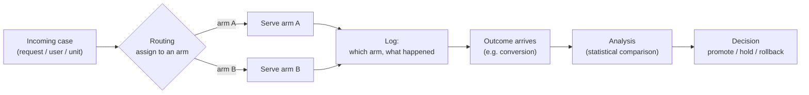
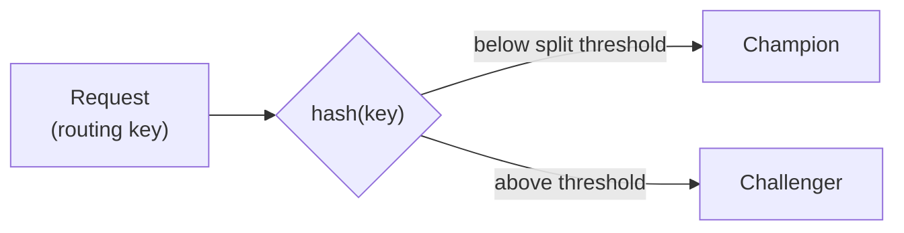
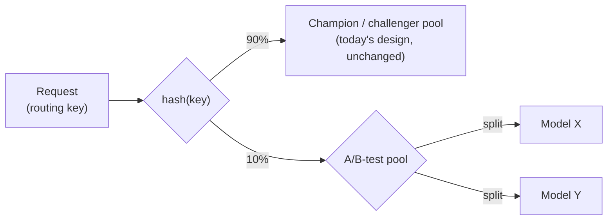
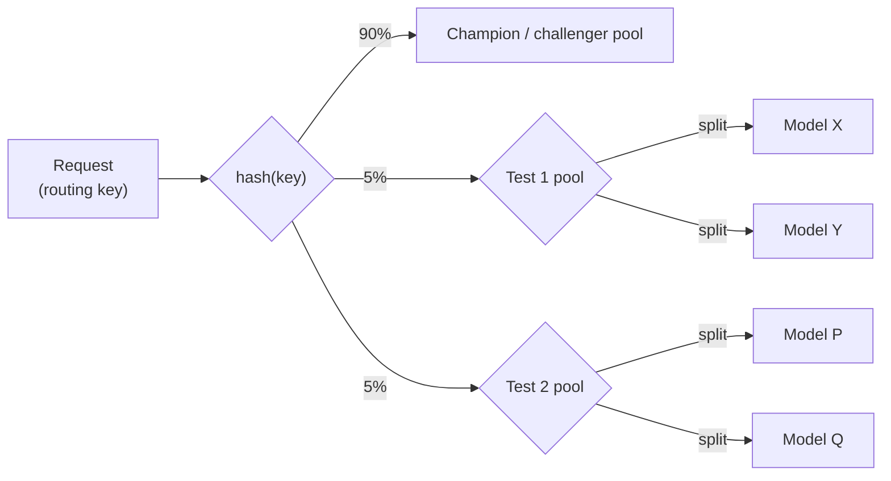

# A/B testing for the ML models — research notes

**Status:** exploratory. Not committed design — this folder exists so
options-level thinking has somewhere to live without contaminating
`design_docs/`, which states only the current, committed design.
Nothing here is implemented or scheduled. If production experience
ever makes a piece of this a real need, promote it into
`design_docs/OPEN_QUESTIONS.md` and from there into an actual design
change — until then, treat it as a map, not a plan.

## Primer: how an A/B test works

At its core, an A/B test is three mechanical pieces plus a decision at
the end — strip away the statistics and this is all there is:

- **Routing** — every case gets assigned to exactly one arm, by a rule
  with two properties: *sticky* (the same unit — e.g. the same
  `line_item_id` — always lands in the same arm for the whole test, so
  its traffic isn't smeared across both and its outcomes stay
  attributable to one arm) and *uncorrelated with outcome* (the thing
  you split on must have nothing to do with what you're measuring —
  e.g. don't split by advertiser size, or you're comparing "model A on
  big advertisers" vs "model B on small advertisers," not the models).
- **Logging** — record which arm a case went to and what happened,
  without yet knowing whether it'll count as a win. This has to happen
  at serving time, before any outcome exists.
- **Outcome + analysis** — once the outcome catches up (immediately for
  some metrics, days later for attributed conversions, here), compare
  the two arms' accumulated outcomes with a statistical test and decide
  whether the difference is real or noise.

Everything else in this file is detail on top of these three pieces:
*how* you route (one split vs. nested pools), *what* you log (today's
fields vs. what richer analysis needs), and *which* statistical method
turns the logged data into the final decision. Our design already
implements this loop end to end — routing in the serving agent, logging
via decision logs, analysis in the deployment job's readout step — the
rest of this document is about how far each piece could be pushed if
it's ever needed.

One exception: the "evaluating without running a live test at all"
section further down doesn't follow this loop at all — there's no live
routing involved, by design. It's a different problem (how to avoid
needing a live test), not a variant of this one.

## State of the art, condensed

**Statistical-design axis** — the main thing that varies across how
companies run A/B tests:
- *Fixed-horizon frequentist* — pick a sample size upfront, no peeking,
  run to completion. Simple, but can't stop early or extend duration.
- *Sequential / "always-valid"* (group-sequential, mSPRT — what
  GrowthBook, Statsig, Eppo use) — peek continuously, stop early,
  without inflating false-positive rate. The modern default at most
  companies, because retrain/redeploy cadence rarely matches a fixed
  horizon.
- *Bayesian* — report P(B better than A) instead of a p-value, easier
  to reason about stopping rules, weaker formal guarantees than
  sequential frequentist methods.
- *CUPED / variance reduction* — bolt onto any of the above using a
  pre-experiment covariate to shrink the confidence interval needed to
  detect a given effect size. Matters a lot with sparse conversion
  events.

**Build vs. buy** — web/product experimentation platforms (Optimizely,
LaunchDarkly, Statsig, Eppo, GrowthBook) are built for client-side or
feature-flag-driven UI experiments, where latency doesn't matter. None
of them fit a 10ms in-process bidding decision over protobuf
candidates. The ad-tech norm is to build this layer thin and
in-process: your own deterministic hash-based assignment plus your own
readout job, buying at most the stats math, never the whole platform.

**Staged ML rollout pattern** — the near-universal shape for rolling
out a new model (Uber Michelangelo, LinkedIn, Meta-style ads systems):
shadow (score, discard, catch bugs) → canary (small live %, guardrail
abort, not statistical significance) → A/B at scale (the formal stat
test) → promote/rollback. This is already the shape of
`design_docs/06_validation_promotion.md`.

## Multi-armed bandits: a different live-traffic design (rejected)

An alternative to a fixed-split live A/B test is to let the traffic
split itself adapt based on observed reward — still live traffic,
still comparing arms, just a different allocation design. Rejected for
this system specifically: bandits need a reward signal that updates
allocation quickly (Thompson sampling re-samples the posterior on a
short cadence); our reward is attributed conversions, which mature
over a **7/14/30-day attribution window** — reallocating traffic on
reward that stale defeats the point. Bandits also optimize cumulative
reward (regret minimization), not a clean "is B better than A, with
confidence" verdict — we need the latter for a promote/rollback
decision, not the former.

## A separate problem: evaluating without running a live test at all

Everything above — the primer, bandits, the routing extensions further
down — assumes we're willing to route *some* live traffic to find out
which model is better. That has a real cost (traffic, time, risk of a
bad challenger) independent of which statistical design is used, and
that cost can be prohibitive on its own. Off-policy / counterfactual
evaluation (OPE) is the standard way around it: estimate how a model
would have performed using only historical data, with **no live
traffic at all**. It isn't an A/B design and it doesn't produce an A/B
verdict — it's an offline evaluation-stage step, more naturally placed
near training's ranking/calibration gate than inside the rollout/A-B
machinery this file otherwise covers.

The textbook version of this (IPS / doubly-robust estimators) reweights
logged outcomes by the logging policy's probability of having taken
the action it took — but that doesn't apply cleanly here, because our
bidding decision is deterministic: same inputs always produce the same
bid, so there's no real "probability of this decision" to reweight by.
A better fit for a bidding system specifically: a **win-rate / bid-
landscape model** — `P(win auction | bid amount, context)` — fit from
historical (bid, win/loss) pairs across *all* scored candidates, not
just the ones we won. With that, a challenger's bids can be replayed
against the model to estimate whether they'd have won, without needing
any propensity at all.

Nothing here is a design blocker — it's a cross-lane data question,
not a logging gap on our side. The ML Prediction service only ever
returns a probability (ADR-0001); the bid value and the ad server's
win/loss result live in the bid-decision/ingestor lane's own logs, not
ours. `DecisionRecord` already carries `candidate id`, so a win-rate
model is a **join** between our decision log and that lane's log on
that key — contingent on them persisting bid value + auction outcome,
which is worth a line to that lane, not a change to our design.

Still only reliable when the candidate policy's bids overlap
meaningfully with what was actually submitted historically — a
challenger whose bids are wildly different from champion's gets a
high-variance, untrustworthy estimate regardless of the technique.
Useful as a pre-filter before burning live A/B traffic on a bad
candidate, not a replacement for the live test.

## Statistical modeling is decoupled from routing/serving mechanics

The verdict math — frequentist, sequential, Bayesian, CUPED — lives
entirely in the **readout job**. Swapping or adding one is a pure
function change; nothing about routing, serving, or logging needs to
know which method is in use.

What the data layer needs to keep that option open:
- **Time-bucketed per-arm aggregates**, not one final snapshot. A
  fixed-horizon test only needs end totals; a sequential test needs
  the same totals as a time series (per day / per readout run) so it
  can check its stopping boundary against the cumulative-so-far data at
  each run.
- **A pre-period covariate join** for CUPED — a per-routing-unit
  baseline from *before* the test started. Not derivable from in-test
  decision logs; has to come from the existing dataset/label layers.
- **The verdict record tagged with which method produced it** — same
  audit principle as logging a model/calibration version. Without it,
  a past promote/rollback call isn't reproducible or explainable.

The readout table itself is just a derived/aggregated view over
decision logs joined to attributed conversions — no new logging
mechanism is needed beyond what's already planned (`arm` +
`timestamp` on `DecisionRecord`), as long as the readout job groups by
date instead of collapsing straight to a final total.

Multiple methods can run side by side on the same readout data for
comparison/visibility. Exactly one has to be the binding decision rule
— picking "whichever one says significant first" breaks the
guarantees of whichever test was meant to be primary (test-shopping).

## Routing mechanics — today vs. possible extensions

**Today.** One routing key, one hash, one threshold:

**Level 1 — an A/B-test pool, independent of the champion/challenger
loop.** A nested partition, not a wider split: the top-level split
separates production (champion/challenger, unchanged) from a reserved
A/B-test pool; the pool itself splits between two arms, neither of
which is champion.

Implied changes, sized:
- Routing config: additive block alongside `champion`/`challenger`/
  `queued` — doesn't touch their semantics.
- Go routing: one new branch checked before today's logic; falls
  through unchanged if the request isn't in the reserved pool.
- Decision logs: no schema change — `arm` already takes a free-form
  value, just gets new strings.
- Readout job: already generic (per-arm, time-bucketed aggregates) —
  reuse as-is, pointed at the new arm names.
- Orchestration: the one real new piece — a lightweight start/monitor/
  stop lifecycle for the pool. Simpler than the champion/challenger
  promotion state machine, since there's no canary ramp or
  guardrail-abort-into-rollback to build: no production champion is at
  risk from this pool.
- Capacity: the agent now holds up to 4 models in memory (champion,
  challenger, X, Y) instead of 2 — a resource/latency check against the
  ~3ms p99 budget, not a code problem.

**Level 2 — multiple disjoint A/B-test pools at once.** Same mechanism
as Level 1, generalized from one pool to a list. Every request lands
in at most one pool, and inside the A/B-test pool, at most one test —
always disjoint, never overlapping:

Implied changes beyond Level 1:
- Config becomes a list of pools instead of one.
- Same hash, more buckets — no new hashing mechanism needed.
- Decision logs need a `test_id` field alongside `arm`, since two
  different tests could otherwise reuse the same arm label and the
  readout job wouldn't know which test a given decision belongs to.
- Orchestration generalizes to a small registry of named tests instead
  of one hardcoded slot.

**Rejected direction — overlapping/orthogonal parallel tests.** Same
traffic independently randomized into multiple tests via separately
salted hashes, so a unit can be in test 1 *and* test 2 at once.
Materially bigger lift (a real independent-hashing mechanism), and it
introduces a genuine interaction-effect risk between tests — orthogonal
randomization only guarantees no *average* bias, not that the tests
don't affect each other. Not needed given the champion-pool-vs-A/B-pool
framing settled on; disjoint pools get most of the value (more than
one test running) without this risk.

## Summary

**The A/B test and its extensions** — all assume live traffic is
routed to find an answer:

| Capability | Size of change | Status |
|---|---|---|
| Today's champion/challenger split | — | Implemented (target design) |
| Pluggable readout math (sequential/Bayesian/CUPED) | Small — contained to the readout job: swap/add the analysis function; sequential and CUPED also need that job's own aggregation query to change (group by time, join pre-period data) | Documented here, not committed |
| Level 1 — independent A/B-test pool | Small–medium — config block, routing branch, new lightweight lifecycle, model-capacity check | Documented here, not committed |
| Level 2 — multiple disjoint A/B-test pools | Small increment over Level 1 — list instead of single entry, `test_id` log field | Documented here, not committed |
| Overlapping/orthogonal parallel tests | Large — new hashing scheme + interaction-effect analysis | Rejected for now |
| Multi-armed bandits | — | Rejected — attribution-window lag defeats adaptive reallocation |

**Bypassing the need for a live test** — a different problem, no live
traffic involved:

| Capability | Size of change | Status |
|---|---|---|
| Off-policy/counterfactual pre-filter (OPE, via win-rate model) | No design change on our side; needs a cross-lane join on `candidate id` against the bid-decision/ingestor lane's bid-value + win/loss logs | Documented here, not committed |

## Closing note

None of this is committed. Whether any of it is actually needed only
becomes clear once the system is running in production. If a concrete
need shows up, promote the relevant piece into
`design_docs/OPEN_QUESTIONS.md` and from there into the real design —
until then, this file is the map for "how would we extend this if we
had to," nothing more.
