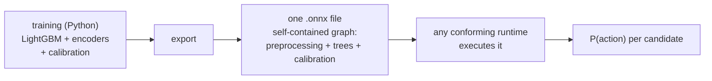
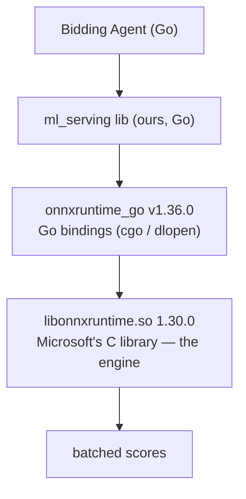
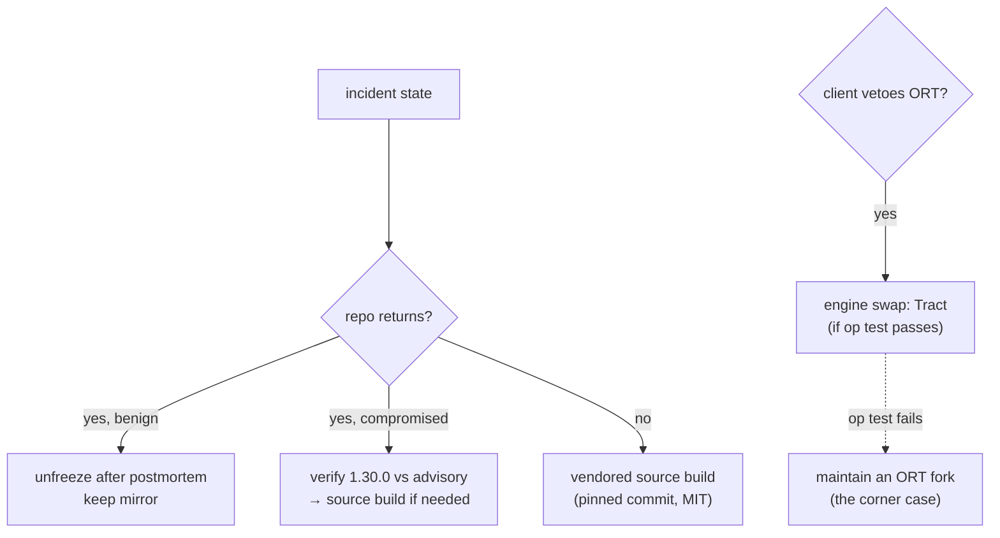

# ONNX, the runtime incident, and our options

> **Status:** research note, 2026-11-26. The ONNX Runtime GitHub
> repository has been down since ≈2026-11-17 with no official
> explanation. Running systems are unaffected; our artifacts are
> archived and verified (`~/workspace/sigma/universal_ads/ort-archive/`,
> see its README for provenance and checksums). This file is the
> team's full context: what ONNX is, how we use it, what broke, the
> scenarios, the alternatives, and the next steps.

## ONNX in one picture

| Thing | What it is | Who owns it | Replaceable? |
|---|---|---|---|
| **ONNX, the format** | an open standard for describing a model as a graph of operators — the `.onnx` file | Linux Foundation (LF AI), not Microsoft | the format *is* the portability layer; engines are swappable behind it by design |
| **ONNX Runtime (ORT), the engine** | one implementation that executes `.onnx` graphs — the most mature one | Microsoft (MIT license) | yes in principle — this file is about what that costs us in practice |

The part that vanished is the **engine's repository**, not the format
and not our files.

## How we run ONNX from Go

| Layer | Owner | Role | Distribution | Hit by the incident? |
|---|---|---|---|---|
| Bidding Agent | agent lane | embeds the lib, serves bids | client's infra | no |
| ml_serving lib | our team | loads artifact + config, assembles inputs, scores, logs decisions | our repo | no |
| `onnxruntime_go` bindings | third-party author (not Microsoft) | thin Go↔C bridge; loads the engine at process start | its own repo + the Go module proxy (cached) | no — repo up, module archived anyway |
| `libonnxruntime.so` | Microsoft | the actual inference engine | **was** GitHub release tarballs; also NuGet/PyPI/Maven | **yes — the GitHub channel is gone** |

## What broke, what did not

| Artifact / source | Status 2026-11-26 |
|---|---|
| GitHub repo `microsoft/onnxruntime` + release tarballs | **404 since ≈Nov 17** — source browsing, issues, advisories, release downloads all gone |
| Official statement on the cause | **none** — a silent week is not routine maintenance |
| NuGet / PyPI / Maven packages | still served (official Microsoft publishing channels) |
| Go module proxy (`onnxruntime_go`) | serving normally |
| **Our running fleet / dev stack** | **unaffected** — the lib loads a local/S3 artifact, never GitHub |
| **Our archive** (`ort-archive/`) | full 1.30.0 distribution + all-platform natives + wheels + Go module, checksummed; our lib byte-identical to NuGet's official copy — two independent channels agree |
| Fresh dev-image builds | **broken** — `ml_serving/dev/api/Dockerfile` curls the dead release URL; fixed the moment we point it at a mirror of the archive |
| Upgrade path / advisory visibility | degraded — no repo means no changelogs, security advisories, or issues to watch |

## Timeline

| Date | Event |
|---|---|
| ≈Nov 17–18 | ORT and several sibling Microsoft repos go private, release assets included; no notice, no redirect |
| Nov 19 | we archive everything (docker-extracted distribution, NuGet natives, wheels, Go module) and cross-verify checksums across channels; contingency decisions taken (below) |
| Nov 26 | still down, still no statement; packages still served; downstream build breakage reported across the ecosystem |

## Scenarios

| Scenario | Likelihood (our read) | Our response | Change required |
|---|---|---|---|
| Repo returns, benign cause | most likely | resume normal life; keep mirror discipline; version bumps only after reading the postmortem | ~zero |
| Repo returns, compromise confirmed in some releases | possible | verify 1.30.0 against the advisory (already cross-verified across two channels, predates the incident); escalate to a source build if the client wants more | small — build pipeline only |
| Repo never properly returns; community forks take over | low, rising with each silent week | vendored source build from our pinned commit (`f2c39fe`, MIT); adopt whichever fork becomes canonical later | ~1–2 wk one-time build/CI work; we own CVE watching; **zero design change** |
| Client security veto on ORT | low | **no drop-in engine exists (tested 2026-11-26)** — the vendored source build is the answer here too, presented as audited-build-vs-veto; reopening Tract means contributing ops or re-encoding the export (`tract_test/RESULTS.md`) | the branch is now priced: it collapses into the vendored-build row |

## Why our graph narrows the alternatives

Our artifact is not plain tensor math: it leans on the `ai.onnx.ml`
operator set — TreeEnsemble for the GBDT, the string encoders for raw
request fields, the calibration lookup. That is the least-implemented
part of the ONNX spec across runtimes.

| Engine | Independent of Microsoft | `ai.onnx.ml` coverage for our graph | Verdict |
|---|---|---|---|
| ONNX Runtime | no (MIT code, though — a fork is self-sufficient) | full, mature | the incumbent |
| **Tract** (Rust, C API, callable via cgo) | yes | **tested 2026-11-26: FAIL** — `OneHotEncoder` unimplemented (×70 in our graph); trees untested behind it (`tract_test/RESULTS.md`) | not viable as-is; re-test on new releases |
| RTen, Burn (Rust) | yes | effectively none for trees/strings | no |
| TVM, OpenVINO, onnx-mlir | yes | none/minimal for our ops | no |
| onnx-go (pure Go) | yes | none; immature | no |

Standing constraints that frame all of this (decided 2026-11-19):

- **The single self-contained artifact is non-negotiable** (one file:
  preprocessing + model + calibration).
- The pure-Go `leaves` scorer is **ruled out** — it would move
  preprocessing/calibration out of the graph.
- The "convert trees to plain tensors" escape hatch (making any
  standard-ONNX engine viable) fails on our **raw-string encoders**,
  which have no core-ONNX equivalent — it would push string encoding
  out of the graph, violating the first constraint.

## Cost of each option

| Option | Design change | Code change | One-time effort | Standing cost |
|---|---|---|---|---|
| Mirror our archived binaries (S3) + repoint builds | none | CI/Dockerfile only | ~hours | none |
| Vendored ORT source build (pinned commit, audited) | none | build infra | ~1–2 wk | CVE/patch watching |
| Engine swap to Tract | none *if* the op test passes | serving lib's engine layer + re-benchmark | weeks (serving lane) | second-engine knowledge |
| Maintain an ORT fork ourselves | none | build + patches | ongoing | highest — only reached if the veto lands **and** Tract fails |

## Next steps

| # | Action | Effort | Why now |
|---|---|---|---|
| 1 | Mirror the archive to team S3; point `dev/api/Dockerfile` at it with checksum verification | ~1 h (roadmap Phase 1) | closes the only live breakage; removes the supply-chain pull permanently |
| 2 | Freeze on ORT 1.30.0 — no version bumps until an official statement | — | 1.30.0 predates the incident and is verified across two channels |
| 3 | ~~Run the Tract op-coverage test~~ **done 2026-11-26 — FAIL** (`OneHotEncoder` unimplemented; harness kept for re-testing new Tract releases: `tract_test/`) | done | the veto branch is priced: vendored build is the only fallback |
| 4 | Watch for resolution: news query (`"onnxruntime" github removed OR disappeared OR private`, past week) + the HN thread | minutes/week | the unfreeze trigger |
| 5 | Decision triggers: repo returns with statement → review + unfreeze; client raises security concerns → present the scenario table above | — | pre-agreed reactions, no scrambling |
