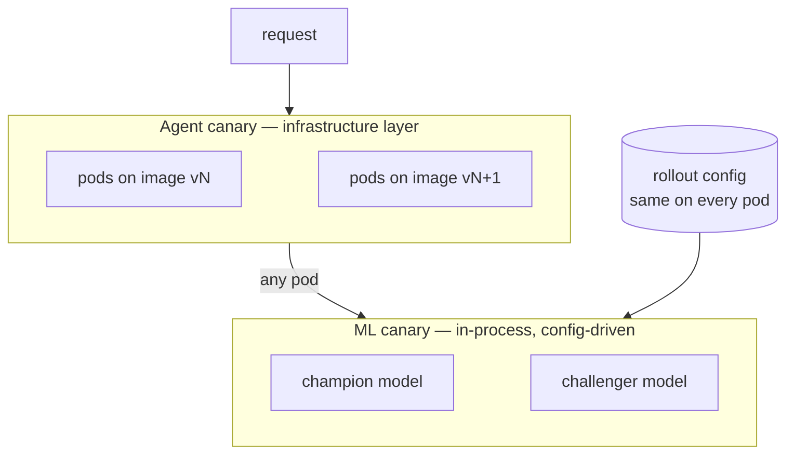
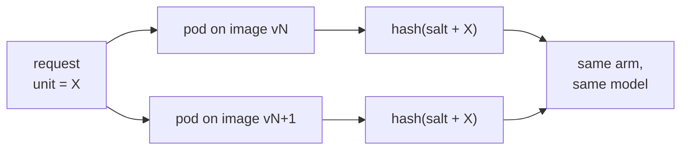
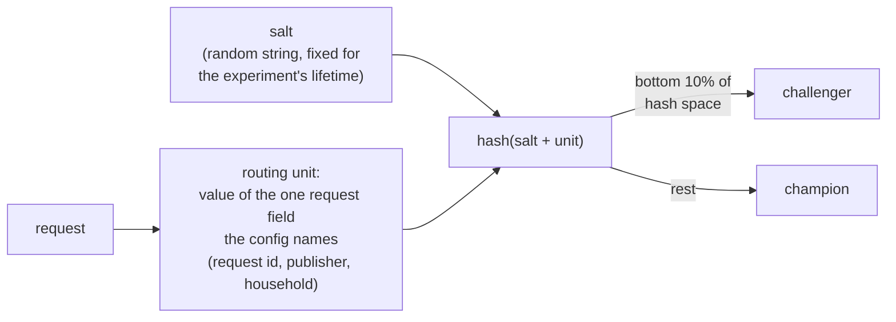

# Project-wide CI/CD and environments

> **Status:** research note, 2026-11-26. Input for the team-wide CI/CD
decision Rodrigo is taking on — written from the ML perspective but
covering what the Bidder Agent side will foreseeably need. Feeds the
roadmap's Phase-0 gate list (`roadmap/03_phases.md`).

One fact anchors everything below: the client's GitHub is **Enterprise
Server** (self-hosted, confirmed by its custom domain). GHES has **no
GitHub-hosted runners** — any Actions workflow runs on a self-hosted
runner someone provides.

## Environments

Topology is settled in the ML design: **dev + prod, no staging** — and
that is not a gap:

- For the **model**, the rollout process is the staging environment:
  fleet load at 0% traffic, shadow on real traffic, guarded canary —
  stronger evidence than any synthetic stage.
- For the **pipelines**, dev plus the release-tag promotion gate plays
  the same role: merge deploys to dev, DAGs prove themselves there, a
  tag promotes to prod.
- For the **agent**, the same two environments apply, with one special
  need: dev has no real ad server, so the agent needs a
  replay/fixture harness to bid against (see the agent section).

The genuinely open half is **data per environment**, not topology:

| Environment | Data today's design assumes | Open |
|---|---|---|
| dev | fixtures always allowed; a sampled/anonymized slice of the curated datasets is gated on the privacy review | whether the slice is permitted, and under which constraints |
| prod | full curated datasets via the cross-account read path (DE lane) | the transfer/grant mechanism itself |

A third environment only earns its place if the client's data or
security policy forces it; nothing in the design needs one.

## CI platform, given Enterprise Server

The ML repos' design insulates the choice: workflow files only call
make targets, so switching CI tools rewrites thin workflow files and
nothing else. The decision is about who owns compute and credentials.

| Option | What we build | When it is right |
|---|---|---|
| The client's existing CI (Jenkins) with its agent fleet | nothing — pipelines calling our make targets | if it is the paved road, with AWS/Databricks reach and capacity for us |
| Actions on a client-shared runner pool | workflow files + credential wiring | if their GHES has Actions enabled and a pool teams can use |
| Our own ephemeral runners (EC2/Fargate) | an IaC module: autoscaled scale-to-zero runners, a toolchain image (uv, Go, Databricks CLI, Terraform), per-repo/environment IAM roles | if no shared pool exists or policy demands runners inside our VPC |
| Runners on an existing k8s cluster (runner controller, ephemeral pod per job) | the controller install + the same images/roles | only if a cluster already exists for other reasons (the bidder's); never build a cluster just for CI |
| A fully own CI platform | the CI server itself plus all of the above | last resort, only if Actions is unavailable outright |

Two facts shape the ranking of those options:

- **Credentials.** If AWS cannot reach the GitHub instance to verify
  keyless auth (likely, if it is VPN-gated), CI needs the client's
  managed-secrets pattern — which favors the options where the client
  already operates the credentials (their CI, their runner pool) over
  building our own.
- **Network placement.** The agent's deploys must reach its cluster's
  API inside the private network, so the chosen option must include
  machines placed in that network — one shared in-network runner
  setup for both lanes. Again favors what the client already runs
  in-network; the build-our-own options carry that placement work on
  top of everything else.

If we build the own-runner path, the standing cost is the usual ops
tax: patching, scaling, and monitoring a thing that is not the
product.

## Two canaries, orthogonal by design

Both lanes run progressive delivery, at different layers:

They compose cleanly because the ML assignment is **per-request and
deterministic** — the same request gets the same model on every pod,
whatever image the pod runs:

Consequence during an agent image canary: both model arms receive the
same old/new-image traffic mix, so whatever the new image changes hits
both arms equally — it can never tilt the champion-vs-challenger
comparison, only add noise (at worst, a longer bake for the same
confidence).

**The assignment function.** No state, no coin flip, no lookup —
arithmetic on the request itself:

| Property | Meaning | Why it matters |
|---|---|---|
| Deterministic everywhere | assignment depends only on salt + unit + config revision — never on pod identity | the ML canary is independent of whatever happens at the infrastructure layer |
| Unit-sticky | while the salt is fixed, every request whose unit field holds value X lands in the same arm | a household seen a thousand times stays in one arm; its outcomes stay attributable to one model |
| Fresh per experiment | rotating the salt reshuffles every unit | no fixed population is "the challenger population" forever |

In one line: *the load balancer picks the pod; the hash picks the
model — any pod, same request, same model, which is why the two
canaries never fight.*

Why not one shared canary mechanism:

| Dimension | In-lib, per-request (ours) | One infrastructure split |
|---|---|---|
| Granularity | unit-sticky assignment in-process, after the request arrived; shadow scores **both** models on the same request in the same process | no pod- or mesh-level split can do either |
| Cadence | model rollouts happen every retrain | image rollouts are rare; coupling them makes every model refresh a fleet deploy |
| Rollback | a config flip, picked up on the next poll | a redeploy — the cheap path gets coupled to the expensive one |
| Evidence | arm/version/revision stamped into every decision row; feeds the per-arm readouts and the split check | nothing recorded about model assignment |

The two real coupling points, and their guards:

| Coupling point | Failure mode | Guard |
|---|---|---|
| Payload-field compatibility | a model consuming a request field only the newer agent image sends defaults on old pods and scores fully on new ones — model performance varies by pod, polluting the readout | such a model ships only after the **whole fleet** sends the field, not just the canary pods; the per-row defaulted-fields list makes violations visible |
| Lib-version skew mid-rollout | a rollout-config shape only the newer lib accepts advances part of the fleet while older pods reject it — the real traffic split drifts from the configured one | two guards: (1) the ML lib **fails static** — a pod that cannot read the new config or load the new model just keeps serving the last working version, no issue; (2) the config says what the split *should* be (e.g. 10% challenger) and the decision rows show what it *actually* was — if part of the fleet never advanced, the numbers will not match, and evidence from mismatched periods is thrown away, never judged |

Operational rule: **coordinate calendars, not mechanisms.** No ML A/B
while the agent fleet is mid-image-canary, and vice versa for risky
agent changes — not because the split biases, but because a guardrail
breach during overlap is ambiguous about its cause. One shared
"who is rolling out this week" view is all it takes.

Parked candidate ask (not sent): an agent build identifier on decision
rows, so an image-mix effect can be sliced post hoc. Cheap to add,
not needed until it is.

## What the Bidder Agent side will need

Expected shape, so the whole team plans against one picture:

- **Lib adoption** — the ML serving lib is a pinned Go module
  dependency; a lib release changes nothing until the agent bumps the
  pin in a reviewed PR. Same two-step adoption pattern the DAG repo
  uses for wheels.
- **Agent CI** — Go build + unit tests; container build that packages
  the lib's native ONNX runtime (right architecture, shared library
  present); an integration test loading the lib's committed fixture
  model inside the built image; image pushed to a container registry
  per environment. No ML infrastructure appears anywhere in it — the
  lib and its fixtures are the contract.
- **Agent CD** — deploy to the bidder's k8s cluster with pod-level
  progressive delivery; rollback = redeploy; per-environment
  clusters or namespaces; the config/secrets path; and the ML lib's
  process settings wired per
  environment.
- **Performance stage, in dev** — dev has no real ad server, so a
  replay/fixture harness plays its role (e.g. k6 firing recorded
  bid-request payloads at the agent); the load/latency tests run
  there, against the latency budget, gating promotion to prod.

## Client questions

1. **CI/CD platform** — are we required to use an existing CI/CD
   platform of yours (Jenkins or other), or may we propose the setup
   we think fits this project best? If there is a required or
   preferred platform, what does it come with: machines that run the
   jobs (and capacity for us), access from those machines to our AWS
   accounts and Databricks, and a team that operates the platform?
2. **Environment structure** — must we follow a mandated environment
   structure (e.g. dev/stg/prd), or can we propose the one that fits
   this project?
3. **Data availability per environment** — what are the policy
   constraints on data in each environment? In particular: can the
   dev environment access real production data so model exploration 
   and lab work happen in dev rather than against prod?
