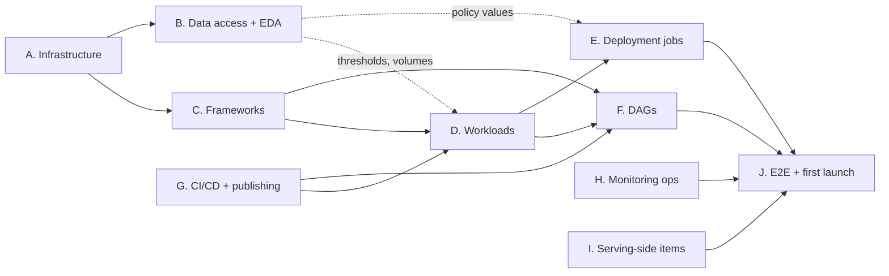

# 02 — Workstreams

The work, broken down by stream. Phases in `03_phases.md` sequence
these; a stream can span several phases. Detail per item lives in the
design doc cited.

## A. Infrastructure provisioning

From zero — no IaC exists anywhere today.

- Scope: dev + prod S3 (artifact store, rollout configs, decision-log
  landing zone, MWAA DAG bucket), MWAA environment (or reuse — gated),
  Databricks workspace + Unity Catalog (`ml_dev`/`ml_prod` catalogs),
  a notebook environment for EDA and exploratory work (the workspace's
  own under Databricks; a service of its own on the alternative path),
  CodeArtifact, managed Redis, IAM service principals + secrets,
  cross-account read grants (with the DE lane), observability wiring.
- Deliverables: an IaC repo/approach; a working dev environment; prod
  later (Phase 5).
- Depends on: account-topology and MWAA gates; the
  Databricks-vs-alternative decision (`04_databricks_alternative.md`).

## B. Data access, EDA, model exploration

- Scope: curated-dataset access landing (external); dataset-scale EDA —
  label volumes per (goal, window), baseline conversion rates, real
  delay/maturity behavior, feature coverage at scale; model
  prototyping — GBDT baseline, calibration quality, ranking-invariance
  for window variants.
- Deliverables: the "set at EDA" values the design defers — gate
  thresholds, downsampling policy, Platt-vs-isotonic cutover, lookback
  and holdout lengths, bake times, A/B arm sizes
  (`design_docs/OPEN_QUESTIONS.md`, EDA-gated table).
- Depends on: data access only. Runs in parallel with everything else
  once access lands; its outputs are config values, not code.

## C. Frameworks

- gandalf `shared/`: run-spec builder, the stage operator (deferrable
  Databricks submit-and-wait), config loader + merge
  (defaults → model → environment), run-mode skipping, failure
  callbacks, dev-upload CLI. (Repo skeleton + tooling already exist.)
- frodo skeleton: package layout, `frodo run <stage>` CLI, concern
  schemas (pydantic), stage harness, test fixtures, Makefile, the
  bundle files (`databricks.yml`, `resources/deployment_job.yml`).
- Design: `ml_offline_repos_scaffold_design/scaffold/01` + `02`.

## D. Workloads (frodo stages)

The pipeline-agnostic logic, one stage group at a time:

- cleaned ETL (`design_docs/02_datasets.md`)
- label build + maturity (`03_labels.md`)
- shared feature layer + materialization (`04_features.md`)
- hot-feature jobs → Redis (`04_features.md`)
- training: set build, fit, calibration, evaluation gate, ONNX export
  with parity + latency gates, registration (`05_training.md`)
- decision ingest + readout tables (`09_monitoring.md`)
- monitoring metrics + trigger evaluation, data-quality recording
  (`09_monitoring.md`)
- backfill support (same workloads, ranged — `08_orchestration_repos.md`)

## E. Deployment jobs

- `deploy-register`: export-first, entry write / queue / bootstrap
  first champion; `deploy-readout`: verdicts, gates, queue consumption,
  trailing confirmation — all via S3 conditional config writes.
  Bundle with per-environment targets; approval-tag flow.
- Design: `design_docs/06_validation_promotion.md` + `07_deployment_job.md`.

## F. DAGs (gandalf pipelines)

- One folder per pipeline: cleaned ETL, labels, feature
  materialization, hot features, training (one per model, run modes as
  trigger parameters), decision ingest, monitoring, backfill — each
  with its config YAMLs (pipeline / concerns / stages) and cadences.
- Design: `scaffold/02-dag-repo.md`; pipeline contents per design doc.

## G. CI/CD + publishing

- GitHub Actions in both repos (workflows only call make targets):
  frodo — lint/tests, wheel build + publish (dev wheel per PR, release
  on tag), bundle deploy dev → prod-on-tag; gandalf — parse tests,
  config validation against the pinned frodo wheel's schemas, DAG sync
  to the MWAA bucket.
- Includes standing up the package index (CodeArtifact assumed).

## H. Monitoring and alerting (ops side)

- Dashboards; guardrail alert rules in the observability stack wired
  to the `deploy-readout` abort path (jobs API); pipeline alerting;
  the alert-routing pane decision (`09_monitoring.md`).

## I. Serving-side integration

Coordination with the serving lane. The agreed work list is
**delivered** — items 1–14 of the lib's root record, including the
2026-11-19 wave (`sample_rate` validation, hot-feature values in the
decision row, doc alignment, and `Options.ModelRoot`: the lib polls
the rollout config from S3 itself, so no config-sync component
exists). Our reconciled record: `research/ml_serving_requirements.md`.
What remains:

- Shadow-sessions enabled on the agent's pods (process setting the
  config cannot set; a standing core reservation). Gates the shadow
  stage.
- Hot-store credential rotation — joint design (our jobs hold the
  writer credentials).
- Staged config propagation + alarm-rollback ownership; capacity
  sizing (vendor-pending candidates max); hot-key TTL ownership.
- Owed back: confirm the hot-feature replay split (our feature tables
  keep the history the replay of a new feature needs — true of the
  design as it stands).

## J. Integration, E2E, first launch

- Dev end-to-end on fixtures (data → labels → features → training →
  registered version → deployment jobs → config served by the lib).
- Prod bring-up; first model bootstrap (first champion write +
  serving-side goal launch — the deliberate gate); shadow → canary on
  live traffic; launch-readiness checklist per
  `06_validation_promotion.md`.
