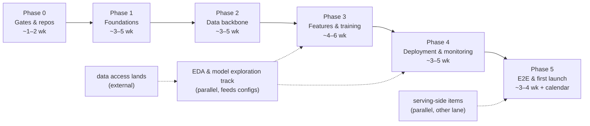

# 03 — Phases

Six phases. Durations are rough engineering-week ranges at current
team capacity, with the parallelism shown; they are planning aids, not
commitments. Workstream letters refer to `02_workstreams.md`.

## Phase 0 — Gates and repo bring-up (~1–2 wk, mostly external)

- frodo repo created from the scaffold design; scaffold-design review
  branch merged.
- Push the external gates: data-access mechanism, MWAA reuse-vs-own,
  account topology, CodeArtifact confirmation, repo hosting.
- Decide the IaC approach and the Databricks-vs-alternative question
  (`04_databricks_alternative.md`) — this is the cheapest moment to
  decide it.
- No phase waits for *all* gates; each later phase names the gate it
  actually needs.

## Phase 1 — Foundations (~3–5 wk, three parallel tracks)

- Infra (A): dev environment MVP — S3 layout, workspace + catalogs,
  package index, IAM/secrets, MWAA dev. *Needs: topology + MWAA gates.*
- frodo (C, G): skeleton, CLI, concern schemas, tests, CI, first
  published wheel, bundle files.
- gandalf (C, G): framework core (`shared/`), CI, DAG sync to dev.
- Exit proof: one trivial stage runs end to end — a DAG-triggered
  single-task run executing a frodo stage from a pinned wheel.

## Phase 2 — Data backbone (~3–5 wk)

- Workloads + DAGs (D, F): cleaned ETL, label build with maturity,
  data-quality recording. *Needs: data access.*
- The **EDA track (B) starts the moment access lands** and runs in
  parallel from here on — label volumes, baseline CVRs, maturity
  reality — feeding config values into Phases 3–4.
- Exit proof: `derived.labels` populated and reconciling against the
  client's rollups.

## Phase 3 — Features and training (~4–6 wk)

- Feature layer + materialization + hot-feature jobs into Redis (D).
- Training pipeline end to end: set build → fit → calibration →
  evaluation gate → ONNX export with parity + latency gates →
  registered version with the registry link (D).
- Training DAGs with run modes; materialization and hot-feature DAGs
  (F).
- Exit proof: a registered, parity-checked version for one goal, built
  from real data, with its hot features live in Redis.

## Phase 4 — Deployment and monitoring (~3–5 wk)

- The two deployment jobs (E): entry/queue/bootstrap, verdicts, gates,
  conditional writes, rollback.
- Decision ingest + readout tables; monitoring metrics, retraining
  triggers, guardrail alert wiring (D, H).
- Serving-side integration (I): point the agent's slots at the S3
  model roots (the lib polls config and artifacts itself — no sync
  component); shadow sessions enabled on the agent's pods; settle
  propagation staging/alarm-rollback ownership and the credential
  rotation design.
- Exit proof: a registered version flows through fleet load → shadow
  in dev with readout tables filling.

## Phase 5 — E2E and first launch (~3–4 wk build + calendar time)

- Prod infra; dev E2E on fixtures; the first model's bootstrap
  (first champion write; the serving-side goal launch is the gate);
  then shadow → canary on live traffic per the rollout policy (J).
- **Calendar-time warning:** evidence accumulates at label speed. The
  proposed 14-day attribution window plus bake times adds weeks of
  waiting that no engineering effort compresses — the launch date is
  bounded by data maturation, not build speed.

## Totals and critical path

- Build effort: roughly **17–27 engineering weeks** across Phases 0–5
  with the parallelism above, plus the launch calendar time.
- Critical path: **data access → EDA → threshold/policy values** (the
  longest external risk), and **infra → frameworks → workloads →
  DAGs** (the longest internal chain). The deployment jobs and the
  serving items sit off the critical path until Phase 4, then join it.
- The single highest-leverage action now: land data access.
